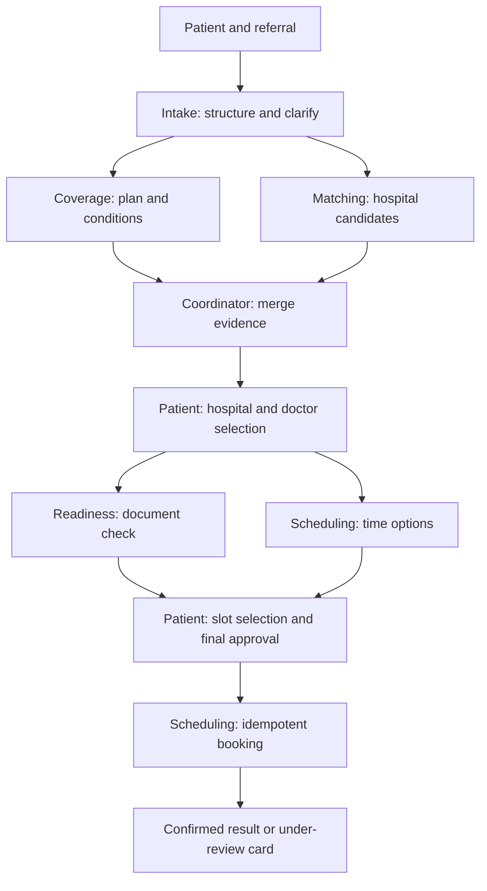
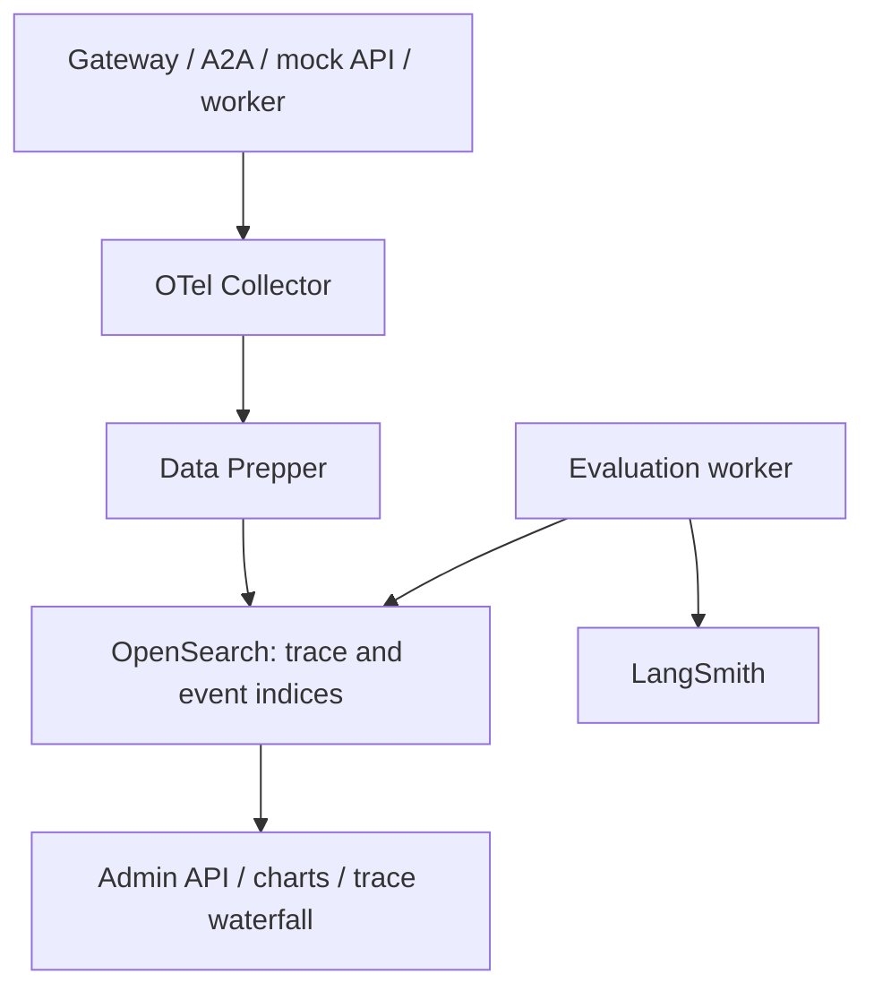

# ReferralEasy — Portfolio Demo Platform: Implementation Plan v3.0

October 14, 2026. This version is the consolidated design that supersedes the previous v2 plan. The deliverable is the architecture and development plan; it is not claimed that the application or the integrations are complete.

## 1. The project's correct goal

The goal is not to build a commercial product that accepts real patients, but to build a runnable portfolio demo that demonstrates an understanding and use of Google ADK, independent A2A agents, skills/sub-agents, streaming A2UI, versioned prompt/agent registry, guardrails, hybrid RAG, evaluation, OTel/OpenSearch, and HITL technologies.

For this reason the technology scope is preserved. To give the agents meaningful decision space, the business scenario is enriched. No clinical diagnosis or treatment decisions are made. All hospital, doctor, patient, insurance, document, email, and SMS data is synthetic. There is no claim of real insurance eligibility, a real hospital connection, or a real human call center.

Demo story: take a patient's specialist referral; complete missing data; investigate insurance/network and referral conditions; match hospital/doctor against patient preferences; verify whether documents are ready; find a slot; if necessary, negotiate alternatives with the user; create an appointment/request with user approval; if the problem cannot be resolved, hand off to a directory or a human operator.

Main success criterion: for each technology in the defined scenario, there is working behavior, traceable evidence, and an explainable design decision.

## 2. Newly added features

### 2.1 Heavily constrained patient preferences

Location/radius, doctor language, day/time, new-patient acceptance, accessibility needs, and a specific insurance plan are taken into account. Patient preferences are kept as hard constraints or soft preferences. Specialty, user approval, and a valid slot on the calendar are mandatory conditions; the preferred day or distance can be relaxed based on the patient's decision. If distance is specified as hard, it is not silently relaxed.

### 2.2 Synthetic insurance and network eligibility

The mock coverage API returns plan-based network records and referral/prior-authorization requirements. "Accepts insurance" is separated from "in-network for this plan." Contradictions or missing information become unknown. The agent does not present this result as a diagnosis/treatment or as a real payment guarantee.

### 2.3 Referral and document readiness

Some mock hospitals require a referral letter, a prior report, or an authorization reference. The agent compares required documents, existing files, and gaps. When a document arrives, only the relevant gap check re-runs. Document OCR can initially be pre-made synthetic text fixtures; a separate OCR platform is not mandatory for the first version. Source-linked extraction finds missing fields; documents are not treated as instructions.

### 2.4 Generating alternative solutions

If a suitable doctor exists but there is no slot at the preferred time, the system presents evidence-based options: increasing the search radius, a different day, or another hospital. Preferences do not change until the patient explicitly chooses. The agent can compare available options; the final choice of hospital/doctor/time belongs to the user.

### 2.5 Appointment lifecycle

Not every hospital behaves the same way. One returns CONFIRMED immediately; another produces PENDING_REVIEW. REQUESTED, PENDING_REVIEW, CONFIRMED, REJECTED, CANCEL_PENDING, and CANCELLED are separate states. A bare HTTP 200 does not mean a confirmed appointment. In the reschedule demo, the old appointment is not cancelled before the new appointment is verified; both stages are tracked according to mock adapter rules.

## 3. Real agent boundaries

There is one coordinator and six specialist agent services. Communication, retry, and notification delivery are ordinary application services. The new specialists take on evidence comparison, missing-information discovery, and alternative-strategy tasks instead of being simple API wrappers.

| Agent              | Its own decision                                                                                              | Tools / data                                                           | Forbidden authority                                                          |
| ------------------ | ------------------------------------------------------------------------------------------------------------- | ---------------------------------------------------------------------- | ---------------------------------------------------------------------------- |
| Care Coordinator   | Which specialists to call, which question to ask, which step is complete, when to stop?                       | A2A specialists, workflow summary                                      | Cannot write bookings directly; cannot change the patient's choice           |
| Referral Intake    | What referral information is missing/contradictory; which clarification question is needed?                   | validate_referral, resolve_location, patient_preferences               | Cannot diagnose; cannot determine a specialty that is not in the referral    |
| Coverage & Network | What do the plan, provider network, and referral rules mean together; which result is unknown?                | check_plan, check_provider_network, get_coverage_rules                 | Cannot guarantee insurance/payment; cannot invent rules                      |
| Provider Matching  | Which search strategy is appropriate; which candidate satisfies which constraint; which alternatives to offer? | hospital/provider API, coverage evidence, hybrid directory RAG         | Cannot choose a candidate on the patient's behalf; cannot relax hard constraints |
| Referral Readiness | Which document is missing for the hospital/plan/visit type; is the request ready?                             | get_referral_requirements, inspect_document, validate_referral_package | Cannot assume a missing document exists; cannot grant admin/clinical approval |
| Scheduling         | Which slots fit the constraints; how should slot loss/an unknown outcome be resolved?                         | list_slots, create_booking, lookup_request, cancel/reschedule adapter  | Cannot write without valid approval; cannot create a duplicate with a new key on timeout |
| Recovery & Handoff | What kind of error is it; is directory, missing data, a new alternative, or human handoff needed?             | error evidence, source-linked directory, create_handoff                | Cannot bypass a policy block; cannot call the same failed agent endlessly     |

After the third transient failure, the normal flow does not call the same specialist again; it transitions one-way into the recovery phase. Recovery's actions are the limited options the state machine permits. The LLM is not called merely to rewrite a failure message.

### Local sub-agents

Inside the Provider Matching service there are two local ADK sub-agents:

- Candidate Researcher: finds hospital/specialist data; preserves provenance and filters; produces a candidate pool.
- Constraint Analyst: compares language/day/distance/network constraints and candidate evidence; structures why each is suitable/unsuitable and which alternative to ask about.

Distance calculation, filtering, and uniqueness are implemented in code. Constraint Analyst cannot cover missing data with a score. Simple ranking is done directly in code; the sub-agent interprets ambiguous/contradictory textual conditions and the alternatives to ask the user. Parent and sub-agents share the same remaining time/call budget.

## 4. Collaboration flow and user selection



Parallel work starts only when the tasks are independent. Coverage's general plan rules run in parallel with the Matching search; the doctor-specific network check happens after the relevant doctor's identity is known. Before a hospital is selected, that hospital's document requirements are not presented as final. The user is shown hospitals first, then doctors at the selected hospital, then times. The system does not auto-select a slot or pre-book.

A policy table determines which specialist/tool calls are possible in which state. The Coordinator LLM cannot override this table. Decision outputs carry action, evidence_ids, missing_fields, next_allowed_actions, and reason_code.

## 5. A2A and task contract

Specialists are served over A2A as separate container/ASGI services. The gateway REST/SSE and auth layer is FastAPI. The ADK A2A application can be mounted into the same ASGI deployment or served on a separate port; a plain REST JSON endpoint is not called A2A. Each agent service publishes an immutable Agent Card, skill definitions, and a versioned structured input/output schema. The SDK/protocol versions tested together in the application are locked.

An agent call does not consist only of free text. Every task carries: workflow_id, command_id, target, current_state_version, required constraints, evidence_refs, allowed_actions, deadline, call_budget, release_manifest_id, and the parent task relationship. The auth identity is verified in the HTTP transport; the user_id in the payload is not trusted.

Result: one of the application outcomes such as completed, needs_input, no_match, retryable_error, terminal_error, or outcome_unknown; evidence IDs and a typed payload. These outcomes are mapped correctly onto A2A's standard task lifecycle states via an adapter; custom enums are not declared directly as protocol states. In needs_input and HITL states, agent work is suspended; an open LLM call is not kept waiting.

## 6. Context, memory, and skills

Each agent receives the minimum relevant context. Matching does not receive date of birth or phone number; Scheduling retrieves them from the tool layer via patient_details_id if needed. The real patient form is validated on the backend. The short conversation summary, structured preferences, provenance-bearing tool results, and workflow state are separate. Summaries cannot override source data. There is no long-term personal memory in the first version.

Each specialist has versioned skill packages: referral-intake, coverage-interpretation, constraint-negotiation, directory-grounding, referral-readiness, booking-confirmation, uncertain-booking-reconciliation, handoff-triage. A package is SKILL.md + manifest + read-only references. Not all skill contents are loaded on every call; the needed one is selected and the effective skill list is written to the trace. Adding a skill does not grant tool authority. The A2A Agent Card skill definition and the runtime instruction package are matched as separate records.

## 7. Workflow resilience and control ownership

PostgreSQL is the source of truth for workflows, sessions, tasks, approvals, booking requests, outbox, handoff, and the release registry. OpenSearch is not a transaction source. State transitions are atomic and carry an optimistic version check. A DB transaction is not held open across a long workflow.

Every active job has an owner/lease and a monotonic generation. A late-arriving response from a worker whose lease has expired cannot write to the new state. Replays are deduplicated by the same command_id. Another replica resumes from the last verified checkpoint; it does not re-run the work from the start. During HITL, control passes to the human owner and automated writes are suspended. After the operator resolves the ticket, the workflow returns to a specific safe state; patient approval is still required for the final booking.

Cancel, user abandonment, and transport timeout are different events. Remote task cancel is best effort; it does not mean no record was created at the external API. In the booking outcome_unknown case, reconciliation is performed. A second independent booking key is not generated.

The mock hospital writes its booking and notification outbox in its own transaction. Distributed ACID between the agent DB and the hospital DB is not assumed; idempotency + status lookup + reconciliation are used. Record existence is protected by slot uniqueness. A notification failure does not roll back the booking. A reschedule failure produces a visible intermediate state and, if necessary, HITL; the model cannot present an incomplete operation as success.

## 8. Timeouts, retry, limits, and providers

The default agent attempt limit is 3000 ms; at most three attempts including the first call. This is not a performance guarantee but an adjustable limit for fault simulation. Sub-agents/tools/models share the remaining deadline. Per-agent overrides are possible for complex showcase scenarios; the three-second strict profile is measured separately. User thinking time is not included in this budget.

The total turn deadline is initially 30 seconds, a maximum of eight delegations, and a separate tool/model budget. In a full transient failure, Directory fallback occurs after the third attempt; there are no unnecessary three retries for a valid empty result. Retry ownership is at a single layer; SDK/HTTP/A2A retries cannot multiply the budget. A cancelled LLM call is not assumed to be free of charge. There are token/cost budgets, rate limits, and backpressure for the workflow and the daily demo.

The first production-like profile: ADK LiteLLM → OpenRouter; separate model settings for the agent, guardrail decision, and eval judge. Alternative: agent LLM Vertex AI Gemini Flash, guardrail/judge OpenRouter. Changing the model/provider is a separate release; there is no silent switching that would corrupt measurements. Provider tool calling, schema, streaming, and cancel contracts are verified with contract tests.

Embedding: Vertex AI Gemini embedding adapter; initially gemini-embedding-001, 768 dimensions if supported. Query/index model, dimension, and preprocessing are the same. If the provider or dimension changes, a new embedding index is created. Rerank via OpenRouter /api/v1/rerank; a smoke test with a documented model, cheap candidates chosen by benchmark. Initial sample model cohere/rerank-v3.5; it is not claimed to be the cheapest.

## 9. Three-layer guardrail and authorization

1. Regex: Unicode normalization, length limit, word boundaries, explicit forbidden patterns. A genuine appointment request containing profanity is distinguished from an attack; short replies such as "yes", a date, or a ZIP code are valid depending on state.
2. OpenRouter decision model: produces allow/block/clarify + category/reason from the masked message and the necessary context. "CEV" is not a resolved model ID; a suitable small model is explicitly selected in env.
3. Local small semantic model: a CPU/ONNX classifier or an evaluated encoder-based approach. Training/method, artifact hash, and thresholds are recorded. Uncertainty or contradiction produces clarify/HITL; model confidence is not treated as a calibrated probability.

In the full showcase profile, all three layers are visible; an explicit block stops the remaining calls. False-positive/false-negative and extra latency/cost are measured per layer. A faster conditional profile is also compared. Booking cannot be written when the guardrail dependency is down; the static guide/help card remains available.

Output guardrail: schema, existing entity ID, verified time, sourced phone/address, and real booking state. Input screening is not the sole defense against prompt injection: tool allowlist, minimum context, treating sources as data, and server-side policy are mandatory. An emergency statement is not silently blocked as off-topic; it is routed to an approved fixed safety response.

Patient/admin sessions and service identities are separate. Workflow ownership and scope are checked in every tool; for example, only Scheduling uses booking:write. The Agent Card states the auth expectation; verification happens at the HTTP level. The local service token/JWT fixture runs with real verification tests; a service identity adapter with audience control is designed for the Cloud Run profile. Trace ID does not grant authority. Approval is bound to patient + workflow + state_version + booking payload hash + expiry; if the data changes, the approval is invalid.

## 10. Hybrid RAG

OpenSearch holds both the vector/BM25 directory and observability in separate indices. This avoids a separate vector DB container; OpenSearch's vector capability is genuinely used. The directory contains doctor/hospital/visit-type/contact and general synthetic administrative rule descriptions. Live calendar and per-person policy state remain in the API source rather than in the RAG truth.

Pipeline: entity-based chunking → Gemini document embedding → query embedding with the same model at query time → the same filters on both branches → BM25 top20 + vector top20 → dedup + RRF → rerank top10 → sourced top3–5 results. Distance is calculated from coordinates; an embedding score is not proximity. Language/specialty/hospital filters are applied. Structured network records cannot be overridden by retrieval text.

Every source carries entity_id, source_id, knowledge_version, and updated_at. Name/phone relationships are preserved in profile chunks. If the reranker fails, RRF is used; if embeddings fail, BM25; if OpenSearch fails, a deterministic filtered directory from versioned seed JSON is used. The last path does not require an LLM and appears as degraded. If there is no source at all, HITL. Availability or booking confirmation is never derived from the directory.

If Coverage/readiness sources conflict, the authoritative structured API result takes precedence; an old description or document text does not hide a missing result. Evidence freshness and unknown status are shown to the user.

## 11. Human in the loop

Triggers: no hospital/specialist, sources conflicting, referral readiness cannot be resolved, ambiguous booking drags on, patient requests a human, or recovery cannot find a reliable option. The handoff reason is classified separately, e.g. technical outage/no-match/missing document.

The patient sees the summary to be shared and approves the link. The ticket lands in the admin Human Queue. The operator claims it, sees the sources, adds an alternative or a missing-document explanation. Conflicting claims are prevented. The agent is suspended; human and automation cannot write a booking at the same time. Ticket resolution is audited. Return to the normal flow and final approval are explicit. If the operator is unavailable, the pending ticket and directory contact are shown; it is not pretended that the patient is connected to a real person.

## 12. UI: eight components and demo admin

A version-pinned A2UI adapter over streaming SSE is used. Renderer component catalog: HospitalPicker, DoctorPicker, SlotPicker, PatientDetailsForm, BookingReview, AppointmentReceipt, DirectoryFallbackCard, HumanHandoffCard. Coverage, preference, and readiness information are field/section variants of the existing cards; a separate UI system is not created for every new feature. Selection of a missing synthetic document can be inside PatientDetailsForm. Patient form data is not collected through HTML hallucinated by the LLM.

Each component instance carries the workflow version and a server-validated action. SSE replay is done by event ID; re-rendering does not create a duplicate booking. Partial agent output is not committed as final state. Progress is measured separately from final response time.

Admin: Overview, Agents & Versions, Trace Explorer, Evaluations, Guardrails, Feedback, Fault Scenarios, Human Queue, Alerts. Agent Card, the versions of tools/skills/sub-agents used, and sample input/output are visible. The Demo Scenario Runner selects a scenario, resets the seed, shows the expected behavior, and produces a link to the real trace/metrics. This page is the portfolio evidence that the technologies work; fake hardcoded success charts are not used.

## 13. Agent/prompt/skill versioning

The immutable release_manifest contains: agent version/hash, instruction/prompt version, agent/tool descriptions, tool schema and implementation digest, skill version/hash, sub-agent manifest hash, A2A card hash, provider/model/params, guardrail policy/classifier/threshold, RAG/embedding/index/reranker/knowledge version, Git SHA/image/lockfile hash.

Every description, instruction, tool, or skill change changes the agent artifact hash. If a sub-agent changes, the parent's dependency hash and version are bumped. CI fails if an affected agent version has not been bumped. Even a PATCH counts as a behavior change and runs evaluation. Runtime tasks carry the effective versions; the latest tag is not sufficient for reports.

A conversation is pinned to a release; versions do not mix mid-conversation. A security kill switch can also stop a conversation pinned to an old version; migrating to a new version requires explicit approval/checkpoint. Canary cohort and rollback routing can be done from a simple registry table; a separate platform is not required.

## 14. Evaluation: quality, task outcome, and collaboration

LangSmith trace/dataset/experiment integration; OpenSearch is the store for in-app charts. The worker writes idempotently to both targets under a single eval_run_id. The same live booking is not re-created; offline replay happens in a separate fixture DB.

The main quality metrics are preserved as-is: correctness, groundedness, completeness. Deterministic rules first; model judge after. N/A and eval_error are not counted as a quality zero. For correctness, no fixture-truth claim is made in areas where online truth is unknown. Groundedness uses the tool/source snapshot; completeness uses that state's expectations.

Additional outcome metrics: correct patient/doctor/slot booking, constraint satisfaction, tool/argument correctness, recovery success, appropriate escalation, unnecessary delegation count, latency, and cost per successful outcome. A single correct tool order is not mandated; different valid paths are accepted. Unapproved or double booking is a critical violation and a release blocker.

Offline: roughly 40–60 fixed starting cases; candidate release/baseline are compared on the same scenario, fault seed, and rubric with several trials. The judge is calibrated with small human-labeled samples. The synthetic patient simulator scripts intent, wrong/incomplete answers, and preference changes; the UI e2e checks the real command/DB result.

Online: 1% of eligible completed turns are selected by reproducible Bernoulli sampling with HMAC(seed,turn_id). The prompt+response is queued along with its own tool/retrieval/context evidence. Twice a day at 00:00/12:00 America/Chicago, pending samples are evaluated in a seeded shuffled order. The same record is not reselected in the normal flow. One percent does not mean an exact sample every 100 turns; zero samples becomes "no data."

Critical events additionally go through a 100% deterministic check and enter the risk-review queue. Risk samples are not mixed into the random quality group; synthetic demo traffic is also labeled separately. The two-day batch does not delay critical-error alerts.

Every eval result carries agent/release/prompt/tool/skill/sub-agent/model/provider/knowledge/policy versions, dataset/rubric/evaluator/judge versions, and trace_id. The workflow score is not attributed to a single specialist. The chart shows sample count, eligible count, N/A, and evaluation error count; results from different judges/rubrics are not merged as if they were the same series.

Comparison mode: single agent with the same tools, multi-agent, rerank on/off, guardrail layer combinations. The goal is not to make multi-agent win under all conditions, but to measure the impact of the technology choice. The multi-agent feature stays in the main showcase. The Eval CLI requires a release manifest and dataset/rubric version; it writes the versions it resolved into the report.

## 15. OTel/OpenSearch analytics



The common end-to-end identity is W3C trace_id; span_id identifies the sub-step. A2A task_id/context_id/message_id are added to the trace as attributes; they are not equated with each other. conversation_id, workflow_id, command_id, and booking_request_id are kept for separate purposes. Async worker/HITL creates a new trace + span link after a long wait. A2A/HTTP transport propagation is verified with an integration test. Application spans are added to ADK GenAI spans; collecting the hidden chain of thought is not a goal.

OTLP structured operation events go Collector → Data Prepper → OpenSearch; custom admin histogram/aggregation queries produce counts and percentiles. Native OTel metrics' OpenSearch ingestion support is not assumed unless verified in the chosen version; if needed, the same measurements are sent as numeric log events. An extra Prometheus is not mandatory for the demo. Authoritative analytics are deduplicated by event_id; the same span/log is not counted twice.

Metrics: agent logical trigger count, attempt/retry count, success_full/empty/partial/error/blocked/fallback, API fail endpoint/status, p50/p95/p99 attempt/invocation/turn latency, model tokens/cost, HITL wait/resolution, guardrail decisions, evaluation scores, and feedback. An empty valid result is not an error. In particular, timeouts are not removed from the latency distribution.

Filters for day, month, custom range, timezone, agent/version, release/model, and synthetic/live-demo. Deployment annotation and sample count are included. Feedback is counted by the last active thumbs up/down per response_id; raw count, like rate, and participation rate are separate. There is an optional post-conversation survey.

PII/secrets in trace/log text are masked before the exporter. Trace ID is not used as a metric label. Directory and telemetry indices are separate; retention is 7 days initially, 30 days for evaluation. The Collector shows bounded buffer/drop metrics; telemetry outage does not drop bookings. Audit of critical business operations stays in PostgreSQL.

## 16. Alerts, mock email, and kill switch

Example rules: terminal failure >20% when there are at least 20 invocations in 5 minutes; p95 attempt >2.5 seconds across three windows; circuit breaker open; quality drop with sufficient samples. These are starting settings. The scheduler queries OpenSearch; with dedup/cooldown it produces alert events and mock email outbox entries. Resolved events are also visible. A notification failure does not open a new infinite email loop.

The admin kill switch can stop booking writes; the read-only directory continues. Release rollback does not erase the ambiguous external outcome of an existing task; reconciliation continues. The demo mail screen shows content and delivery state; it does not send real email.

## 17. Mock Node.js services

A single Fastify/TypeScript application, modules: locations, hospitals, providers, coverage, referral-requirements, documents, availability, appointments, notifications. Zod/OpenAPI contracts and seed fixtures. Two hospital adapters are enough: instant-confirm and review-required; different payload/status models are translated into a normalized internal contract.

Fault middleware: latency, 429/Retry-After, 503, malformed schema, empty valid result, stale slot/409, before-commit timeout, after-commit timeout, duplicate event, stale coverage evidence, and notification fail. Reproducible via fault seed + scenario_id + request sequence. The Scenario Runner shows the expected fault step; random mode is also seeded.

Slots in UTC, display in the hospital's IANA timezone. First/return visit durations and new-patient acceptance are separate fixture fields. The same key+payload repeats the same booking; the same key with a different payload is rejected. A pending request is not shown as confirmed. API failure and a real "no specialist" are separate outcomes.

## 18. Docker Compose and local convenience

A single agent image launches the coordinator/intake/coverage/matching/readiness/scheduling/recovery services via AGENT_ROLE. Extras: web, gateway, mock-api, postgres, opensearch, otel-collector, data-prepper, worker, scheduler, local-guardrail. Local Matching sub-agents are not separate containers. Queue/outbox uses PostgreSQL SKIP LOCKED; a broker is not required. Single-node OpenSearch holds both the vector store and telemetry.

make demo: env validation → compose up → migration → seed → index/embed init → health checks → demo URLs. Profiles: core, showcase, and optional OpenSearch Dashboards. An LLM-enabled demo requires real API credentials. The offline-fixture profile returns canned model/embedding results and is clearly labeled. The user can start with only a sample env and a single command; model/credential selection is validated during setup. Image versions are pinned, volumes/healthchecks/resource limits defined; actual RAM requirements are measured and written to the README.

Cloud Run approach: stateless request handler, shared session/task, load balancer, graceful shutdown, concurrency/min/max instance design. The same command is tested with two replicas. A2A alone does not provide autoscaling; Compose is not a Cloud Run autoscaler either. Do not rely on a background process continuing after the request; the worker becomes a separate service.

## 19. Initial env contract

```dotenv
APP_ENV=demo
AGENT_ATTEMPT_TIMEOUT_MS=3000
AGENT_MAX_ATTEMPTS=3
TURN_DEADLINE_MS=30000
MAX_DELEGATIONS_PER_TURN=8
MAX_MODEL_CALLS_PER_TURN=12
MAX_TOOL_CALLS_PER_TURN=16
HTTP_TOOL_TIMEOUT_MS=1500
FALLBACK_TIMEOUT_MS=3000
RETRY_BACKOFF_BASE_MS=150
RETRY_BACKOFF_MAX_MS=500
GUARDRAIL_MODE=three_stage
GUARDRAIL_TOTAL_TIMEOUT_MS=3000
GUARDRAIL_DECISION_MODEL=<pinned-openrouter-id>
GUARDRAIL_LOCAL_MODEL=<pinned-local-artifact>
AGENT_MODEL_PROVIDER=openrouter
AGENT_MODEL_ID=<pinned-tool-capable-model>
OPENROUTER_API_KEY=<secret>
VERTEX_PROJECT_ID=<project>
VERTEX_LOCATION=<supported-region>
VERTEX_AGENT_MODEL_ID=<pinned-flash-model>
EMBEDDING_PROVIDER=vertex
EMBEDDING_MODEL_ID=gemini-embedding-001
EMBEDDING_DIMENSIONS=768
RERANK_PROVIDER=openrouter
RERANK_MODEL_ID=cohere/rerank-v3.5
EVAL_SAMPLE_RATE=0.01
EVAL_CRON=0 0,12 * * *
EVAL_TIMEZONE=America/Chicago
EVAL_SAMPLE_SEED=<stable-secret-seed>
EVAL_JUDGE_MODEL_ID=<pinned-model>
LANGSMITH_ENABLED=true
LANGSMITH_API_KEY=<secret>
OTEL_EXPORTER_OTLP_ENDPOINT=http://otel-collector:4318
OPENSEARCH_URL=http://opensearch:9200
DATABASE_URL=<postgres-url>
MOCK_FAULT_SEED=42
ALERT_FAILURE_RATE_THRESHOLD=0.20
ALERT_MIN_INVOCATIONS=20
ALERT_WINDOW_SECONDS=300
ALERT_COOLDOWN_SECONDS=900
```

Placeholder model IDs are not real configuration; models that pass the smoke test are selected. Per-agent overrides enter the effective manifest. Secrets do not enter the repo. Local model artifact/model download requirements are documented. LangSmith, telemetry, and eval failures do not roll back the business transaction.

## 20. Eight portfolio demo scenarios

| Scenario               | Demo behavior                                                                       | Technology demonstrated                         |
| ---------------------- | ----------------------------------------------------------------------------------- | ----------------------------------------------- |
| Standard appointment   | Patient selects hospital/doctor/slot; approval and receipt                          | ADK, tool schemas, A2UI/SSE                     |
| Heavily constrained search | Turkish + Friday + 15 miles; no suitable slot; patient changes the constraint    | Multi-agent collaboration, sub-agents, skills   |
| Network contradiction  | General acceptance exists, plan record unknown/out-of-network                       | Evidence, coverage agent, guardrails            |
| Missing document       | No report; a synthetic document is added; the workflow continues                    | Readiness, suspend/resume, context              |
| Commit after timeout   | A record exists but the response is lost; no duplicate record is created            | Idempotency, reconciliation, distributed state  |
| Three transient errors | Limited attempts; hybrid directory; static directory when needed                    | Retry, circuit breaker, RAG/rerank              |
| No specialist found    | Human queue, operator claim, safe return                                            | HITL, ownership, audit                          |
| Version regression     | Description/skill change; CI version check; old/new eval chart and mock alert       | Registry, LangSmith, OTel/OpenSearch            |

## 21. Development and verification order

1. Contracts, domain fixtures, state machine, mock adapter, approval/idempotency.
2. Web and the eight components; the normal user selection flow.
3. ADK agents, sub-agents/skills, registry, and the A2A task/context contract.
4. Coverage/readiness/preference-negotiation scenarios; the three guardrail layers.
5. Deadline/retry/lease, unknown booking reconciliation, and HITL.
6. Hybrid RAG, dependency outages, and the deterministic final directory.
7. OTel/OpenSearch admin charts, feedback, alert mail, and the Scenario Runner.
8. LangSmith, offline/online eval, comparison reports, and demo recordings.

Definition of done: all eight scenarios are reproducible; each shows a real task/trace/result. No unapproved/double booking; a stale worker cannot write; cross-user tool access is denied; guardrails do not wrongly block short valid messages; model/schema contracts are tested; version changes are visible in CI; eval clearly shows which version it evaluated. The demo README does not merely list technologies; it ties each technology to a working scenario, code module, and trace/eval evidence.

## 22. Repo structure

```text
ReferralEasy/
  apps/web/
  services/gateway/
  services/agents/{coordinator,intake,coverage,matching,readiness,scheduling,recovery}/
  services/mock-api/
  services/workers/
  packages/{contracts,skills,agent-runtime}/
  registry/{agents,prompts,releases}/
  evaluations/{datasets,rubrics,evaluators,reports}/
  fixtures/{directory,patients,coverage,documents,fault-scenarios}/
  infra/{compose,otel,data-prepper,opensearch}/
  docs/{architecture,adr,runbooks,demo-scenarios}/
  tests/{contracts,integration,e2e}/
  compose.yaml
  .env.example
  Makefile
```

## 23. Source and version verification references

- ADK LiteLLM: https://adk.dev/agents/models/litellm/
- ADK A2A: https://github.com/google/adk-docs/blob/main/docs/a2a/quickstart-exposing.md
- ADK traces: https://github.com/google/adk-docs/blob/main/docs/observability/traces.md
- A2A auth/authorization: https://github.com/a2aproject/A2A/blob/main/docs/topics/enterprise-ready.md
- LangSmith ADK: https://docs.langchain.com/langsmith/trace-with-google-adk
- LangSmith eval: https://docs.langchain.com/langsmith/evaluation-types
- OpenRouter rerank: https://openrouter.ai/docs/api/api-reference/rerank/create-rerank
- Gemini embeddings: https://docs.cloud.google.com/gemini-enterprise-agent-platform/reference/models/text-embeddings-api
- OpenSearch ingestion: https://docs.opensearch.org/latest/observing-your-data/apm/configuring-telemetry-ingestion/
- A2UI renderer: https://a2ui.org/guides/renderer-development/

These links are integration references verified in the conversation. The dependency lock, model access, and protocol compatibility to be chosen at the start of implementation are re-verified with contract/smoke tests. Architectural recommendations and initial thresholds are not measured production results.
