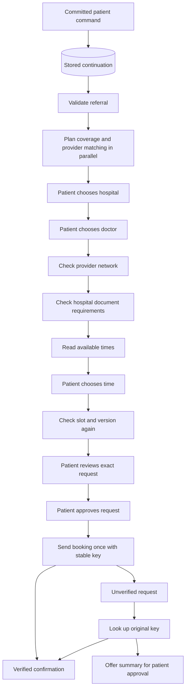

# ADR-0041 — Resume the referral journey from recorded sources

- Status: Accepted
- Date: 2026-10-19
- Scope: Architecture §3, §4, §6, §7, §8 and §11; implementation phase 3.3

## Problem

The gateway could send a message to the coordinator. It did not build specialist inputs from
recorded sources. It did not apply specialist results to the workflow. A patient answer did not
start the next step. The browser scenario driver supplied those steps.

## Decision

Use a durable continuation for each accepted patient command. Use fixed rules for the standard
referral journey. Each specialist still runs through its A2A service, schema, policy and tool budget.
Model tasks retain the existing ADK path. The standard path does not need a model to choose a
routine state transition.

The coordinator stops at each patient choice. It also stops when the sources cannot support the
next step. It shows a handoff summary in that case. It creates a human queue entry only after the
patient approves that summary. Handoff approval cannot approve a booking.

## Responsibilities and interfaces

`WorkflowInputs` reads source records and patient answers. It validates constraints and prepares
the minimum input for each specialist. Source records, conversation messages, patient answers,
specialist results and pending work use separate payload keys. A chat summary cannot replace a
source record.

`CoordinationService` decides when the next standard step can run. It depends on the narrow
`CoordinatorPort` and `ControlState` interfaces. `CommandService` owns transitions, card actions,
approval checks and booking records. The application assembly connects these objects.

The agent workflow module owns specialist operations. It calls the existing governed tools. The
gateway does not acquire specialist tool permissions. Matching receives search data and constraints.
Scheduling receives an opaque `patient_details_id` and fetches the details through its own tool.

This separation applies SOLID principles: each layer has one responsibility; ports isolate external
services; small interfaces expose only required operations; and the same control contract has memory
and PostgreSQL implementations. New operations require an explicit schema, handler and policy grant.

## Durability and booking authority

The accepted command stores a pending job. A worker can claim it only after the command receipt
commits. A claim has a unique token and a lease. Each claim attempt receives a new token.
Renewal and completion require that token, the command ID, pending work and a live lease.
A stale worker cannot clear a newer answer. A replacement worker can resume an expired claim.
Jobs have a five minute expiry. An expired job follows the recovery path.
If recovery fails, the job remains pending for another claim after lease expiry.
The [continuation lifecycle](../architecture/durable-continuation-lifecycle.md) owns these rules.

Each transition records the intended card projection first. The next continuation repairs a missing
card after a crash between transition and projection. State version checks remain in the control
store. PostgreSQL remains the durable authority.

The review binds consent to the exact payload and state version. The coordinator checks the slot
again before review. Booking checks the shared kill switch before the outbound write. It records
that the send has started before calling the hospital. A resumed send uses lookup with the original
key. It cannot send another booking. This can require human review if a crash occurred before the
hospital received the request.

A timeout produces an unverified record. Confirmation requires a matching key, payload and verified
appointment. Reconciliation updates the existing booking record. It does not insert a second booking.
Three unresolved lookups, or a proven absence, lead to a summary that the patient can approve.

## Constraints, evidence and budgets

Plan coverage and matching are the only independent pair. Provider network checks require the chosen
doctor. Document checks require the chosen hospital. Slot checks use that hospital and doctor.

Recorded day and time alternatives use set membership in the slot's display timezone. Invalid values
require review. Matching applies the recorded radius without widening it. Unknown distance cannot
satisfy a radius. Accessibility requires a matching hospital feature. A changed constraint needs a
recorded patient decision.

Specialist outputs are built from tool responses and validated against their role schema. Candidate
records carry retrieved evidence. The citation guard refuses an invented citation even when no
evidence was retrieved. The general model-output guardrail remains a separate platform task.

Remote workflow tasks inherit the absolute deadline and remaining counters. Independent branches
receive separate allocations. The parent charges reported child usage. Read retries stop after
three attempts and remain within the deadline. Booking and delegation are not retried as reads.

## Release and operation

Apply migrations `015_autonomous_coordination.sql` and `016_handoff_consent.sql`. They add the
required policy rows and the pending-job index. Agent Cards and agent declarations are `2.0.0`.
Agent-owned task schemas are `v2`. Frozen generated contracts remain `v1`. The release declaration
is `0.2.0`; historical release manifests remain unchanged.
Build the next manifest from the new image digest before rollout. Use its release pin for the new
services.

Configure the gateway's A2A endpoint and token to start coordination. The FastAPI lifespan starts
the polling worker and stops it on shutdown. This worker needs a continuously running container.
A request-only serverless deployment needs a separate execution service, as required by §22.

Demo workflow creation loads synthetic source records for known fixture patients. Other callers
must supply authoritative `source_data`. The coordinator does not derive a referral, plan or
contact details from free text. Missing source data follows the consented handoff path.

## Verification and limits

The completion record is [autonomous-coordination.md](../architecture/autonomous-coordination.md).
It includes repeatable tests for both booking adapters, timeouts, duplicate commands, restart,
missing documents, outages, the kill switch and consented handoff.

Durable SSE history across replicas, per-conversation release and canary pinning, evaluation replay,
the alert scheduler and operator dashboard actions remain separate work. This decision completes
the standard coordination flow. It does not complete every feature in Architecture v3.

New patient instructions and this decision use short sentences, active verbs and explicit conditions.
Technical names remain unchanged. These writing choices follow
[ASD-STE100 Issue 9](https://www.asd-ste100.org/assets/files/ASD-STE100_ISSUE9.pdf).

