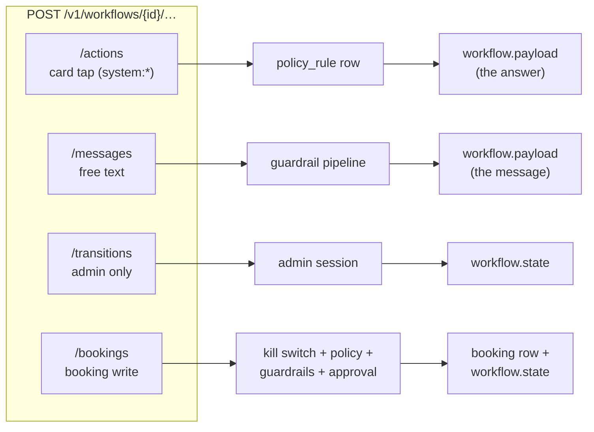
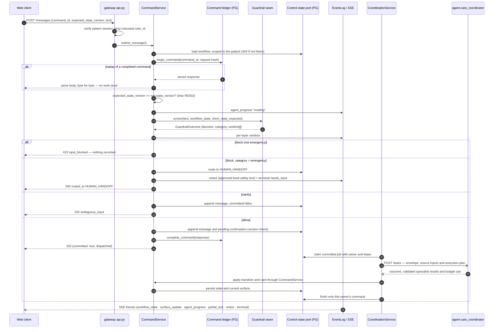
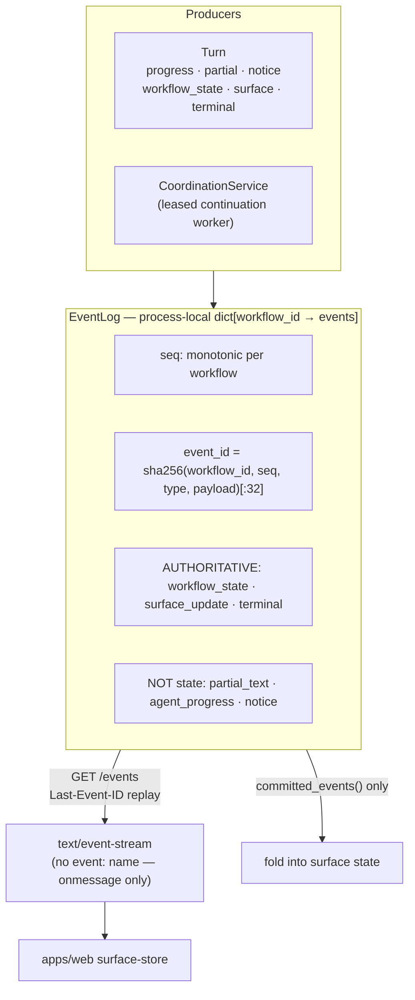
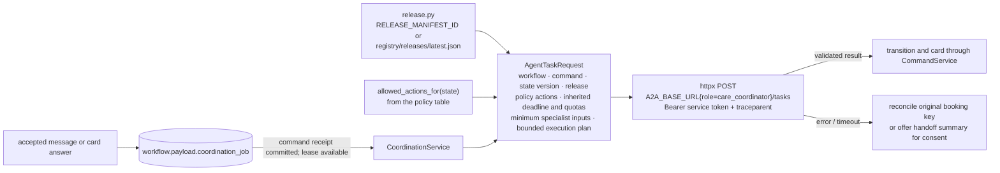

# 1 · Request lifecycle — command plane, SSE and coordinator dispatch

Spec: §5, §7, §9, §12 · Code: `services/gateway/src/referraleasy_gateway/`
(`api.py`, `commands.py`, `events.py`, `surfaces.py`, `dispatch.py`, `release.py`)

[← back to the index](README.md)

## The four write operations

`commands.py` is the only module that changes control state. Each operation has a different
authority behind it.

## A free-text message, end to end

## The SSE stream and surfaces

Standard coordination jobs and current cards persist in PostgreSQL. Historic SSE events remain
process-local. A separate execution service needs shared event delivery before it can serve the
same live stream. See [ADR-0041](../../adr/ADR-0041-autonomous-coordination.md).

## Coordinator dispatch internals

`configured` is false unless there is a URL, a token **and** a release id; an unconfigured gateway
says "no coordinator is configured" to the patient rather than implying someone is acting.

The bounded in-memory dispatch queue remains for general model tasks. The standard workflow uses
the stored continuation path shown above. It requires a continuously running container.
