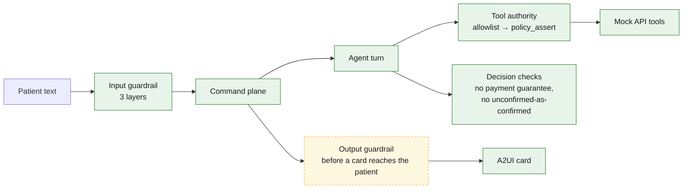
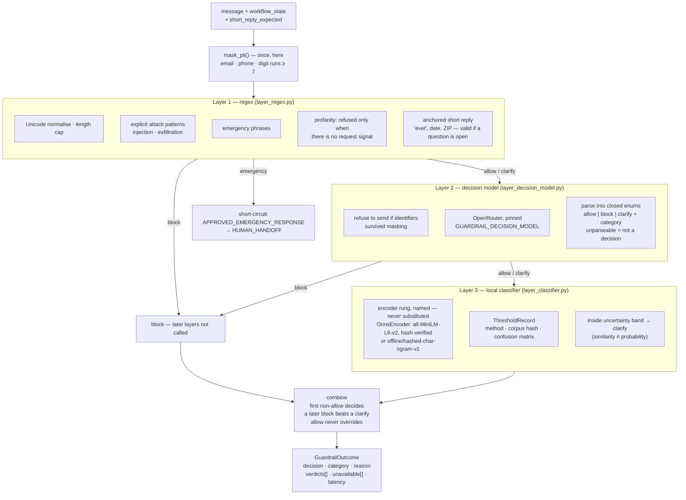
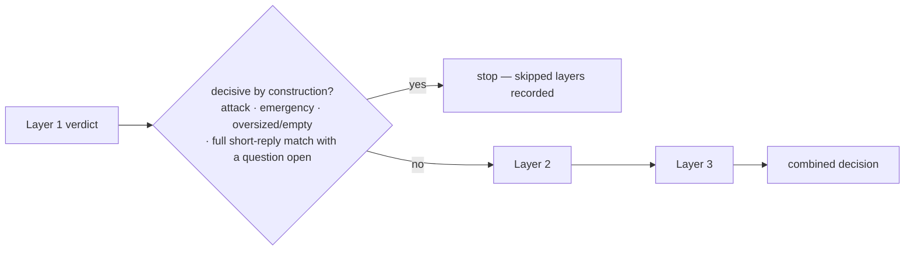
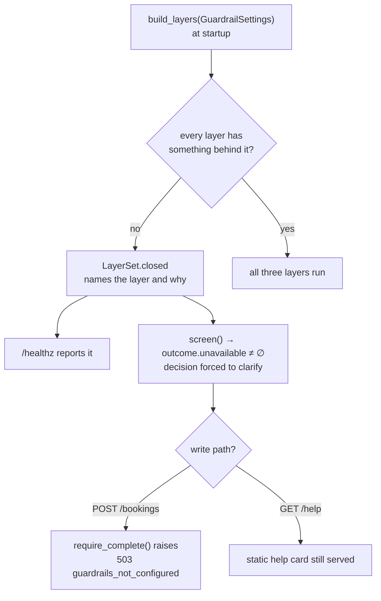
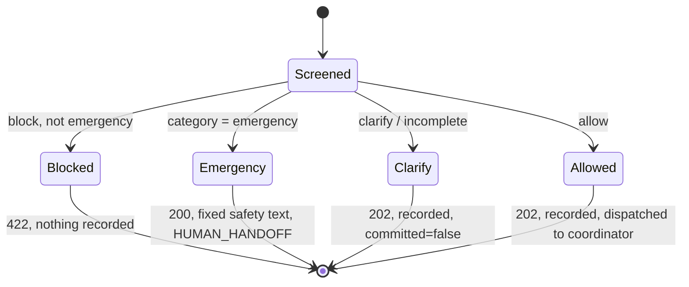
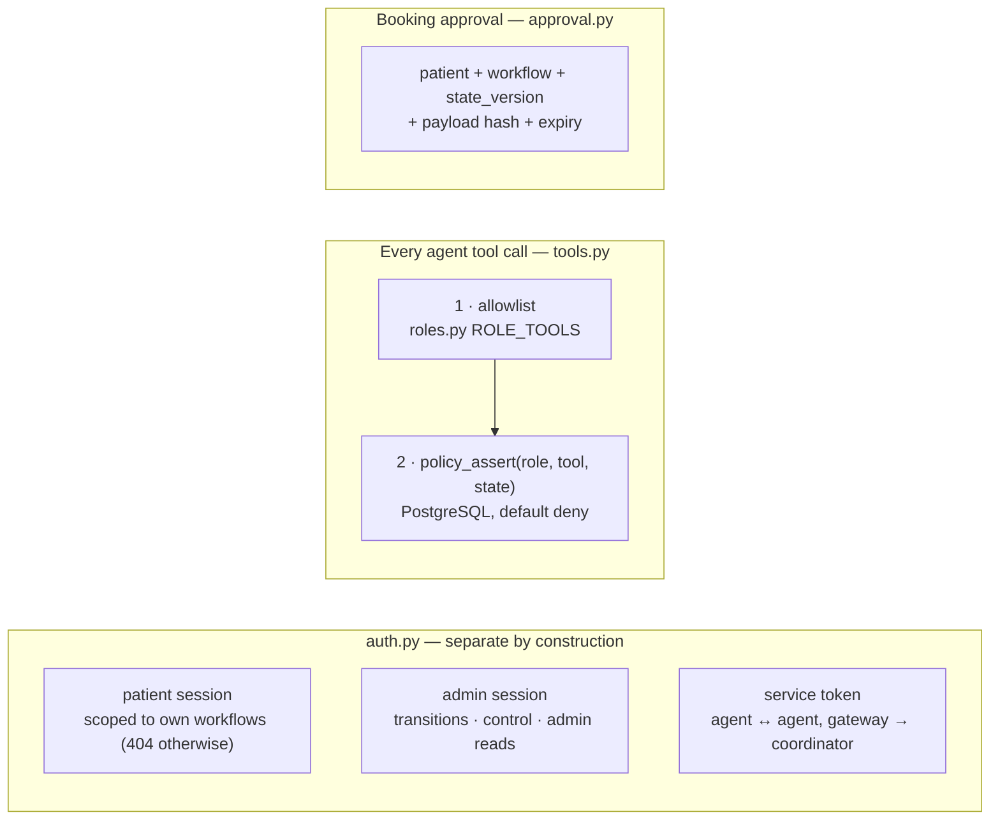

# 2 · Guardrails — three input layers, an output check, and authorization

Spec: §9 · ADR-0005, ADR-0038 · Code: `packages/guardrails/` (the layers and the measurement),
`services/gateway/src/referraleasy_gateway/guardrails.py` (the seam), `packages/agent-runtime/.../tools.py`
(tool authority)

[← back to the index](README.md)

## Where guardrails sit

Input screening is **one** of several defences. The others (tool allowlist, minimum context,
sources treated as data, server-side policy) are what actually stop prompt injection.

`OutputGuardrail` exists and is tested in `packages/guardrails/output.py`, but nothing in
`services/` calls it yet. The equivalent wording checks that *are* live run inside the agent handler
(`referraleasy_agents/decisions.py`).

## The input pipeline — `three_stage` profile

## The `conditional` profile

Same order, minus calls that cannot change the answer. It is measured against `three_stage` rather
than assumed better.

## Closed dependency: an unavailable layer is not a permission

## How each outcome reaches the patient

## Authorization, beside the guardrail

Only Scheduling holds `create_booking` / `cancel_booking` / `reschedule_booking`, and the Coordinator
holds only `delegate_task`. `roles.py` asserts both at import time.

## Measurement

`python -m referraleasy_guardrails.evaluation` runs the labelled corpus through each layer and both
profiles and reports per-layer false positives/negatives, added latency and cost. The admin
Guardrails page reads live per-layer decisions from `otel-events-*`.
