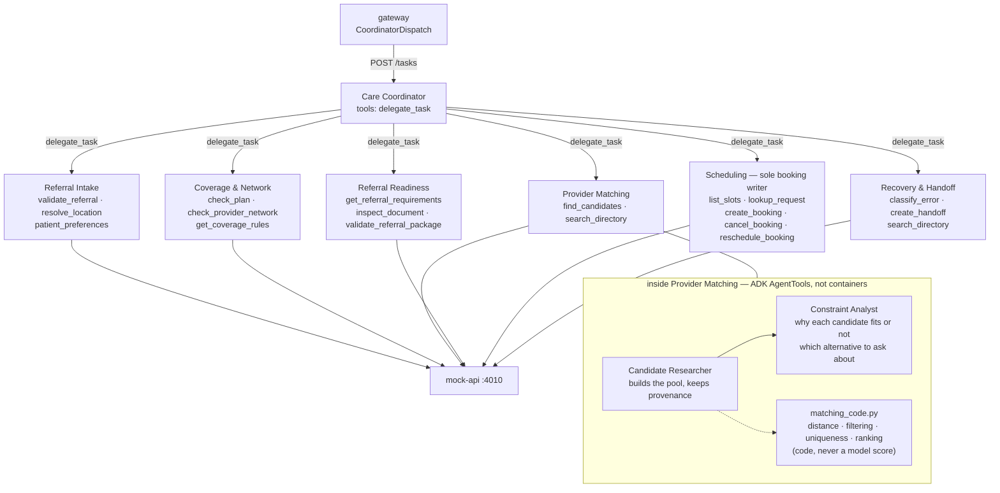
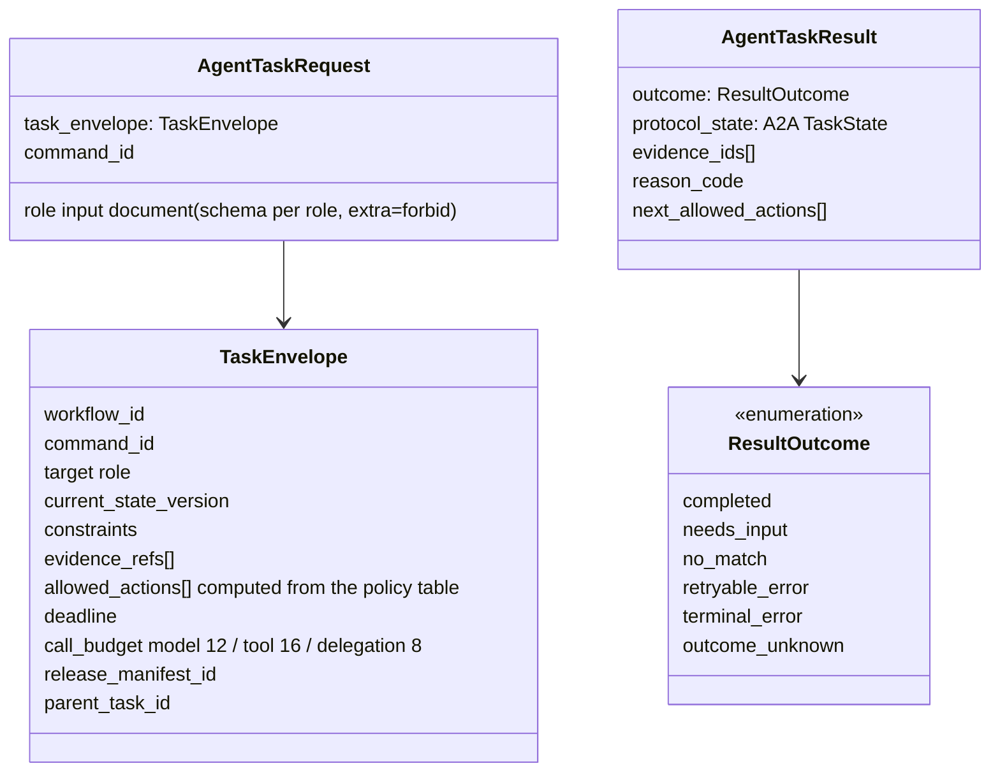
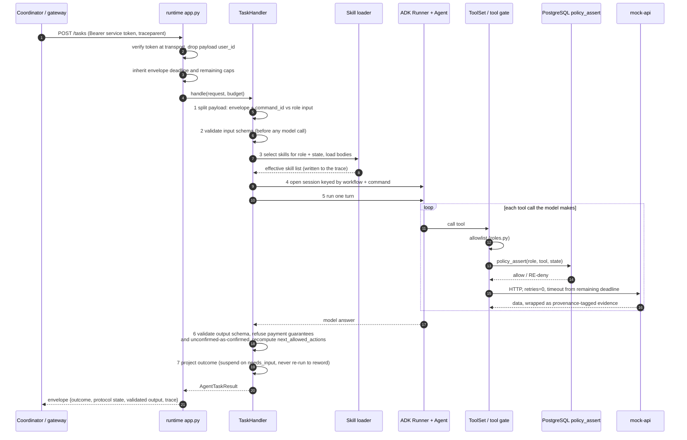
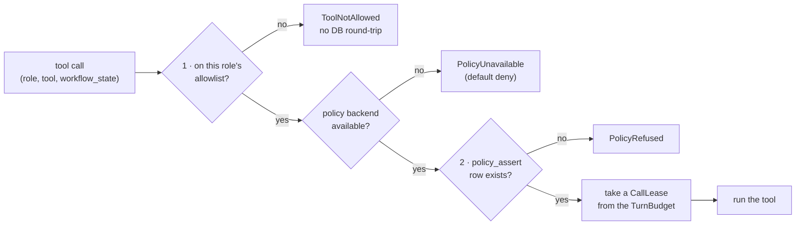
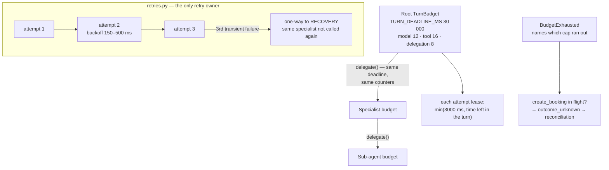
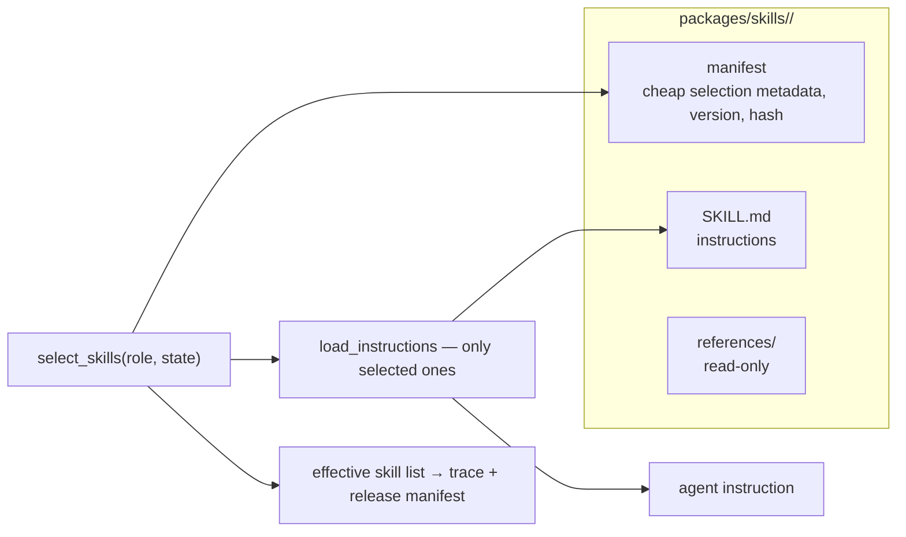
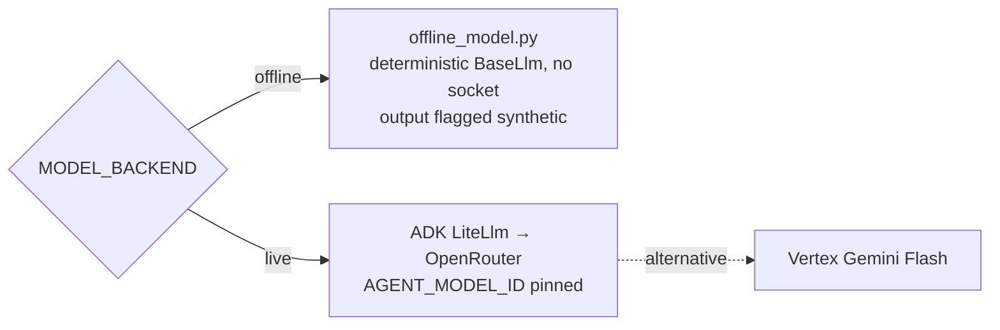

# 3 · Agents, the A2A task contract and tool authority

Spec: §3, §5, §6, §8 · ADR-0002, ADR-0003, ADR-0030, ADR-0033 · Code: `packages/agent-runtime/`,
`services/agents/referraleasy_agents/`, `packages/skills/`, `packages/contracts/schemas/task.json`

[← back to the index](README.md)

## Agent topology

One coordinator and six specialists. They run from one image, and `AGENT_ROLE` picks the role.
The coordinator's only tool is `delegate_task`. Only Scheduling can write bookings.

The standard journey uses `execution_mode=workflow`. Its source-driven operations run through the
same tools and policy gates. Only plan coverage and matching run in parallel. Each remote workflow
call inherits the deadline and remaining quotas, and the parent charges returned usage. The ADK
sequence below describes model tasks. See [ADR-0041](../../adr/ADR-0041-autonomous-coordination.md).

## The A2A task: envelope and result

`contracts/a2a.py` maps each application outcome onto an A2A protocol task state; the custom enum
is never presented as a protocol state. A turn that ends in `outcome_unknown` is HTTP 200 with
protocol state `failed` **and** the outcome beside it.

> **Transport today:** each agent serves `POST /tasks`, `GET /healthz` and `GET /manifest` from the
> runtime's FastAPI app, and publishes an immutable Agent Card (`cards.py`). ADR-0003 pins
> `a2a-sdk`, but no module imports it yet; ADK↔a2a-sdk compatibility is recorded as unverified.

## One specialist turn (`handler.py`)

## Tool authority — two checks, in a fixed order

A skill grants **no** tool permission. The manifest schema has no field that could carry one, and
the loader refuses a mutated manifest.

## Budget and retries (§8)

HTTP clients run with retries set to zero (`http.py`), so SDK, HTTP and A2A retries cannot
multiply the budget.

## Skills

The eight packages are referral-intake, coverage-interpretation, constraint-negotiation,
directory-grounding, referral-readiness, booking-confirmation, uncertain-booking-reconciliation and
handoff-triage.

## Model providers

