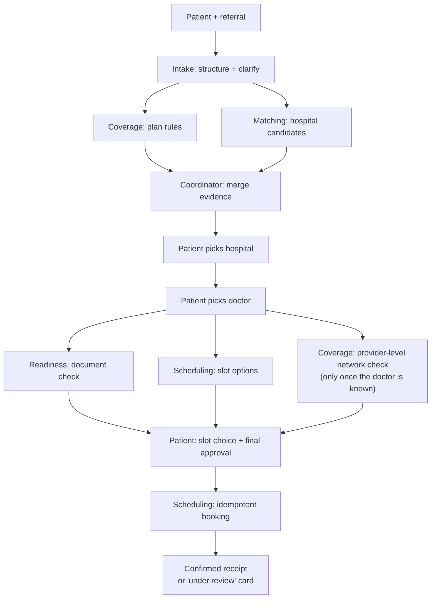
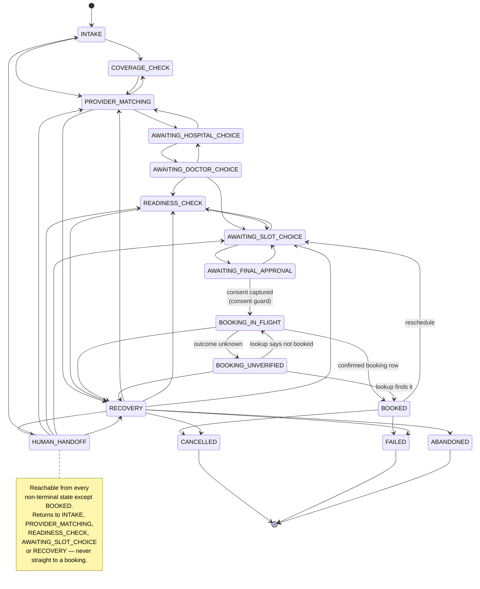
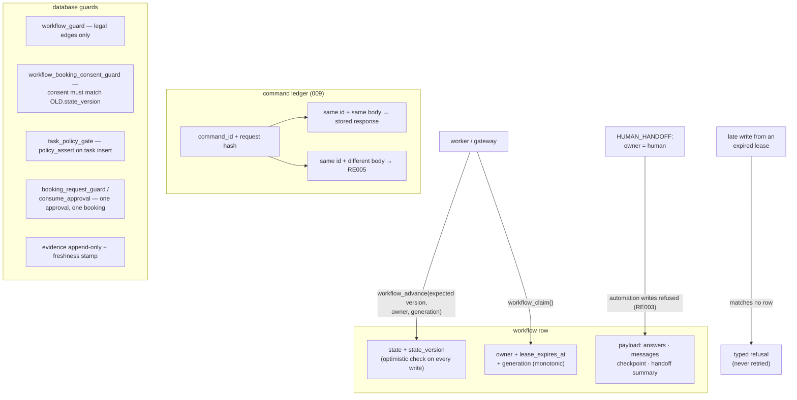

# 4 · Workflow state machine and the policy table

Spec: §4, §7 · ADR-0022, ADR-0025 · Code: `packages/contracts/schemas/common.json#WorkflowState`,
`migrations/003_workflow.sql`, `migrations/005_policy.sql`, `migrations/014_align_domain_vocabulary.sql`,
`packages/domain/workflow.py`, `services/gateway/src/referraleasy_gateway/transitions.py`

[← back to the index](README.md)

## The collaboration flow (§4)

Independent work runs in parallel. The patient chooses at each step: hospital first, then doctor,
then slot. The system never picks a slot for them and never pre-books.

## The state machine

These are the legal edges held by the database (`workflow_transition`), transcribed in
`transitions.py` for the in-memory profile. The terminal states `ABANDONED`, `CANCELLED` and
`FAILED` are reachable from most states; to keep the diagram readable they are drawn only from
`BOOKED` and `RECOVERY`.

`RECOVERY` has no edge back to `AWAITING_FINAL_APPROVAL` or `BOOKING_IN_FLIGHT`. Leaving normal
flow is one-way, so nothing downstream can book quietly.

## Policy table: which tool may run in which state

`policy_rule` is default-deny: a missing row is a refusal. The table below shows the allowed rows
from migration 014. The coordinator's `delegate_task` is allowed in every non-terminal state.

```mermaid
flowchart LR
    subgraph S1["INTAKE"]
        i1["referral_intake:<br/>validate_referral · resolve_location<br/>patient_preferences"]
    end
    subgraph S2["COVERAGE_CHECK"]
        c1["coverage_network:<br/>check_plan · get_coverage_rules<br/>check_provider_network"]
    end
    subgraph S3["PROVIDER_MATCHING"]
        m1["provider_matching:<br/>find_candidates · search_directory"]
    end
    subgraph S4["AWAITING_HOSPITAL / DOCTOR_CHOICE"]
        h1["system: await_patient_choice"]
        h2["coverage_network:<br/>check_provider_network<br/>(doctor choice only)"]
    end
    subgraph S5["READINESS_CHECK"]
        r1["referral_readiness:<br/>get_referral_requirements<br/>inspect_document · validate_referral_package"]
    end
    subgraph S6["AWAITING_SLOT_CHOICE"]
        s1["scheduling: list_slots"]
        s2["system: await_patient_choice"]
    end
    subgraph S7["AWAITING_FINAL_APPROVAL"]
        f1["system: capture_consent"]
        f2["scheduling: list_slots"]
    end
    subgraph S8["BOOKING_IN_FLIGHT"]
        b1["scheduling: create_booking<br/>lookup_request · list_slots"]
    end
    subgraph S9["BOOKING_UNVERIFIED"]
        u1["scheduling: lookup_request"]
        u2["recovery_handoff: create_handoff"]
    end
    subgraph S10["BOOKED"]
        k1["scheduling: cancel_booking<br/>reschedule_booking · list_slots"]
    end
    subgraph S11["RECOVERY"]
        x1["recovery_handoff: classify_error<br/>create_handoff · search_directory"]
        x2["provider_matching: find_candidates"]
    end
    subgraph S12["HUMAN_HANDOFF"]
        o1["operator: resolve_ticket<br/>capture_consent"]
        o2["recovery_handoff: create_handoff"]
    end
    S1 --> S2 --> S3 --> S4 --> S5 --> S6 --> S7 --> S8 --> S9
    S8 --> S10
    S8 -.-> S11 -.-> S12
```

## Durability: who may write, and when (§7)

The gateway runs the same test suite against an in-memory backend and a PostgreSQL one, so a rule
that exists in only one of them fails CI.
