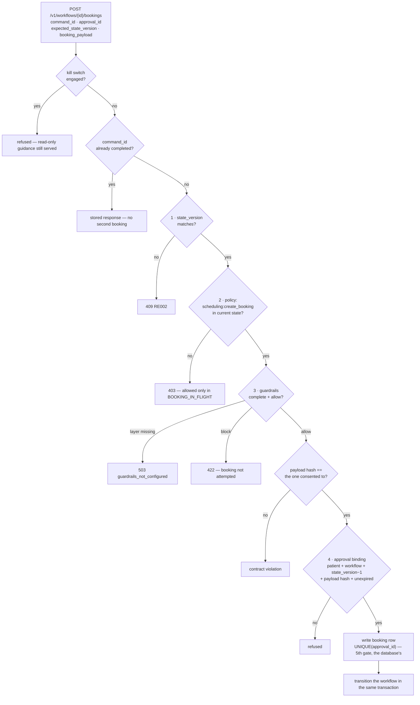
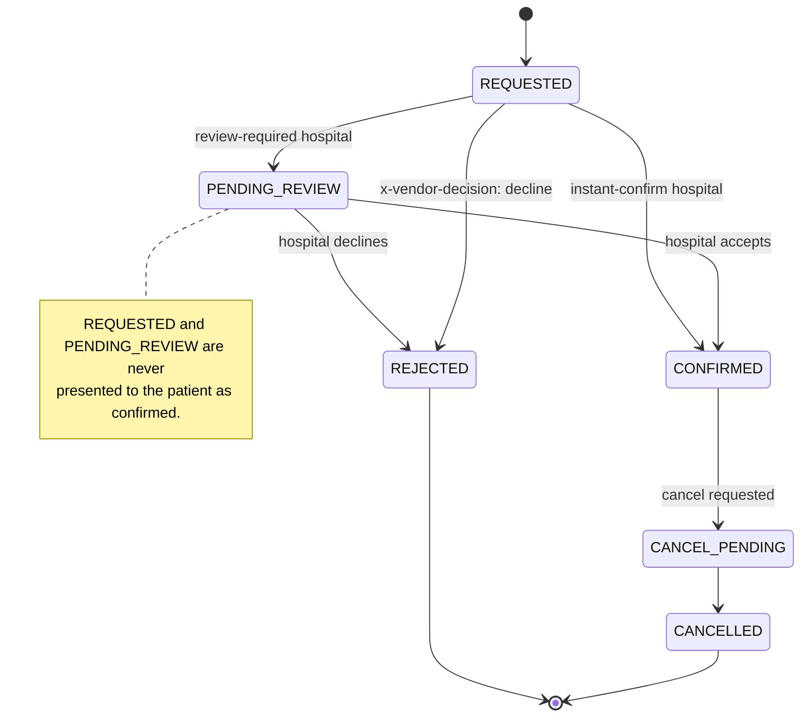
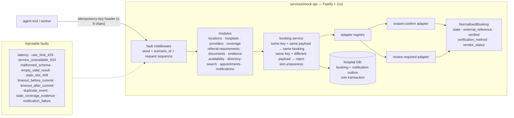
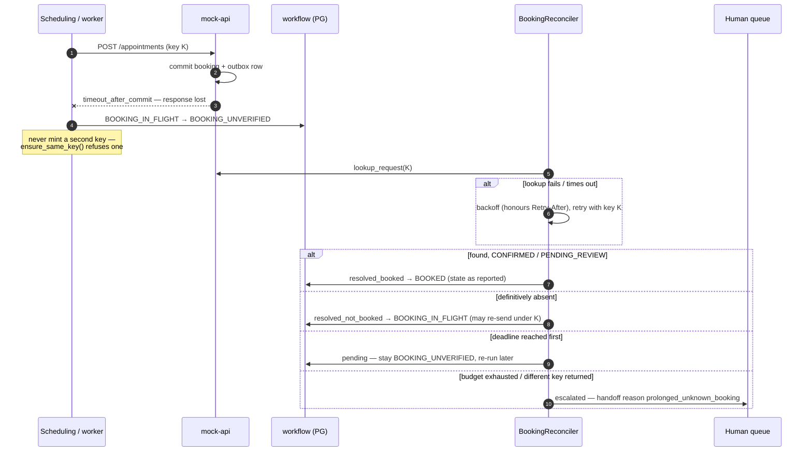
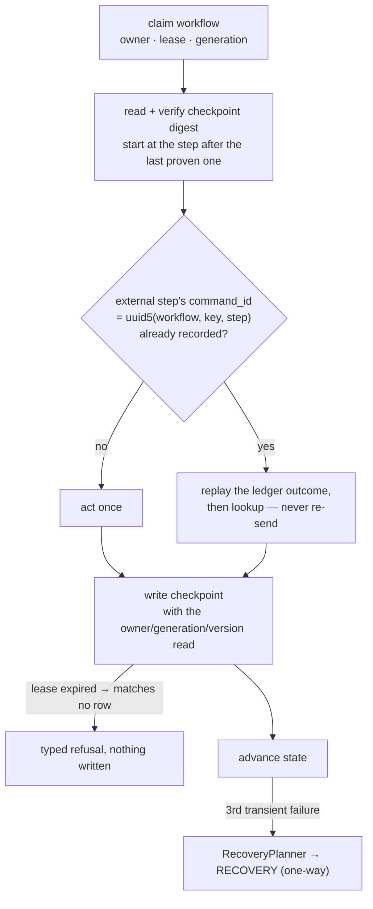
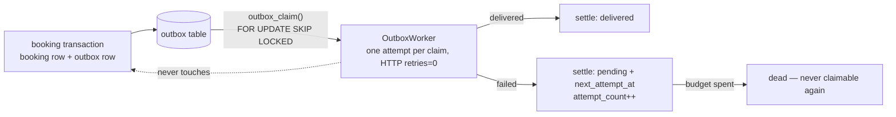

# 5 · Booking, idempotency and reconciliation

Spec: §2.5, §7, §9, §17 · ADR-0021, ADR-0035 · Code: `services/gateway/.../commands.py` (`book`),
`services/gateway/.../approval.py`, `services/mock-api/src/` (`modules/appointments.ts`, `adapters/`,
`faults/`), `services/workers/src/referraleasy_workers/` (`booking.py`, `reconcile.py`, `outbox.py`)

[← back to the index](README.md)

## The booking write: five gates before the row

## Booking lifecycle (§2.5)

HTTP 200 never means `CONFIRMED`. Only the booking's own `state` is authoritative.

## The mock hospital API (§17)

## Unknown outcome → reconciliation, under the same key

The "timeout after commit" scenario: the booking exists, but the response was lost.

`reconcile.py` is the only retry owner for lookups. It is deliberately not wrapped in
`run_with_retries`, because nested loops would turn 3 × 3 attempts into 9.

## Worker pipeline: two replicas, one command

## Notifications never roll a booking back

