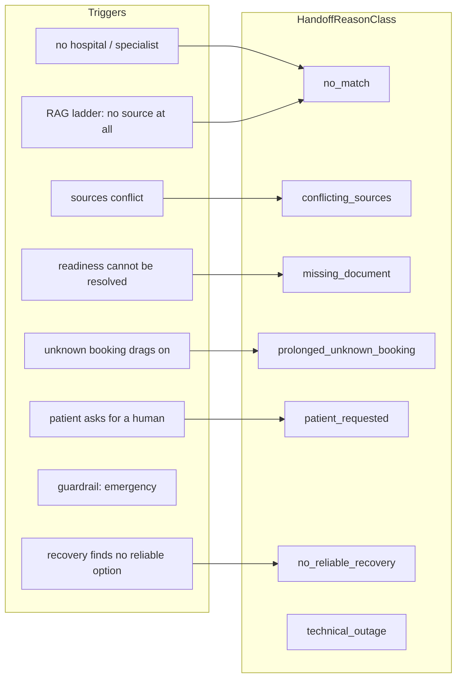
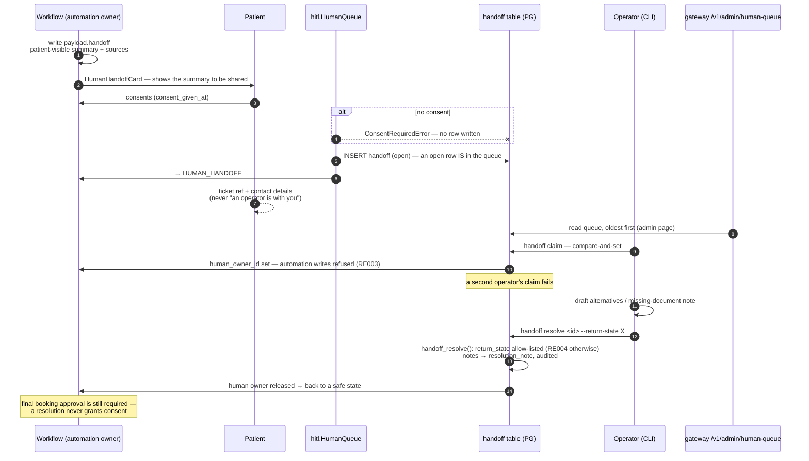
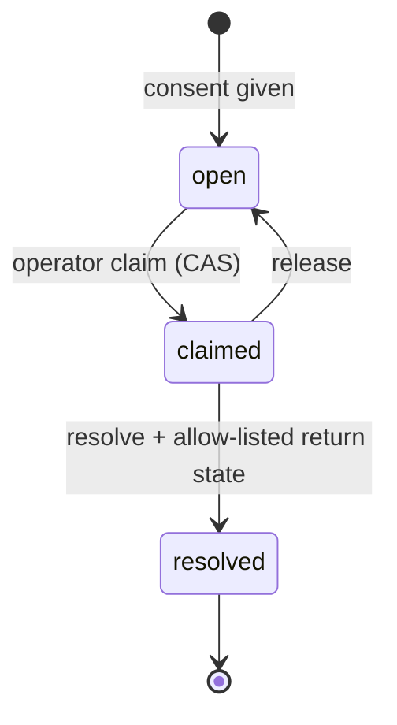
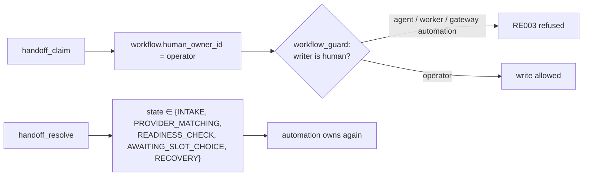

# 6 · Human in the loop

Spec: §11 · ADR-0035 · Code: `services/workers/src/referraleasy_workers/hitl.py`,
`packages/domain/src/referraleasy_domain/handoff.py`, `migrations/011_handoff.sql`,
`services/gateway/.../human_queue.py` (read), `python -m referraleasy_workers handoff …` (act)

[← back to the index](README.md)

## Triggers and reason classes

An emergency routes the workflow to `HUMAN_HANDOFF` straight from the gateway, with the approved
fixed safety text. It does not go through the worker's consent flow.

For standard coordination, the gateway stores `payload.handoff_draft` and shows the exact summary.
The card asks the patient to share it. `system:capture_consent` then queues that draft through
`ControlState.queue_handoff`. It creates no booking approval. The existing worker queue API and
operator lifecycle remain available.

## Ticket lifecycle

## Handoff state

## Ownership while a human holds the ticket

> **Gap (README #6):** the admin Human Queue page *reads* the queue. Claiming, releasing and
> resolving are terminal commands (`python -m referraleasy_workers handoff …`), so there is only one
> implementation of §11's claim rules and the database's compare-and-set decides who wins.
