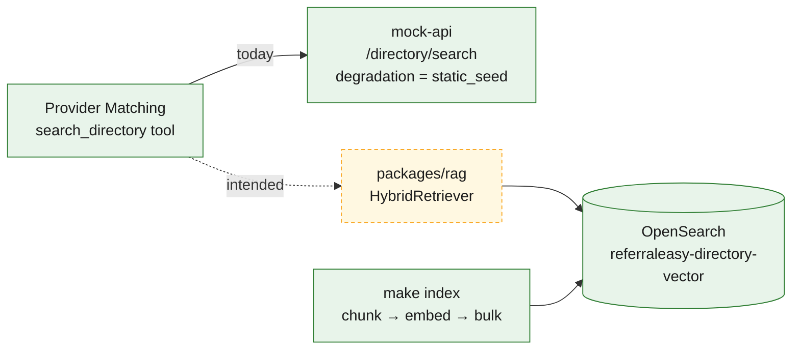
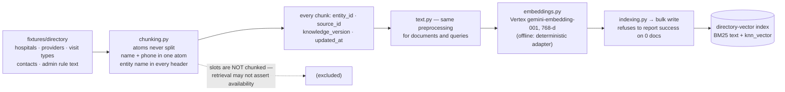
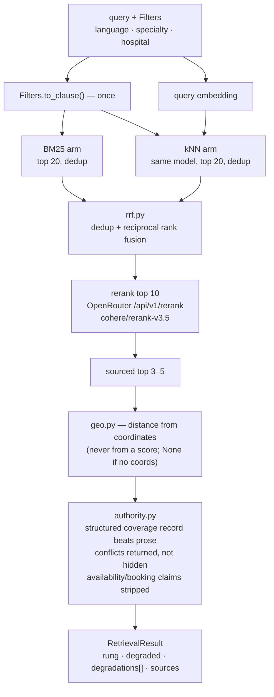
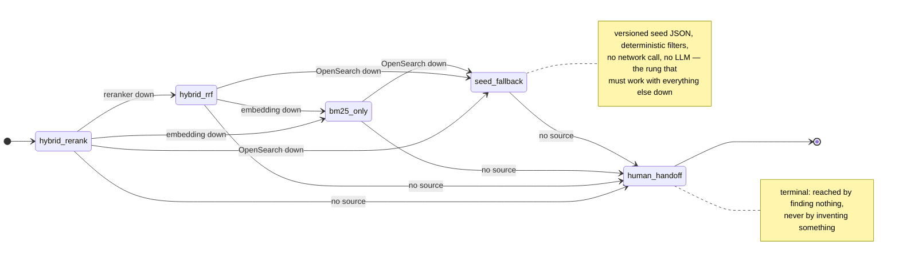

# 7 · Hybrid RAG and the degradation ladder

Spec: §10 · ADR-0006, ADR-0007, ADR-0008, ADR-0029 · Code: `packages/rag/src/referraleasy_rag/`,
`infra/opensearch/index-templates/referraleasy-directory-vector.json`, `make index`

[← back to the index](README.md)

## Wiring status

The package is complete and tested, including 13 OpenSearch-backed integration tests. No service
imports it yet. Every answer from the tool that *is* wired says `static_seed`, so a filtered answer
is never presented as an exhaustive one.

## Indexing

## Query pipeline

## The degradation ladder

The ladder only goes down, never back up. Every step down is recorded with a reason, and any rung
other than `hybrid_rerank` sets `degraded = true`.

## Retrieval evaluation

`evaluation.py` measures recall@k and MRR with the reranker on and off, so the reranker's
contribution is a number rather than an assumption.
