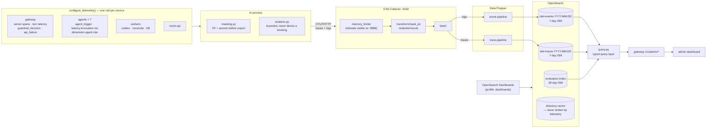
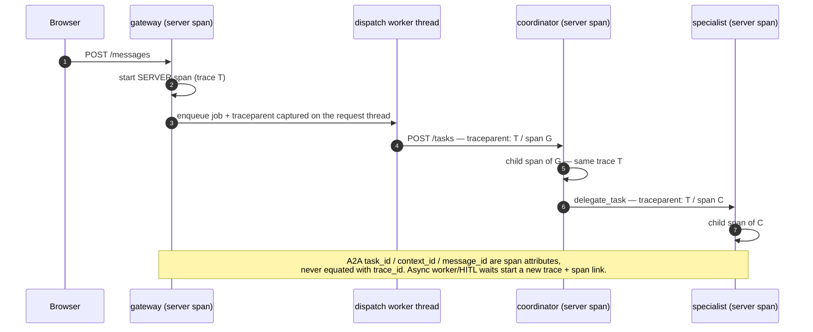
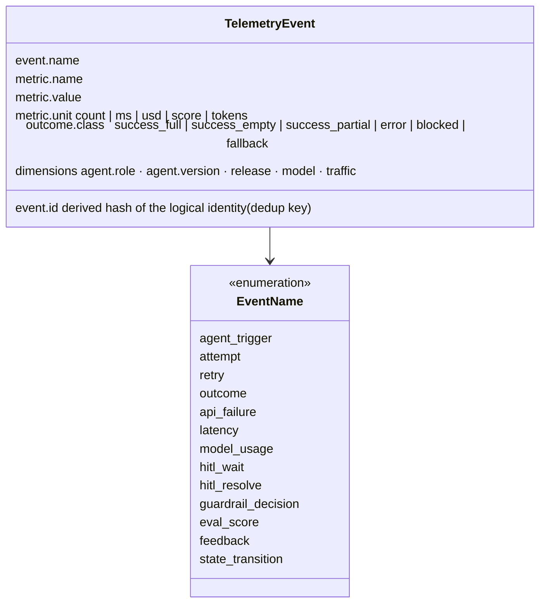
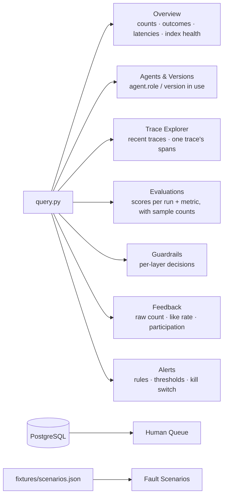

# 8 · Telemetry: OTel → Data Prepper → OpenSearch

Spec: §15 · ADR-0008, ADR-0032 · Code: `packages/telemetry/`, `infra/otel/`,
`infra/data-prepper/pipelines.yaml`, `infra/opensearch/{index-templates,ism-policies}/`,
`services/gateway/.../admin.py`

[← back to the index](README.md)

## Pipeline

OpenSearch 3.9.0 does not ingest native OTLP metrics (ADR-0008), so every measurement is sent as a
numeric **log event**. There is no Prometheus.

## Identity: propagate, don't correlate

## One event = one measurement

Counts use `cardinality(event.id)`, not `doc_count`, so a re-export or a double emission counts
once. Distributions use `percentiles(metric.value)`. The three latencies (`latency.attempt.ms`,
`latency.invocation.ms`, `latency.turn.ms`) are separate series, and timeouts stay in them.

## What the admin dashboard reads

Telemetry and evaluation failures never roll back a business transaction. The critical audit stays
in PostgreSQL.
