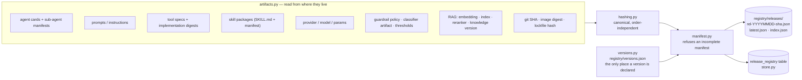
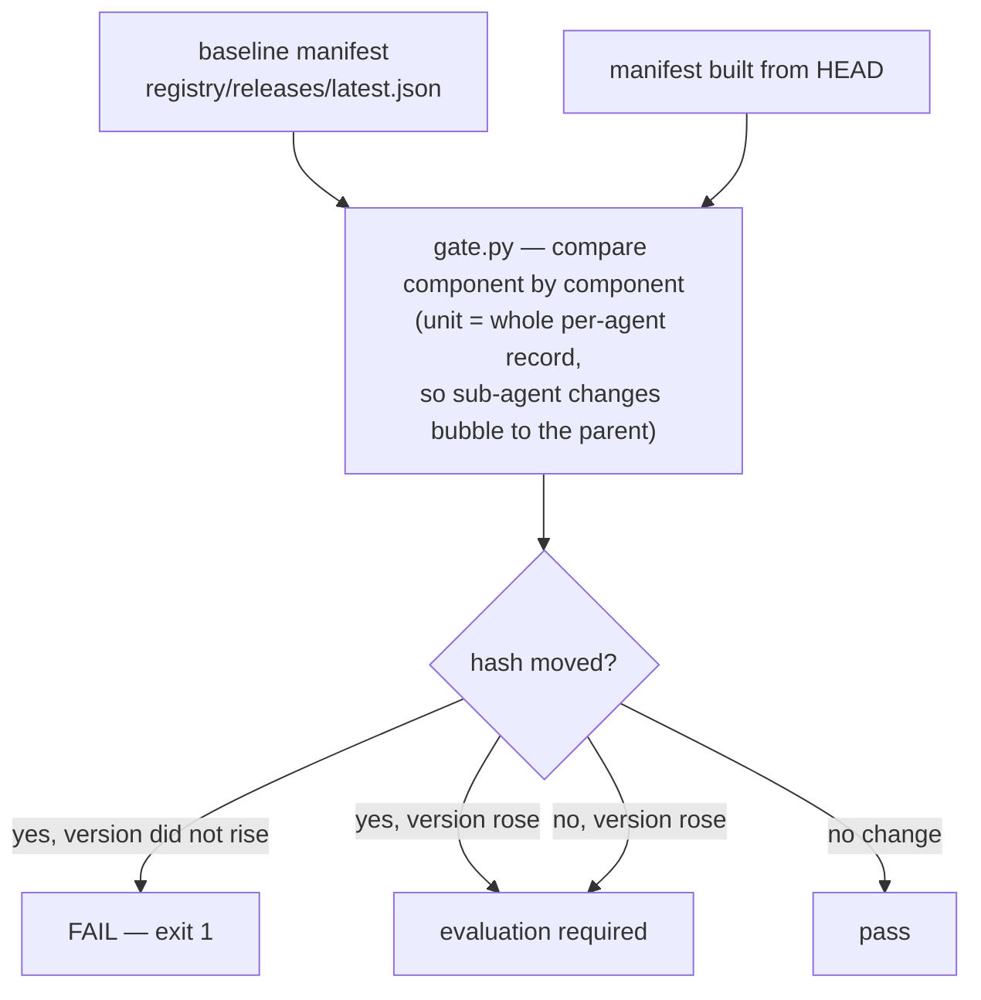
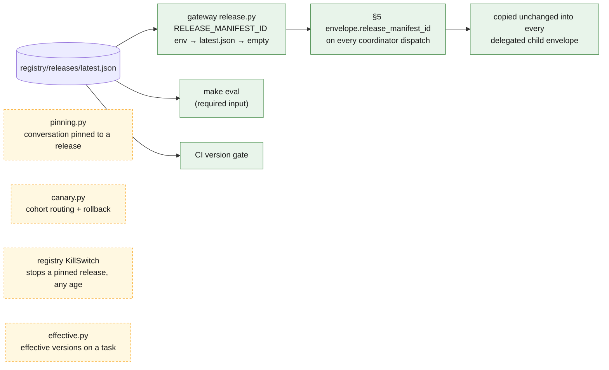
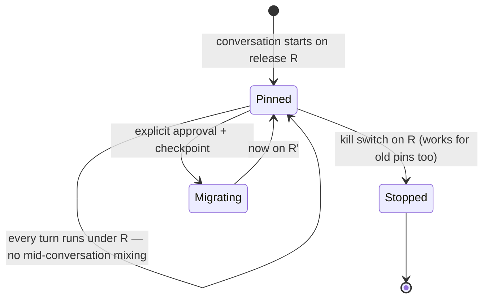

# 9 · Release registry and the version gate

Spec: §13 · ADR-0037 · Code: `packages/release-registry/src/referraleasy_release_registry/`,
`registry/{agents,prompts,releases,versions.json}`, `scripts/check_release_versions.py`,
`services/gateway/.../release.py`, `migrations/012_release_registry.sql`

[← back to the index](README.md)

## What a release manifest is built from

The manifest's top-level keys are `agents`, `prompts`, `tools`, `skills`, `provider`, `rag`,
`guardrail_policy`, `rollout`, `source`, `release_manifest_id` and `parent_release_manifest_id`.

## The CI version gate

> **Gap (README #2):** CI builds no image, so `RELEASE_IMAGE_DIGEST` is not set anywhere and the CI
> job reports a broken gate instead of actually gating.

## Who reads the registry

The gateway names a release on every task, but it does not yet pin conversations. Per-conversation
pinning, canary cohorts and the registry's rollout kill switch are implemented and tested, with no
caller in `services/`. The rollout kill switch is a different control from the admin kill switch in
[11-alerts-killswitch.md](11-alerts-killswitch.md).

## Pinning rules (as implemented in `pinning.py`)

