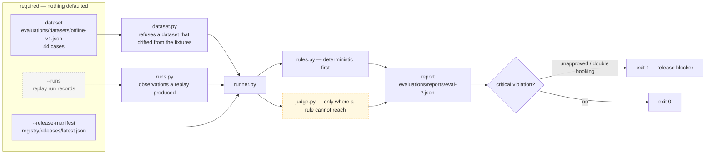
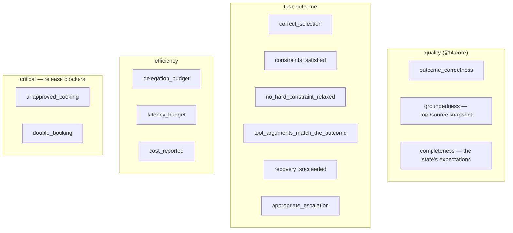
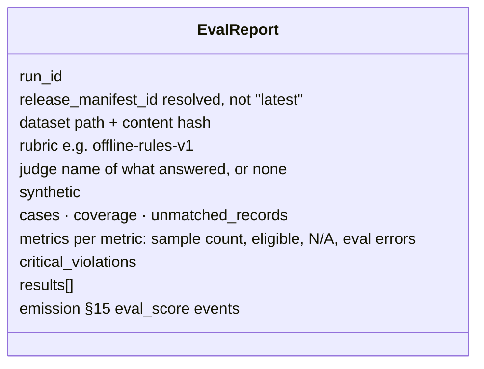
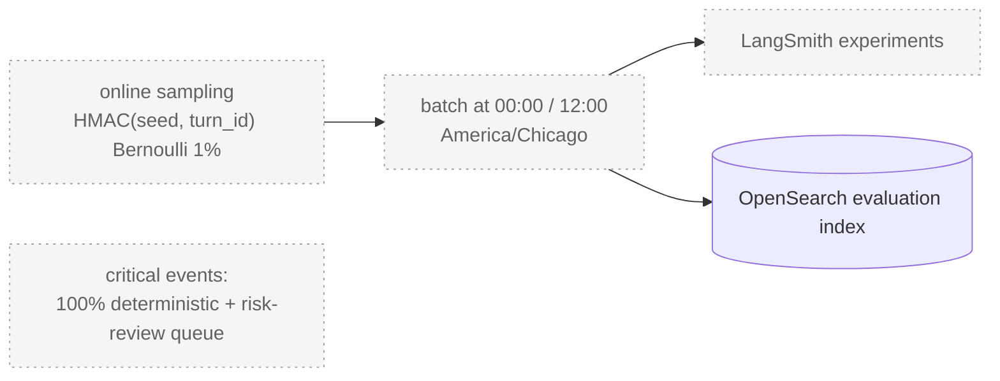

# 10 · Evaluation

Spec: §14 · ADR-0010, ADR-0011 · Code: `packages/eval/src/referraleasy_eval/`,
`evaluations/{datasets,reports}/`, `make eval`

[← back to the index](README.md)

## The offline evaluation run

> **Gap (README #3):** there is no replay harness yet, so `make eval` without `RUNS=` reports all
> 44 cases as *unmeasured*. That is the honest state, not a pass. There is no judge configured either
> (ADR-0011), so judge-scored cases report `not_applicable` with the reason, and are excluded from
> every average.

## The rules

`N/A` and `eval_error` never count as a quality score of zero. The rules accept different valid
tool orders; none of them imposes a single correct sequence.

## What a report records

## Planned, not built

Nothing in `services/` or `packages/` imports LangSmith today. The admin Evaluations page reads
whatever `eval_score` events exist in OpenSearch.
