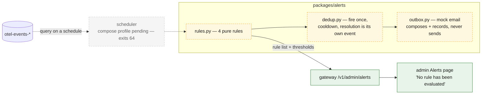
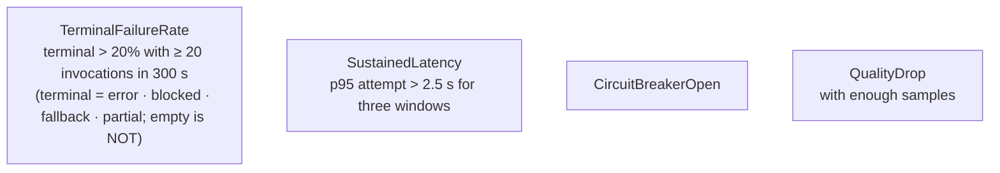
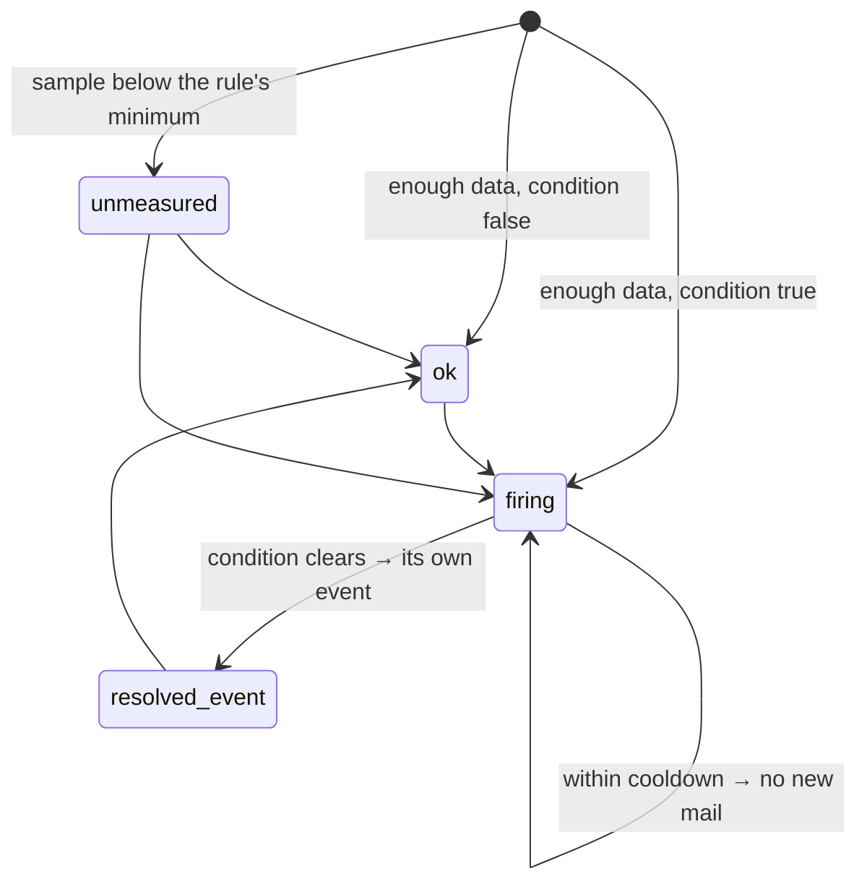
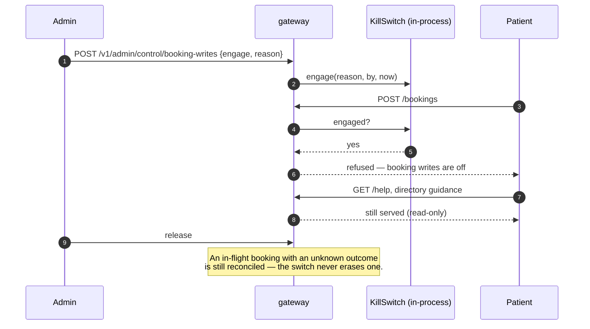

# 11 · Alerts, the mock email outbox and the kill switch

Spec: §16 · Code: `packages/alerts/src/referraleasy_alerts/`, `services/gateway/.../killswitch.py`,
`services/gateway/.../admin.py`, `/v1/admin/{alerts,control}`

[← back to the index](README.md)

## Alerting, as designed and as wired

The rules, the dedup logic and the outbox are implemented and tested. The admin page shows the rule
list and thresholds, and states that nothing has been evaluated, because the scheduler that would
query OpenSearch does not exist yet.

## The four rules

## Rule states: `unmeasured` is not `ok`

## The admin kill switch (wired)

This switch stops all booking writes. The release registry has a different one, which stops a
*pinned release* (see [09-release-registry.md](09-release-registry.md)), and that one is not wired.
