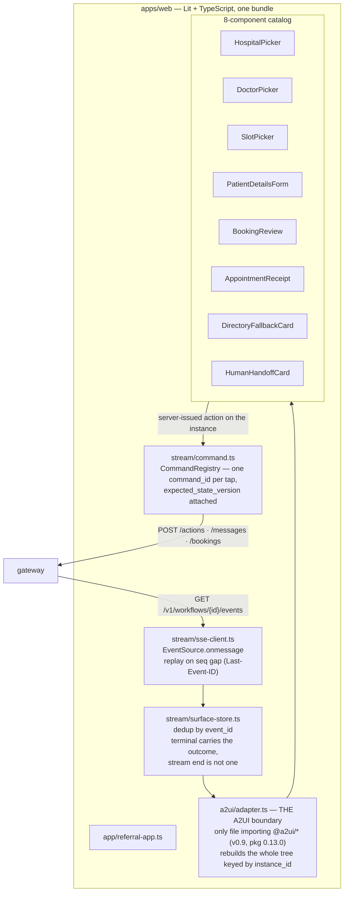
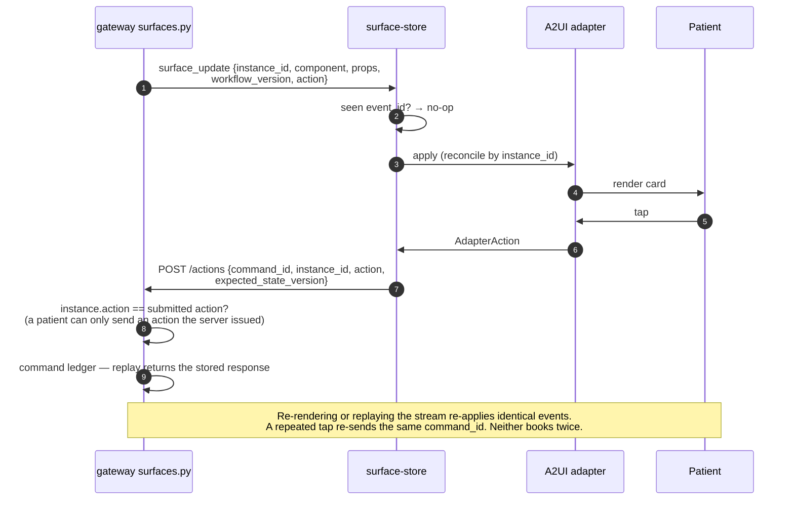
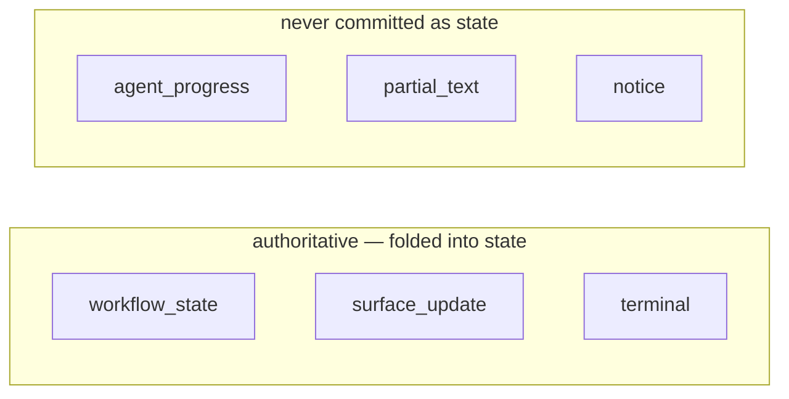
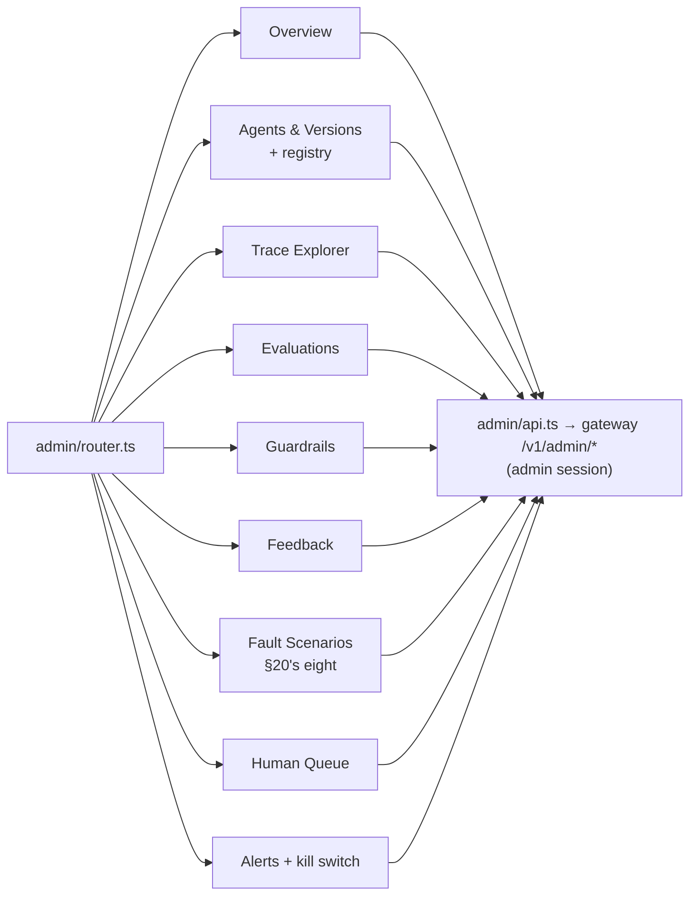

# 12 · Web client, A2UI and the admin dashboard

Spec: §12 · ADR-0004, ADR-0027 · Code: `apps/web/src/` (`a2ui/`, `stream/`, `components/`,
`admin/`), `packages/contracts/schemas/sse.json`, `services/gateway/.../surfaces.py`

[← back to the index](README.md)

## Patient client

## Card lifecycle — why a re-render can't re-book

## SSE event types

Progress latency and final-answer latency are measured on two separate clocks (`timing.py`) and are
never reported as one number.

## Admin dashboard (`/admin`)

Every chart reads a real index or table. When a series has no data, the page says so instead of
drawing a placeholder: "no fabricated demo charts" is one of the repo's `[!]` invariants.
