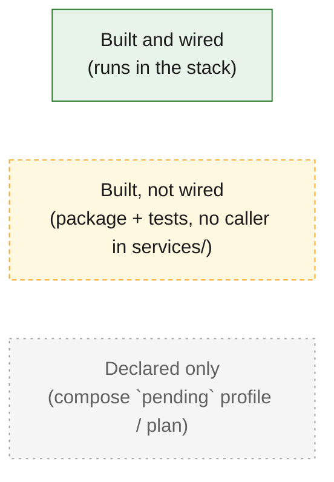
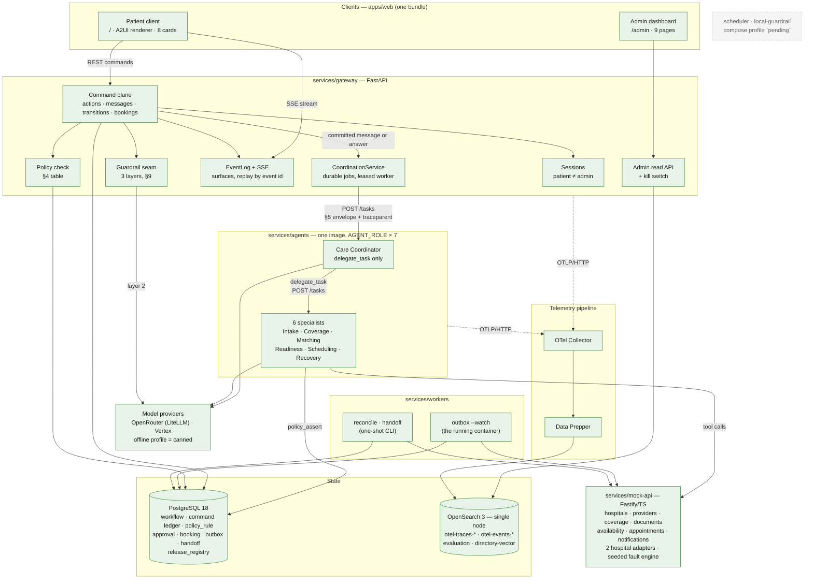
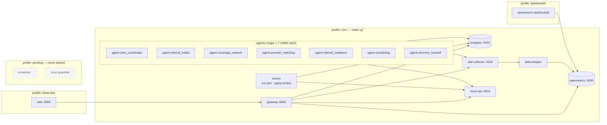
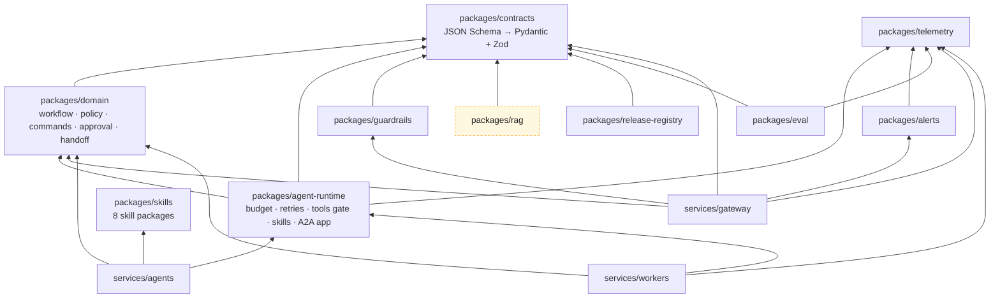

# Architecture diagrams

Mermaid diagrams of the system **as it is built**, drawn from the code rather than from the plan.
Where the plan ([`../../../ReferralEasy_Architecture_v3.md`](../../../ReferralEasy_Architecture_v3.md))
and the code disagree, the diagrams follow the code and mark the difference.

## Legend

Every diagram uses the same three styles:

## Feature diagrams

| # | Feature | Spec | File |
| --- | --- | --- | --- |
| 1 | Request lifecycle: command plane, SSE, coordinator dispatch | §5, §7, §12 | [01-request-lifecycle.md](01-request-lifecycle.md) |
| 2 | Three-layer guardrails + output guardrail | §9 | [02-guardrails.md](02-guardrails.md) |
| 3 | Agents, A2A task contract, tool authority | §3, §5, §6, §8 | [03-agents-a2a.md](03-agents-a2a.md) |
| 4 | Workflow state machine and policy table | §4, §7 | [04-workflow-state-machine.md](04-workflow-state-machine.md) |
| 5 | Booking, idempotency and reconciliation | §2.5, §7, §17 | [05-booking-reconciliation.md](05-booking-reconciliation.md) |
| 6 | Human in the loop | §11 | [06-hitl.md](06-hitl.md) |
| 7 | Hybrid RAG and the degradation ladder | §10 | [07-hybrid-rag.md](07-hybrid-rag.md) |
| 8 | Telemetry: OTel → Data Prepper → OpenSearch | §15 | [08-telemetry.md](08-telemetry.md) |
| 9 | Release registry and the version gate | §13 | [09-release-registry.md](09-release-registry.md) |
| 10 | Evaluation | §14 | [10-evaluation.md](10-evaluation.md) |
| 11 | Alerts and the kill switch | §16 | [11-alerts-killswitch.md](11-alerts-killswitch.md) |
| 12 | Web client, A2UI and the admin dashboard | §12 | [12-web-a2ui.md](12-web-a2ui.md) |

---

## System overview

The whole platform on one page: who calls whom, and where state lives.

### Deployment topology (compose profiles)

**There is no message broker.** The work queue is a PostgreSQL table read with
`SELECT … FOR UPDATE SKIP LOCKED`, and the single OpenSearch node is both the vector store and the
telemetry store (ADR-0023, ADR-0008).

### Package dependency map

`packages/rag` has no importer in `services/` yet: the Matching agent's `search_directory` calls
the mock API's `/directory/search` and labels every answer `static_seed`. See
[07-hybrid-rag.md](07-hybrid-rag.md).
