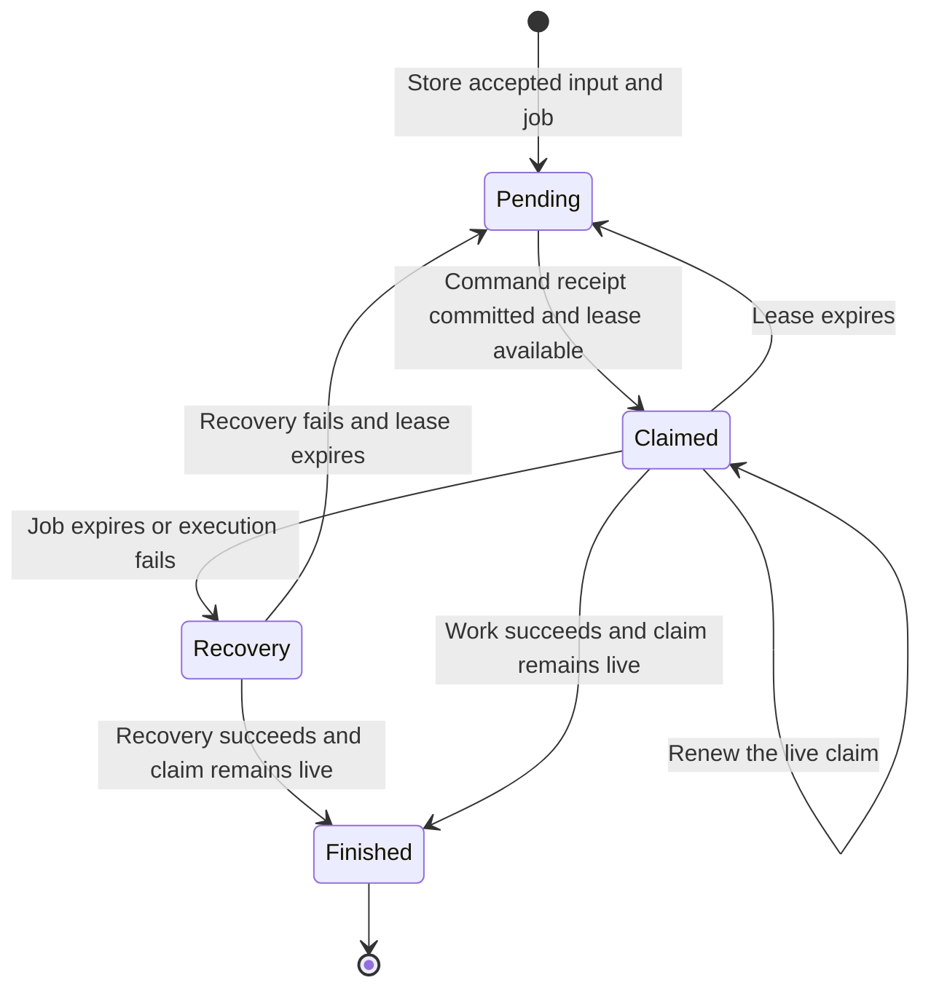

# Durable continuation lifecycle

Date: 2026-10-19. Related decision: [ADR-0041](../adr/ADR-0041-autonomous-coordination.md).

The [continuation module](../../services/gateway/src/referraleasy_gateway/continuations.py) owns job creation, expiry and execution identity.
Commands store its pending patch with the accepted patient input.
Coordination uses claims to resume work and request recovery.
Neither caller reads the stored job fields.

## Responsibilities

| Module | Responsibility |
| --- | --- |
| `ContinuationLifecycle` | Create pending work; assign a new claim token; check job expiry; authorize recovery and completion |
| `ContinuationStore` | Define four atomic storage operations for pending work, claims, renewal and completion |
| `ContinuationRecord` | Read and write the existing stored format; share memory-adapter claim rules |
| `CommandService` | Check command authority; store patient input and pending work; commit the command receipt |
| `CoordinationService` | Choose workflow steps; run specialists; request recovery; finish successful work |
| Control adapters | Enforce committed-command and live-claim predicates under a lock or in PostgreSQL |

This design applies SOLID principles. The lifecycle has one responsibility.
Its storage dependency is a small protocol. Both adapters implement that protocol.
Workflow decisions remain in coordination. Command authority remains in commands.

## Lifecycle



A job expires five minutes after creation. A claim has a two minute lease.
Each claim receives a new token. A process that reclaims the same command therefore has a new identity.
Renewal and completion require the command ID, token, pending state and live lease.
An expired or replaced claim cannot renew, finish, or request recovery.
An expired job remains available for recovery by its current claim owner.

PostgreSQL makes each claim decision in one `UPDATE`.
Renewal returns the current workflow from the same statement.
The memory adapter makes the same decisions under its lock.
Each pending scan returns at most 32 workflow IDs.
A pending scan grants no ownership. The claim operation must check the conditions again.

Coordination checks the claim before each step and after each specialist result.
It refuses a result if the job expired or another claim replaced it.
A lost booking claim cannot fall through to outcome recording.
If recovery fails, the job remains pending. Another worker can resume it after lease expiry.

## Compatibility and limits

The stored key remains `coordination_job`. Its `owner` field now holds the unique claim token.
Earlier records without `kind` use the answer intent. Earlier records without `expires_at` remain readable.
No database migration is required.

Workflow writes retain their existing state-version checks.
This change does not combine a specialist call and a workflow write into one transaction.
The existing booking approval, stable request key and reconciliation rules still apply.

## Verification

The [lifecycle tests](../../tests/gateway/test_coordination_continuations.py) run against both adapters.
They check command commitment, competing claims, lease expiry, replacement, completion, job expiry,
current-row renewal, earlier records, bounded scans and recovery failures.
They also check that stale or expired specialist results cannot record output or booking outcomes.

Set `TEST_DATABASE_URL` to a migrated database reserved for tests. Then run:

```bash
.venv/bin/pytest tests/gateway/test_coordination_continuations.py -q
.venv/bin/pytest -q
.venv/bin/python scripts/e2e.py --repeat 2
```


## Browser checks and current results

The browser checks use the actual web client, gateway, agent tools and an isolated mock hospital.
Classification uses fixture results. These checks do not call a live model.

The confirmed path requires three patient choices and explicit consent.
It produces one booking. The confirmed receipt survives a reload.
The hospital-review path remains unverified. Its status survives a reload.
Its status-check action uses the original booking and does not create another booking.

Browser QA found a nullable `hospital_id` beside the selected `provider_id`.
`WorkflowInputs.choice` now reads the selection field for the current question.
The autonomous E2E driver uses these browser-shaped answers, including null context fields.

Verification on 2026-10-19:

| Check | Result |
| --- | --- |
| Final Python unit and contract suite | 2,978 passed; two existing fixture skips |
| TypeScript tests | 295 passed across web, mock API and contracts |
| Python type checking | Passed for all 178 source files |
| TypeScript type checking and builds | Passed for all three packages |
| Changed Python files: lint and format | Passed |
| Full Python suite before the final browser-input and recovery fixes | 3,533 passed; two existing fixture skips |
| PostgreSQL and memory lifecycle checks before the last two regression cases | 44 passed |
| Full E2E suite before the final fixes | 24 scenarios passed in each of two PostgreSQL iterations |
| Final memory E2E suite | 24 scenarios passed in each of two fresh iterations |
| Final browser checks | Both hospital paths passed; reload, consent and original-request lookup checked |
| Final PostgreSQL rerun | Not rerun after the final fixes |
