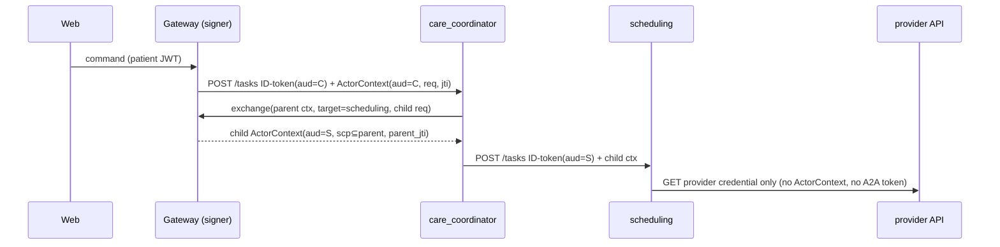

# WS1 — Identity, authorization & A2A trust

**Checklist items closed:** 1.1, 1.5, 1.6, 1.7, 2.1, plus a separate provider-API credential · **Release blockers closed:** B1, B6 · **ADR:** ADR-0043 (proposed)

## 1. Current state (verified)

- **B1 confirmed.** `APP_ENV` defaults to `demo` in `gateway/config.py:236` and again in `compose.yaml:62`. `is_demo` is `{demo,test,ci}` (`config.py:285-290`) and registers token-minting routes that check no credential (`api.py:397-442`). Admin skips patient scoping (`commands.py:1345-1360`) and can book (`api.py:581-600`). One unauthenticated POST gives access to everything.
- **B6 confirmed.** One static bearer with subject `a2a-service` (`agent-runtime/auth.py:104-178`). The gateway (`dispatch.py:205,386`), delegations (`agents/service.py:130-175`) and provider-API calls (`service.py:89-94`, `tools/client.py:135`) all send it.
- **Correction (worse): the mock API checks no credential.** Its only `onRequest` hook is `faults/plugin.ts:40`, so the A2A token sent to it is pure leakage.
- **Correction (worse): the caller can choose the patient.** `drop_untrusted_identity` only feeds tracing (`app.py:204-206,239`). The handler gets the raw request (`app.py:246`), and `require_patient_id` reads `payload["patient_id"]` first (`tools/call.py:233`). The comments at `auth.py:9-12` and `:107-109` ("gateway's signed context") describe things that do not exist.
- **1.1.** The envelope is only schema-validated (`handler.py:521-523`). `ToolGate.check` calls `policy_assert(role, tool, state)` (`tools.py:140-181`) with state from that envelope (`toolbox.py:186-188`). No user is involved.
- **1.6.** The autonomous path uses a synthetic **admin** session: `subject="autonomous-coordinator"`, `patient_ref=None` (`coordination.py:262-272`). Tool records have no actor (`toolbox.py:63-77`). Langfuse drops `user.id` (`llm_tracing.py:90-93`). The kill-switch `by` comes from the request body (`api.py:194,655-657`), not the session.
- **1.7 confirmed.** The gate fails closed (`tools.py:151-180`); the gateway JWT is pinned to HS256 (`auth.py:82-83`).
- **2.1, mechanism corrected.** `?token=` is accepted when `is_demo` (`auth.py:431-437`, `api.py:359-361`). `nginx.conf:44` only proxies `$request_uri`; the leak comes from nginx's default `combined` log format (no `log_format` is defined), which logs `$request` including the query string, and from uvicorn's access log. The patient JWT sits in `sessionStorage` (`main.ts:128`).
- **ADK fact.** `AgentTool` inherits parent plugins (`google/adk/tools/agent_tool.py:260-279`) and merges the child's `state_delta` back into the parent (`:281-289,355-357`). Session state is writable from below, so it cannot hold authority.

## 2. Target architecture

Two credentials travel on every hop, and they answer different questions.

1. **Service identity, "which workload is calling?"** On GCP, a Google OIDC ID token (Workload Identity, `aud` = target URL), checked by Cloud Run IAM and then by the app against `ALLOWED_CALLERS[target_role]`. Locally, `LocalIdTokenProvider` mints ID-token-shaped ES256 JWTs from a per-service dev keyring. Both use one `ServiceIdentityProvider`/`Verifier` interface.
2. **ActorContext, "on whose authority, in which state?"** A compact ES256 JWS in `X-Actor-Context`, minted only by the gateway.

| claim | meaning |
|---|---|
| `iss` `kid` | gateway issuer; key version (alg pinned **per kid** in the keyset, never read from the header) |
| `sub`, `sub_kind` | principal whose authority is used: patient or admin |
| `act` | RFC 8693 actor, present when someone else acts: `{"sub":"system:autonomous-coordinator"}` or the delegating agent. The decoded object exposes `actor_sub`/`actor_kind ∈ {patient,admin,system}` |
| `patient_ref`, `pdid` | patient scope (both identifiers); tools read the patient **only** from here |
| `workflow_id` `command_id` `wst` `sv` | workflow, command, signed workflow state, state version |
| `scp` | scopes (vocabulary below) |
| `aud` | exactly one target role (`agent:care_coordinator`, `agent:scheduling`, …) |
| `req` | SHA-256 of the RFC 8785 (JCS) canonical `payload` (envelope, role input, approval material) |
| `iat` `exp` `jti` `parent_jti` | `exp = min(envelope.deadline + 30 s, iat + 300 s)`; a child's `exp` never exceeds its parent's |

**Verification at each hop.** Service identity first, then the ActorContext: known kid, valid signature, `aud` equal to this role, `exp` within 30 s skew, and `req` equal to the hash of the body received (so the envelope, `allowed_actions` and approval data are tamper-evident). A body `patient_id` that differs from the claim is a 401 plus an audit event. The jti goes into `actor_jti(aud, jti, req, exp)`: same jti and same `req` is an allowed retry; same jti with a different `req` is a refused replay.

**Delegation (RFC 8693-style token exchange).** The coordinator holds no signing key. It calls the gateway's `POST /internal/v1/actor-context/exchange` with its ID token, the parent context, the target role and the child payload digest. The gateway checks that the caller is the `care_coordinator` workload, the target is allowlisted, and the child narrows the parent (same workflow, command, version and pdid; `allowed_actions ⊆ parent`). It signs `scp = parent.scp ∩ ROLE_SCOPE_CEILING[target]` with `parent_jti` set and writes an audit row.

**Autonomous coordinator.** It acts *on behalf of* the patient: `sub` = patient, `act = {sub: system:autonomous-coordinator}`, `actor_kind=system`. Its scopes come from the patient's last consenting command, intersected with `SYSTEM_SCOPE_CEILING`, which excludes `booking:write` unless WS4's approval exists. It no longer has an admin session.

**IdentityPlugin (ADK `BasePlugin`, first in WS3's stack).** The FastAPI dependency verifies the token and sets a `ContextVar[ActorContext]`. `before_run_callback` halts the runner if no actor is set or the actor does not match the session key. `on_event_callback` rejects any `state_delta` that writes `actor:*`. `AgentTool` sub-runners run in the same asyncio task and see the ContextVar; the plugin pushes an attenuated actor (`scp ∩ SUBAGENT_SCOPE_CEILING[name]`) and pops it in `after_run_callback`. WS2's ToolPolicyPlugin calls `ToolGate.check(tool, actor=current_actor())`, which requires `TOOL_SCOPES[tool] ⊆ actor.scp` and checks `policy_assert(role, tool, actor.wst)`.

**Provider API.** It gets its own credential. In production that is a SMART Backend Services `private_key_jwt` key in Secret Manager or KMS; in the demo, a `PROVIDER_API_CREDENTIAL` from the `SecretProvider`, checked in constant time by a Fastify hook. Only roles that call the provider API receive it.

## 3. Key decisions & rejected alternatives

| Decision | Why | Rejected alternative |
|---|---|---|
| Asymmetric ES256 ActorContext; only the gateway holds the private key | A verifier cannot forge, so a compromised specialist cannot mint authority | HMAC: every verifier could mint for every other role, which repeats today's shared-token flaw |
| ES256 locally and on GCP (local file key ↔ Cloud KMS `EC_SIGN_P256_SHA256`) | Local tests exercise the production verification path byte for byte | Ed25519 locally: a second alg, with KMS support not guaranteed in every region |
| Service identity separate from actor identity | Workload authN (IAM-native) and user authorization rotate and fail independently | One token carrying both: no Cloud Run IAM, and it mixes concerns |
| Token exchange at the gateway for delegation | One signer, central audit, scopes provably narrowed | Multi-`aud` token: any recipient could replay it to a sibling (confused deputy). Chained/attenuated tokens (macaroon style): more custom crypto, harder to revoke |
| `req` digest binds the payload | Makes the unsigned envelope and approval data tamper-evident without changing the contract schema | Signing the envelope schema: a contract change across Python and TS |
| jti store keyed `(aud, jti, req)` | Separates an allowed idempotent retry from a replay | Strict single use: breaks the one retry layer (`retries.py`) |
| Identity in a ContextVar, not session state | `AgentTool` writes child state back to the parent (agent_tool.py:355-357) | `tool_context.state["actor"]`: a sub-agent could overwrite it |
| Single-use 30 s SSE ticket | Works with `EventSource`, and the value is worthless after one use | HttpOnly cookie: right for a production BFF (documented), but it needs CSRF handling and breaks the demo's per-tab patient sessions |
| `APP_ENV` required, no default | Production-safe by default | A `demo` default plus documentation: one forgotten env var is B1 |

## 4. Implementation steps

- **S1, profile hardening (B1).** In `config.py`, a missing or unknown `APP_ENV` fails startup. Profiles are `production|demo|test` (`ci` = demo), and `is_demo` becomes `== "demo"`. Demo refuses to start alongside `K_SERVICE`/`CLOUD_RUN_JOB`, `SECRET_PROVIDER=gcp`, an https non-localhost `GATEWAY_URL`, or `SYNTHETIC!=true`. Add a startup banner, a `/healthz` `profile` field and an `X-ReferralEasy-Profile` header. Change `compose.yaml:62` to `${APP_ENV:?}`. Admin JWTs get `scp`; the fixture route mints `admin:read` unless more is requested. Admin reads write an `admin_access` audit row (migration). The kill switch uses `by=session.subject`.
- **S2, SSE ticket (2.1).** Add `POST /v1/workflows/{id}/stream-ticket`, which returns a 30 s ticket stored hashed, bound to sub, workflow and jti, and consumed atomically by `GET …/stream?ticket=`. Delete `allow_query_token`. nginx gets a `log_format` using `$uri`, and uvicorn gets a log filter that redacts `ticket=`/`token=`. The JWT TTL drops to 900 s.
- **S3, ActorContext library.** Add `agent-runtime/.../identity/{claims,signer,keyset,verifier,jti_store}.py` on `joserfc` (already locked via authlib; pin it directly), with `LocalFileSigner` and a sketched `KmsSigner`. `scripts/dev_keys.py` (run by `make demo`) writes git-ignored `secrets/dev/`: the private key goes to the gateway, `jwks.json` to the agents. Add migration `0NN_actor_jti.sql`.
- **S4, mint and verify.** `dispatch.py` and `coordination.py` mint a context per command (the autonomous one is system, on behalf of the patient). `app.py` verifies it and sets the ContextVar. `require_patient_id`/`require_workflow_id` read the actor only. Fix the false comments.
- **S5, delegation exchange.** Add the internal-only gateway exchange route; `HttpDelegation.send` exchanges a token before each POST.
- **S6, IdentityPlugin and gate.** Add `plugins/identity.py` and change the gate to `ToolGate.check(tool, *, actor)`. `roles.py` gets the scope tables. `assembly.py` asserts `include_plugins=True` on every `AgentTool`.
- **S7, service identity and provider credential.** `ServiceIdentityVerifier` plus `ALLOWED_CALLERS` replace `BearerTokenVerifier`. `build_api` uses `PROVIDER_API_CREDENTIAL`, checked by `mock-api/src/http/auth.ts`. Retire `A2A_SERVICE_TOKEN`.
- **S8, attribution (1.6).** `_CallRecord` gains `actor_kind`, hashed `sub`/obo and `jti`. Langfuse `user.id` becomes an HMAC pseudonym (WS5 rule). `requested_by` names the system actor and the patient it acts for.
- **S9, infra sketches.** `infra/terraform/identity/`: a KMS P-256 key with a rotation runbook, one service account per service, `run.invoker` bindings matching `ALLOWED_CALLERS`, signer rights for the gateway only, and the provider credential secret. Only `var.project_id` placeholders.

## 5. Tests that prove it

All of these run in the CI `unit-tests` job (`uv run pytest`) except the vitest file (`pnpm test` in the TS job) and the compose smoke.

| File | Test | Asserts |
|---|---|---|
| `tests/gateway/test_profile.py` | `test_missing_app_env_refuses_start` | `GatewaySettings.from_env({})` raises |
| | `test_demo_with_cloud_run_env_refuses` (negative) | `APP_ENV=demo` + `K_SERVICE` raises |
| | `test_production_has_no_fixture_routes` | `POST /v1/auth/admin-session` → 404 |
| | `test_healthz_reports_demo_profile` | `profile.fixture_auth is True` |
| `tests/gateway/test_admin_scopes.py` | `test_admin_read_scope_cannot_book` (attack) | 403 |
| | `test_admin_read_writes_access_audit` | one audit row |
| | `test_kill_switch_by_is_session_subject` | spoofed `by` → 422 |
| `tests/gateway/test_stream_ticket.py` | `test_query_token_rejected` (attack) | `?token=<valid JWT>` → 401 |
| | `test_ticket_single_use` | second use → 401 |
| | `test_ticket_bound_to_workflow` | another workflow's ticket → 401 |
| `tests/agent_runtime/test_actor_context.py` | `test_expired_rejected` | refused |
| | `test_wrong_audience_rejected` (confused deputy) | refused |
| | `test_alg_from_header_ignored` (`none`/HS256 with the public key as secret) | refused |
| | `test_unknown_kid_rejected` | refused |
| | `test_rotation_old_kid_valid_until_removed` | old kid verifies until removed |
| | `test_tampered_envelope_fails_req_digest` (attack: `allowed_actions` widened) | refused |
| | `test_jti_replay_different_body_rejected` | refused |
| | `test_jti_retry_same_body_allowed` | accepted |
| `tests/agents/test_identity_is_service_supplied.py` (extend) | `test_payload_patient_id_cannot_choose_patient` (attack; **fails today**) | refused |
| `tests/agents/test_delegation_exchange.py` | `test_child_scopes_never_widen` | child `scp` ⊆ parent |
| | `test_specialist_cannot_exchange` (negative) | refused |
| | `test_child_exp_le_parent` | child `exp` ≤ parent `exp` |
| `tests/agent_runtime/test_identity_plugin.py` | `test_run_without_actor_halts` | runner halts |
| | `test_state_delta_writing_actor_rejected` | rejected |
| | `test_agent_tool_subrunner_attenuated` | constraint_analyst cannot call a tool outside its ceiling |
| | `test_include_plugins_false_fails_assembly` | assembly fails |
| `tests/agent_runtime/test_roles_and_tools.py` | `test_gate_requires_scope` | right role and state but no scope → `ToolNotAllowed` |
| `tests/agent_runtime/test_service_identity.py` | `test_unlisted_caller_rejected` | scheduling calling readiness → 401 |
| `services/mock-api/test/auth.test.ts` | `rejects A2A token`, `rejects missing credential` | both refused |
| `tests/agents/test_mock_api_tools.py` | `test_provider_calls_never_carry_actor_or_a2a` | neither header sent |
| `tests/gateway/test_coordination_continuations.py` | `test_autonomous_actor_is_system_obo_patient` | `act.sub` is system, `sub` is the patient, no admin scopes |

## 6. Demo-mode story

`make demo` sets `APP_ENV=demo`, generates the keyring and starts as today; every response says `X-ReferralEasy-Profile: demo`. An admin "Trust" panel shows the profile and kids, and traces show `actor_kind`, the obo pseudonym and `jti` → `parent_jti` chains. `make demo-attacks` shows these refusals:

- the payload-patient-swap message
- the replayed jti
- an `admin:read` booking attempt
- `?token=`

`K_SERVICE=x APP_ENV=demo` shows the startup refusal.

## 7. Dependencies & sequencing

- These land independently: S1, S2, S3, S7 (the provider credential half first), and S8 (except the Langfuse attribute).
- S4 needs S3. S5 needs S4. S6 needs WS3's plugin framework and WS2's ToolPolicyPlugin, which call `ToolGate.check(actor=)`.
- WS4 places approval material in the payload so that `req` covers it, and gates `booking:write`. WS5 owns the pseudonymisation of `sub` in traces. WS7's persistent sessions must not persist the actor (it is per-turn). WS8 gets events `identity.replay_rejected`, `identity.audience_mismatch` and `identity.patient_mismatch` for alerting. ADR-0040 (Cloud Run) is updated by reference.

## 8. Effort & risk

| Slice | Effort |
|---|---|
| S1 | M |
| S2 | S |
| S3 | M |
| S4 | M |
| S5 | M |
| S6 | M |
| S7 | M |
| S8 | S |
| S9 | S |

- **Main risk: clock skew and turn length outliving `exp`.** Mitigated by deriving `exp` from the envelope deadline, the 30 s skew and a long-turn test.
- **Main risk: JCS canonicalisation drift between Python producers.** Mitigated by one helper and golden vectors.
- **Main risk: an extra gateway hop per delegation.** Acceptable because `DELEGATIONS_PER_TURN` is small.
- **Rollback.** Each verifier has a `IDENTITY_ENFORCEMENT=enforce|shadow` switch, and `shadow` is allowed only outside `production`. It logs a refusal but serves, which supports a staged rollout. S1 has no rollback: production-safe by default is the point.

## 9. Portfolio talking points

- "I separated *which workload is calling* (IAM/OIDC ID tokens) from *on whose authority* (a gateway-signed ActorContext). The shared bearer token conflated them, so every agent could impersonate every other agent and choose the patient."
- "Authority only narrows: token exchange at one signer gives `child.scp ⊆ parent.scp`, single audience and a `parent_jti` chain. ADK `AgentTool` sub-runners inherit plugins, and I attenuate there rather than trusting session state, because ADK merges child `state_delta` back into the parent."
- "The `req` digest made a schema-only envelope tamper-evident without a contract change, and `(aud, jti, req)` separates a legitimate retry from a replay."
- "Demo conveniences are opt-in, loud, and refuse to coexist with production signals. The same ES256 code path runs locally with a file key and on GCP with Cloud KMS."
- "Autonomous work is attributed as *system on behalf of patient* (RFC 8693 `act`), never as an omnipotent admin."
