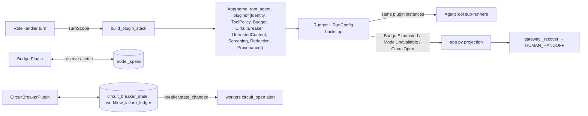

# WS3 — Runtime guard rails: ADK plugin stack, budgets & circuit breaker

**Checklist items closed:** 1.4, 3.1, 3.4, 3.5, 3.7, 3.8, 6.3 (model-error part), B7
**Release blockers closed:** no token or USD cap; delegation budget multiplication (B7); breaker state never published, so the `circuit_open` alert cannot fire
**ADR:** ADR-0045 (proposed): "ADK App plugin stack; BudgetPlugin and CircuitBreakerPlugin; Postgres spend ledger"

## 1. Current state (verified)

**Plugins, budgets and spend**

- **No plugins, callbacks or RunConfig anywhere in the repo.** `build_agent` returns a bare `Agent` (`assembly.py:245-259`). `build_runner` builds `Runner(app_name, agent, session_service)` (`:280-284`). `handler.py:408` calls `run_async` with no `run_config`. The effective cap is therefore `max_llm_calls=500`, or `ADK_MAX_LLM_CALLS` if set (`google/adk/agents/run_config.py:37-52,264`).
- **Global rules live in the tool wrapper.** `ToolSet.invoke` → `governed_tool_call` runs the gate, then the budget lease (`tools/toolbox.py:200-237`, `agent-runtime/tools.py:194-216`). The deterministic workflow path (`workflow.py:20-41`) calls the same `invoke` **without any ADK Runner**.
- **The real model-call cap is `BudgetedLlm`** (`assembly.py:79-128`). It charges before the call and puts a timeout on each attempt. Its caps are global, not per role (`budget.py:96-105`).
- **B7 is confirmed.**
  - In ADK mode, `call_budget=parent.call_budget` (`tools/coordination.py:198`). That is the gateway's original 12/16/8 (`gateway/dispatch.py:334-339`), not what remains.
  - Only the `execution_plan` branch narrows the budget (`:228-247`). Only the `workflow` mode calls `account_remote` (`service.py:193-197`).
  - Worst case is 12 + 8×12 = 108 model calls per coordinator turn. Sub-agents add nothing: they share the turn's `TurnBudget` (`handler.py:336-355`). No test covers this.
- **No token or USD accounting.** `BudgetSnapshot` counts calls only (`budget.py:258-277`). There is no default `max_tokens` (`model.py:161-165`). Usage does reach ADK as `LlmResponse.usage_metadata` (`google/adk/models/lite_llm.py:2972-2982`).

**Loops and errors**

- **No loop or breaker controls.** Repeated identical tool calls are bounded only by the 16-call cap.
  - `FailureLedger.refuse_if_closed` (`recovery.py:226`) is called only from `forbidden.py:505` and `recovery/__main__.py`. It is in-memory.
  - `classify_error.transient_attempts` is filled in by the model (`tools/specs.py:364`, `handoff.py:66-102`).
  - `workers/alerts.py:79-84,249` skips `circuit_open` because nothing publishes breaker state.
- **Retries and time.**
  - Nothing wraps `run_async` in a timeout.
  - `workflow.py:20-41` has its own `150*2**n` retry loop, which contradicts `retries.py:1-26`.
  - **Correction:** LiteLLM `num_retries` defaults to `None` (`litellm/__init__.py:539`), and OpenRouter goes through `base_llm_http_handler`. The effective retry count is already 0, but by accident: no setting and no test pins it.
- **6.3, corrected.** A model 429 is not a crash. `app.py:245-254` catches it, but `project_failure` maps any non-`AgentRuntimeError` to `terminal_error` (`results.py:114-123`). `is_transient` (`retries.py:105-117`) does not recognise LiteLLM exceptions either, so a transient provider error is reported as terminal.

**ADK 2.12.0 behaviour this plan relies on**

- `BasePlugin` has `before/after_run`, `before/after_model`, `on_model_error`, `before/after_tool`, `on_tool_error` and a notify-only `on_run_error` (`plugins/base_plugin.py:114-411`).
- Plugins run in list order, and the first non-None return short-circuits the rest. **An exception raised in a plugin is re-raised as `RuntimeError(...) from e`** (`plugin_manager.py:301-322`).
- `on_model_error` can return an `LlmResponse` that replaces the error (`flows/llm_flows/core/_finalizer.py:373-397`).
- **`AgentTool` passes the parent's plugin *instances*** to its inner Runner (`include_plugins=True`, `tools/agent_tool.py:260-279`, through the deprecated `plugins=` argument). **It also passes `run_config`** (`:292-298`).
- `max_llm_calls` counts per nested invocation, and nested session state is a *copy* (`:281-289`).

**Contract and recovery**

- **3.8:** Agent Cards say `streaming=True` (`cards.py:232`), and `tests/agents/test_agent_cards.py:220` asserts it. Nothing actually streams.
- **3.6 is sound.** A typed failure goes `app.py:245-254` → gateway `_recover` → `HUMAN_HANDOFF` (`gateway/coordination.py:944-983`). The one weakness is that the reason is chosen by string-matching `detail`.

## 2. Target architecture

### Framework

- **New package:** `packages/agent-runtime/src/referraleasy_agent_runtime/plugins/`.
  - `__init__.py`: `PLUGIN_ORDER` and `build_plugin_stack(scope, extra)`. The builder refuses unknown plugins and any other ordering.
  - `scope.py`: a frozen `TurnScope` holding `budget`, `actor` (WS1 `ActorContext`, `None` until WS1 lands), `profile`, `role`, `spend_ledger`, `breakers`, `failure_ledger`, `emitter` and `clock`.
  - `errors.py`, `budget.py`, `breaker.py`, `spend.py` (a ledger port with Postgres and in-memory implementations), and `prices.py`.
- **Per-turn instances.**
  - Runners are already built per turn, so the plugins are built per turn as well and receive the `TurnScope` through their constructor.
  - Plugins read nothing from session state (see D1).
  - Each plugin records the root `invocation_id` in the first `before_run`. A nested `after_run` therefore does not finalise the turn.
- **Assembly.**
  - `assembly.build_app` returns `App(name=service_name(role), root_agent=agent, plugins=...)`, and `build_runner` takes `app=`.
  - `_run` passes `RunConfig(max_llm_calls=tree cap + 2)` as a backstop and wraps the iteration in `asyncio.timeout(budget.remaining_ms())`.
- **Typed exit.**
  - `_run` catches `RuntimeError` and `LlmCallsLimitExceededError`.
  - `unwrap_plugin_error` walks `__cause__` to the first `AgentRuntimeError`.
  - It maps the ADK limit error to `BudgetExhausted(MODEL_CALLS)`.

### BudgetPlugin

- **`before_run`:** checks the deadline.
- **`before_model`:**
  - Checks the turn's token totals.
  - Clamps `llm_request.config.max_output_tokens` to `min(profile, remaining)`. ADK maps this to `max_completion_tokens` (`lite_llm.py:3388`).
  - **Reserves** the worst-case USD cost (input estimate + max output, times the price table) in a single Postgres transaction across three scopes: global day, workflow, turn.
- **`after_model`:** settles the actual cost from `usage_metadata`.
- **On a model error:** releases the reservation.
- **If a reservation is refused:** raises `BudgetExhausted(USD_DAILY | USD_WORKFLOW | TOKENS)` and no call is made.

### CircuitBreakerPlugin

- **Loop breaker (`before_tool`).**
  - Hashes `(agent, tool, canonical_json(args))`.
  - The 2nd identical repeat returns `{"refused": "repeated_call"}` so the model can change course.
  - The next repeat raises `BudgetExhausted(REPEATED_CALLS)`.
- **Endpoint breaker.**
  - Keyed by `model:<id>`, `a2a:<role>` or `mock-api`.
  - Opens after 5 failures in 60 s, stays open for 30 s, then allows one half-open probe.
  - While open, `before_model` refuses fast with `CircuitOpen`.
- **`on_model_error`.**
  - Translates LiteLLM `RateLimitError`, `ServiceUnavailableError` and `Timeout` into `UpstreamTransient(status, retry_after_s)` and records the failure.
  - Makes **one** retry through `retries.run_with_retries`. The retry honours `Retry-After` only if it is at most 2 s and fits inside the deadline.
  - Uses `profile.fallback_model` if one is configured. The fallback is recorded in the release manifest, and its call is charged to the budget.
  - Otherwise raises `ModelUnavailable`.
- **One-way door.**
  - `before_tool` on `delegate_task` calls `FailureLedger.refuse_if_closed(target)`.
  - Tool errors record transient failures in a Postgres-backed ledger.
  - `classify_error` reads the attempt count from that ledger instead of from the model.
- **Publication.** Each transition is upserted to `circuit_breaker_state` and emitted as `breaker.state_changed {endpoint, from, to, opened_at, failure_count}`. That is the fact WS8 needs.

## 3. Key decisions & rejected alternatives

| # | Decision | Why | Rejected alternative |
|---|---|---|---|
| D1 | Build plugin instances per turn and inject a `TurnScope` | The Runner is already per turn. AgentTool shares instances but copies state. | Budget in session state (a nested copy diverges). A ContextVar (implicit, fragile across tasks). |
| D2 | `ToolSet.invoke` and `ToolGate` remain the enforcement point. Plugins delegate to them and add only what ADK alone sees: model calls, tokens, USD, AgentTool calls, loops. | `workflow.py` calls `invoke` with no Runner, so gate logic inside a plugin would leave that path ungoverned. Keeping both also gives defence in depth. | Moving the wrapper into ToolPolicyPlugin (bypassed in workflow mode, or duplicated). |
| D3 | `BudgetedLlm` stays as the meter (count plus per-attempt `asyncio.timeout`). BudgetPlugin becomes the ledger (tokens, USD, output clamp). | Only a wrapper can bound how long the provider call takes. Only a plugin sees request config, usage and errors natively. | Plugin only (no way to bound the call). Wrapper only (no native error recovery). |
| D4 | A two-phase Postgres USD ledger: reserve the worst case, settle the actual. Expired reservations count as spent. Unknown price or unreachable DB means refuse. | Six processes spend concurrently. Reserving first prevents overshooting $10/day, and fail-closed is the owner's rule. | Counters that only settle after the call (concurrent overshoot). Provider dashboard limits (too late, and not demonstrable). |
| D5 | The per-turn token cap is process-local. The per-workflow USD scope covers hops across processes. | Leaves `TaskEnvelope` and the Zod bindings untouched. The workflow scope already sees every hop's spend. | Adding `remaining_tokens` to `call_budget` (contract churn). |
| D6 | B7: always narrow the child's budget to `min(target profile, parent remaining)` and always call `account_remote` | Makes the tree cap real: at most 24, instead of 108. | Lowering the global caps (still multiplies, and starves leaf roles). |
| D7 | `RunConfig.max_llm_calls` is a backstop only | It is ADK-native, but it counts per AgentTool invocation (verified). | The default of 500. |
| D8 | Set the card to `streaming=False`, and test it against the routes actually served | An honest contract. | Building SSE now. If added later, test against google/adk-python#6566 (SSE + `transfer_to_agent` loop) and #5494 (`run_live` silent limit). |
| D9 | Delete the retry loop in `workflow.py` in favour of `run_with_retries`, and pin LiteLLM `num_retries=0, max_retries=0` | One retry owner. | Two backoff curves. |
| D10 | Add a structured `failure_class` (`budget_exhausted`, `model_unavailable`, `circuit_open`) to the projection. `_recover` uses it and stops string-matching. `reason_class` stays `technical_outage`. | Preserves 3.6 with no contract change. | Plugins returning fake final text (fails the schema and hides the cause). |

## 4. Implementation steps

- **S1 Framework.** Add `plugins/{__init__,scope,errors}.py`.
  - In `assembly.py`, add `build_app` and change the runner to take `app=`.
  - In `handler.py:_run`, add the RunConfig, the timeout and the unwrap.
  - The slots reserved for WS1, WS2, WS5, WS6 and WS9 are no-ops until those plugins land.
- **S2 Budget profiles.** Add a `BudgetProfile` per role in `budget.py`. The effective cap is `min(env, profile, inherited)`. Initial values (model calls / tool calls / delegations / input tokens / output tokens):

  | Role | Model calls | Tool calls | Delegations | Input tokens | Output tokens |
  |---|---|---|---|---|---|
  | Coordinator (tree cap) | 24 | 24 | 4 | 60k | 1024 |
  | provider_matching | 12 | 16 | 0 | 40k | 1024 |
  | intake, readiness, coverage | 6 | 8 | 0 | 24k | 1024 |
  | scheduling | 6 | 10 | 0 | 24k | 1024 |

  Also add `CapKind.{TOKENS, USD_TURN, USD_WORKFLOW, USD_DAILY, REPEATED_CALLS}` and record the profiles in the release manifest.
- **S3 B7.** In `coordination.py:197-247`, always narrow the child's declaration. In `service.py:193`, drop the `workflow`-only guard so `account_remote` always runs.
- **S4 Ledger.** Add `migrations/020_model_spend_ledger.sql` with two tables:
  - `model_spend(day, scope, cap_usd, reserved_usd, spent_usd, PK(day, scope))`.
  - `model_spend_event` (workflow, role, model, the token counts, reserved, settled, state, `expires_at`).

  Reserve with one conditional `UPDATE … WHERE spent+reserved+$x <= cap RETURNING` per scope inside a single transaction. Load prices from `config/model_prices.json`; its hash goes into the manifest, and `offline/scripted` costs 0. Settings: `MODEL_BUDGET_USD_DAILY=10`, `_PER_WORKFLOW=0.50`, `_PER_TURN=0.10`, with an event at the 80 % threshold.
- **S5 BudgetPlugin.**
- **S6 CircuitBreakerPlugin.**
  - Add `migrations/021_circuit_breaker.sql`.
  - Make `FailureLedger` Postgres-backed.
  - Remove `transient_attempts` from the `classify_error` spec and handler.
  - Map LiteLLM exceptions in `retries.py`.
- **S7 Retry hygiene.** Set `num_retries=0, max_retries=0` in `build_model` (`model.py:240`). Replace the loop in `workflow.py` with `run_with_retries`; writes and `delegate_task` stay single-attempt.
- **S8 Gateway routing.** Add `failure_class` in `app.py` and map it in `_recover`.
- **S9 Card.** Set `cards.py:232` to `streaming=False` and update the test.
- **S10 Breaker state.** Hand the `circuit_breaker_state` reader contract to WS8, which removes `CIRCUIT_SKIP_REASON`.

## 5. Tests that prove it

**How CI runs them:**
- `uv run pytest` (the `test` job) runs everything below unless it is marked otherwise.
- `integration` tests run in the Postgres job, with `TEST_DATABASE_URL` and an asserted test count.
- `e2e` tests run in the e2e job.

**`tests/agent_runtime/test_plugin_stack.py`**
- `test_plugin_order_is_contract`
- `test_rejects_reordered_or_unknown_plugin` (negative)
- `test_agent_tool_inherits_same_plugin_instances`: a spy plugin sees sub-agent model calls, and the instances are the same object (`is`).
- `test_plugin_error_unwraps_to_typed_outcome`: `BudgetExhausted` becomes `retryable_error`, not `terminal_error`.

**`tests/agent_runtime/test_budget_profiles.py`**
- `test_effective_cap_is_min_of_env_profile_inherited`
- `test_env_cannot_raise_above_profile` (negative)

**`tests/agents/test_delegation_budget.py`**
- `test_adk_child_declaration_is_parent_remaining`
- `test_tree_cannot_exceed_coordinator_cap`: a script attempts 8 delegations × 12 calls; the total stays ≤ 24.
- `test_peer_overreporting_usage_rejected` (negative)

**`tests/agent_runtime/test_budget_plugin.py`**
- `test_max_output_tokens_clamped`
- `test_reservation_refused_makes_no_model_call`: the scripted model's call count is 0.
- `test_settle_uses_usage_metadata`
- `test_unknown_model_price_fails_closed` (negative)
- `test_ledger_unreachable_fails_closed` (negative)

**`tests/integration/test_spend_ledger_pg.py`** (`integration`)
- `test_concurrent_reservations_never_exceed_daily_cap`: 50 parallel reservations, then `spent + reserved ≤ 10.00`.
- `test_expired_reservation_counts_as_spent`

**`tests/agent_runtime/test_circuit_breaker_plugin.py`**
- `test_identical_tool_call_loop_broken`: the 3rd repeat is refused, while the same tool with different args passes.
- `test_breaker_opens_after_threshold_and_half_opens`
- `test_open_breaker_refuses_before_model_call` (negative)
- `test_429_retries_once_honouring_retry_after_within_deadline`
- `test_retry_after_beyond_deadline_fails_fast`
- `test_fallback_model_used_and_charged`
- `test_transition_emits_breaker_state_changed`

**Changes to existing test files**
- `tests/agents/test_recovery_and_failures.py`
  - `test_one_way_door_enforced_on_live_delegate_task`
  - `test_classify_error_ignores_model_supplied_attempts`: the parameter is absent from the tool declaration.
- `tests/agents/test_handler_turn.py`
  - `test_run_async_wrapped_in_turn_deadline`: a hung tool produces `DEADLINE`.
  - `test_runconfig_backstop_maps_to_budget_exhausted`
- `tests/agent_runtime/test_model_factory.py`
  - `test_litellm_retries_pinned_to_zero`
- `tests/agents/test_workflow_execution.py`
  - `test_no_private_backoff_loop`
- `tests/agents/test_agent_cards.py`
  - `test_card_streaming_matches_served_routes`, which replaces the `is True` assertion.

**`tests/e2e/test_exhaustion_to_handoff.py`** (`e2e`, closes 3.7)

Gateway → in-process stack → scripted model. Each asserts `HUMAN_HANDOFF`, a set `coordination_error.class`, and no raw error shown to the patient.
- `test_model_429_storm_ends_in_human_handoff`
- `test_daily_usd_exhausted_ends_in_handoff_without_model_call`
- `test_tool_loop_ends_in_handoff`

## 6. Demo-mode story

- **Defaults.** `make demo` runs with production defaults: the Postgres ledger and a $10/day cap.
  - `SPEND_LEDGER=memory` and `GUARDRAIL_PLUGINS_DISABLED` are accepted only when `APP_ENV=test` and the model is offline.
  - In that mode the service prints a startup banner. It refuses to start if `APP_ENV=production` or a live model is configured.
- **Visibility.**
  - `/healthz` gains `budget: {ledger, daily_cap_usd, spent_usd, reserved_usd}` and `breakers_open`.
  - The ADR-0039 admin read API adds `GET /admin/runtime/guardrails`, showing spend per scope, open breakers and recent refusals.
- **`make demo-chaos`.**
  - Sets `MODEL_BUDGET_USD_DAILY=0.02`. Lowering the cap is always allowed.
  - Adds the mock-api fault profile and a looping `OFFLINE_SCRIPT`.
  - What viewers see:
    - a breaker opening;
    - the `circuit_open` alert in the mock outbox;
    - the Langfuse attributes `budget.usd_reserved`, `budget.tokens` and `breaker.state`;
    - a referral ending in `HUMAN_HANDOFF` with a patient-safe message.

## 7. Dependencies & sequencing

- **S1 lands first and stands alone.** It unblocks WS1, WS2, WS5, WS6 and WS9, whose plugins slot into the reserved positions.
- **WS1:** `ActorContext` populates `TurnScope.actor`; the ledger then records `actor_kind`.
- **WS8:** consumes the `breaker.state_changed` event and the `circuit_breaker_state` table for `circuit_open`, and may add a budget-threshold alert.
- **WS4:** write tools stay single-attempt; `outcome_unknown` is preserved.
- **Order within WS3:**
  - S2, S3, S7 and S9 are independent.
  - S4 comes before S5.
  - S1 comes before S5 and S6.
  - S8 comes after S5 and S6.

## 8. Effort & risk

| Size | Slices |
|---|---|
| M | S1, S4, S5, S6 |
| S | S2, S3, S7, S8, S9, S10 |

**Risks and mitigations**

| Risk | Mitigation |
|---|---|
| The input-token estimate comes in too low | Use chars÷3 as an upper bound, and settle on actual usage. |
| Profiles are too tight for live Haiku turns | Calibrate from `eval-replay` traces before release. |
| AgentTool inherits plugins through a deprecated argument | Pinned by the `is`-identity test. |
| ADK's `RuntimeError` wrapping of plugin exceptions changes | Pinned by the unwrap test. |

**Rollback:** the plugin-disable flag (test profile only). The migrations only add tables.

## 9. Portfolio talking points

- "I put each guard where its information lives. Tool authority stays in the one chokepoint that both execution paths share. Token, USD and model-error policy are ADK plugins. The provider-call timeout stays in the model wrapper, the only seam that can bound the call."
- "I read the ADK source rather than trusting the docs. AgentTool shares plugin instances but copies state, and `max_llm_calls` counts per nested invocation. So the real cap is a tree-wide counter, and `RunConfig` is only a backstop."
- "Spend is reserved before the call and settled after it, in one Postgres ledger with global, workflow and turn scopes. Concurrency cannot overshoot $10/day, and an unknown price or a down ledger means no call is made."
- "Every guard rail leaves through one typed path into the deterministic `HUMAN_HANDOFF`. An end-to-end test drives a 429 storm, an exhausted budget and a tool loop all the way there."
