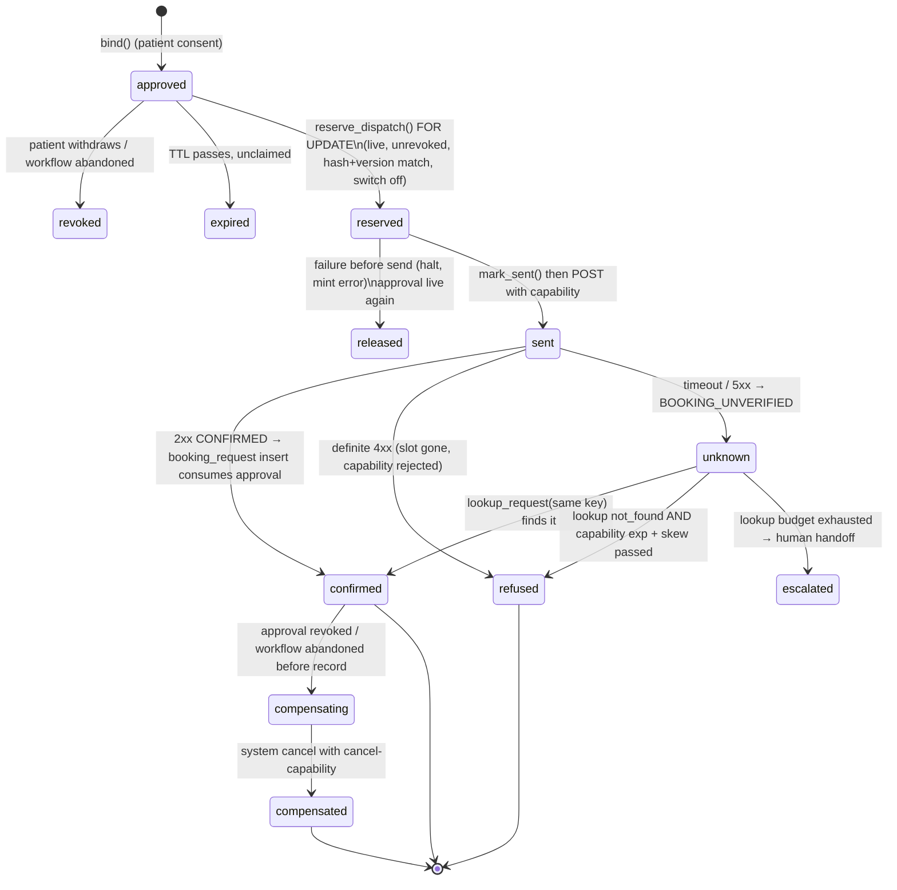

# WS4 — Irreversible side-effect safety: reserve-then-dispatch for hospital bookings

**Checklist items closed:** 5.1 (refusal ⇒ zero POSTs is proven by a test), irreversible cancel/reschedule gating. **Release blockers closed:** B2 (the hospital POST happens before the authoritative approval check), B3 (the hospital API accepts and stores an unverified `approval_id`). **ADR:** ADR-0046 (proposed)

## 1. Current state (verified)

- **Correction:** `prepare_booking` (`commands.py:634-663`) does not mint the approval; `ApprovalService.bind` does (`commands.py:1580`). `prepare_booking` re-runs guardrails and `authorise` (`:649`), then returns an unsigned dict with `"consumed": False` hard-coded (`:661`). The coordinator stores it as `booking_authority` (`coordination.py:605-611`).
- **Correction:** there *is* a DB check before the send, at the wrong moment. `workflow_booking_consent_guard` (`014_align_domain_vocabulary.sql:333-358`) requires `approval_is_live` (`007_approval.sql:186-204`) once, on entering `BOOKING_IN_FLIGHT`. The POST can come much later (continuation retry, crash and resume), and nothing locks or reserves the approval meanwhile. `InMemoryControlState` (`control.py:405+`) has no such guard.
- **`authorise_dispatch`** (`commands.py:615-623`) checks only the kill switch and that an `approval_id` exists: no expiry, consumption, hash or version check. The switch is per process (`killswitch.py:14-18`).
- **The agent check** `check_approval` (`tools/scheduling.py:120-213`) validates that self-describing snapshot, with no DB lookup. Whether the agent writes at all depends on a caller-supplied flag: `workflow.py:117` writes when `reconcile_only` (`coordination.py:78`) is falsy. The POST is at `tools/scheduling.py:298`.
- **The authoritative check comes after the effect.** `book()` re-runs `authorise` (`commands.py:1217`, which includes expiry), then `record_booking` (`:1238`). The 008 trigger consumes the approval only if `expires_at > now()` (`008_booking_request.sql:80-109`), and `UNIQUE(approval_id)` applies (`:58`). So an approval that expires during a slow hospital call makes `book()` refuse, leaving an orphan appointment. Two racing dispatchers both POST, saved only by the hospital's dedupe on the shared idempotency key.
- **"Revoked" does not exist yet.** The `approval` table (`007_approval.sql:27-62`) has no revocation column. WS4 introduces it.
- **B3 is confirmed.** `approval_id` is `uuidValue.nullish()` in the request (`mock-api/src/contracts/zod.ts:410`; response `:330`) and stored as `?? null` (`booking/service.ts:247`, `:572`). `app.ts:77-89` has no auth hook, so the agent's bearer token (`tools/client.py:135`) is never checked.
- **Cancel and reschedule** (`tools/scheduling.py:342`, `:370`) are gated only by policy rows (`014_…sql:304-305`). The coordinator never calls them; only a tool call to the Scheduling agent can.
- **5.1 is confirmed:** the only pre-send test covers the kill switch (`tests/gateway/test_coordination_continuations.py:398-414`).
- **Kept:** `command_dedup`; `UNIQUE(approval_id)`; the key `_id(workflow, approval)` (`coordination.py:609`); `booking_sent` written before the send, so a resend becomes a lookup (`:846-849`); timeout → `BookingOutcomeUnknown` (`tools/scheduling.py:416-439`) → reconciliation that never mints a new key (`workers/reconcile.py:206+`); outbox dedupe.

## 2. Target architecture

The approval is **claimed in Postgres before any external call**. Claiming means locking the approval row and inserting a `booking_dispatch` row in one transaction. The claim produces a **dispatch capability**: a short-lived, single-use JWS. It is the only thing that lets an `/appointments` write through. The Scheduling agent forwards the capability but cannot mint one. The hospital API verifies it and records its `jti`. Recording the outcome checks against the *claim*, not against the approval's expiry, so a slow hospital can no longer create an orphan.

**Capability claims** (`typ=re-dispatch+jwt`, EdDSA, `kid` from WS1's key infrastructure under a separate `purpose=dispatch`):

| Claim | Value |
|---|---|
| `iss` | `gateway` |
| `aud` | `hospital:<hospital_id>` |
| `sub` | `workflow_id` |
| `act` | `book`, `cancel` or `reschedule` |
| bound to | `approval_id`, `payload_hash`, `idempotency_key`, `booking_request_id` (cancel/reschedule only) |
| `jti` | `booking_dispatch.id` |
| `exp` | `iat + 120s` |

**Hospital-side verification:** check the signature, `aud` and `exp`; check that the canonical body hashes to `payload_hash` and that `approval_id` and `idempotency_key` match the claims; record the `jti` under `UNIQUE(jti)`. The same `jti` with the same key is an idempotent replay; with a different key it is a 409.

The capability is **not** WS1's ActorContext. ActorContext authenticates *who* asks an agent, is reused across hops, and has an agent role as `aud`. The capability authorises *one effect* at a third party, which gets no patient-actor claims.

## 3. Key decisions & rejected alternatives

| Decision | Why | Alternative rejected and why |
|---|---|---|
| Two-phase reserve-then-dispatch in Postgres (`SELECT … FOR UPDATE` on `approval`, then insert `booking_dispatch`) | Check and claim in one transaction: no time-of-check/time-of-use gap and no double dispatch. The DB already owns these rules (007/008/014). | **Re-check liveness in `authorise_dispatch` only:** still not atomic, because two replicas can both pass. |
| A new `booking_dispatch` table rather than a status column on `approval` | `approval` is immutable consent evidence (`approval_no_rebinding`, `007…sql:146-171`); dispatch has its own lifecycle. A partial `UNIQUE(approval_id) WHERE status <> 'released'` allows one live claim. | **`approval.status` enum:** mixes the patient's consent with system retries and would require loosening the immutability trigger. |
| Recording checks against the claim, not expiry. 008's consume trigger accepts an approval that holds a `sent` or `unknown` claim even after `expires_at`. | An approval that was valid at reservation time authorised the send. Refusing to record afterwards creates the orphan. | **Longer TTL:** narrows the window but does not close it. |
| Signed single-use capability, verified by the hospital | The agent is LLM-adjacent; its check is defence in depth, not authority. The external system refuses unauthorised effects itself. | **Gateway calls the hospital directly:** strongest guarantee, but pulls scheduling out of the specialist against ADR-0041's A2A topology; kept as the fallback for hospitals that cannot verify JWS. **Saga/outbox-only:** an outbox makes delivery reliable, not authorised, and compensation means a real slot is briefly held. |
| Capability `exp` = 120s bounds the in-doubt window | After `exp + skew`, a `not_found` lookup is definitive, since the hospital would refuse a late arrival. So `unknown → refused` is safe. | **An unbounded unknown state:** reconciliation could never conclude "not booked" without a human. |
| No permissive mode in the hospital API | Production-safe by default; tests mint with a test key. | **`MOCK_API_CAPABILITY_MODE=off` for the demo:** it would be the bypass that ships. |
| Cancel is irreversible (it releases a slot someone else may take). It needs a patient approval with `action='cancel'`, bound to `booking_request_id`. Reschedule needs a book approval for the new payload; the old booking is cancelled under the same reschedule capability. | Same class of effect as booking. | **Policy row only (today):** an injected tool call could cancel an appointment. Until the gateway has a patient cancel flow, no capability is minted, so the tools are deny-by-default. |

## 4. Implementation steps

- **S1. Pin the gap with failing tests first.** Add the §5 "zero POSTs" tests marked `xfail(strict=True)`. They flip to passing in S3.
- **S2. Migration `020_booking_dispatch.sql`.**
  - Add `approval.revoked_at` and `revoked_by` (non-binding columns). Extend `approval_no_rebinding` so revocation is one-way.
  - Add the `booking_dispatch` table: `id`, `approval_id` (FK), `workflow_id`, `payload_hash`, `idempotency_key` (UNIQUE), `status` CHECK, `capability_expires_at`, `sent_at`, `settled_at`, `external_ref`, `actor_sub` (from WS1 ActorContext). Add the partial unique index on `approval_id`.
  - Add `reserve_dispatch(workflow_id, approval_id, expected_state_version, ttl)` (plpgsql). Under `FOR UPDATE` on the approval and workflow it requires: not consumed or revoked; `expires_at > now() + ttl`; hash = `workflow_booking_payload_hash`; consent version matches; state `BOOKING_IN_FLIGHT`; `booking_halt.engaged = false`. It inserts or returns the claim, or raises `RE004` naming the reason.
  - Add a single-row `booking_halt` table so the kill switch is shared across replicas.
  - Update `approval_is_live` so an approval with a live claim is not live for other paths.
  - Update the 008 consume trigger so it requires a matching claim in `sent` or `unknown`, and drop its expiry check *only* when such a claim exists.
- **S3. Gateway.**
  - In `commands.py`, replace `authorise_dispatch` with `reserve_dispatch(row) -> DispatchGrant(claim, capability)`. Add `ApprovalLedger.reserve/mark_sent/settle/release` to both ledgers (`approval.py`), with in-memory parity under the existing `RLock`.
  - `prepare_booking` drops `consumed` and stops shipping the snapshot as authority. `book()` verifies the claim instead of re-running `authorise`, and settles it in the `record_booking` transaction.
  - `_book` (`coordination.py:840-865`) calls `reserve_dispatch`, derives `booking_sent` from the claim status, passes `dispatch_capability` instead of `reconcile_only`, and calls `release` on a halt or error before `mark_sent`.
  - `killswitch.py` gets a `PostgresKillSwitch` behind the existing `engage`/`release` seam.
- **S4. Capability signer.** Create `packages/agent-runtime/src/referraleasy_agent_runtime/capability.py` (`mint_dispatch_capability`, `inspect_capability`) on WS1's `KeyProvider`/JWKS with a `purpose=dispatch` key. Locally the keys are file-backed under gitignored `.secrets/` (`make keys`); the GCP sketch `infra/terraform/kms_dispatch_key.tf` uses Cloud KMS `EC_SIGN_ED25519` with placeholders only.
- **S5. Scheduling agent.**
  - `create_booking` requires a capability in `call.payload` and sends it as `Authorization: ReDispatch <jws>` alongside the service token.
  - `check_approval` becomes `check_capability`: an unverified decode that checks only that the hash and key match. The authority is the hospital.
  - In `workflow.py:117`, a write happens only if a capability is present; otherwise the agent does a lookup. This removes the `reconcile_only` trust.
- **S6. Hospital API (mock).** Add `src/auth/capability.ts`, a Fastify `onRequest` hook on `POST /appointments*` using `jose` and a read-only JWKS mount, plus a service-token check on every route (B3). Make `approval_id` required (`zod.ts:410`) and equal to the claim; add a `capability_jti` table to `db/database.ts`; regenerate contracts.
- **S7. Workers: orphan compensation.**
  - Add `referraleasy_workers/compensate.py`. It sweeps `booking_dispatch` rows in `sent` or `unknown` older than `exp + skew`, and confirmed hospital appointments whose workflow is revoked or abandoned. It mints a system `act=cancel` capability (WS1 `actor_kind=system`, reason `compensation`) and cancels.
  - Emit `booking.orphan_compensated` and `booking.dispatch_escalated` for WS8 alerts.
- **S8. Cancel/reschedule gating.** Add `approval.action` (default `book`) in 020; the cancel and reschedule tools require a capability with a matching `act`; WS2's binding supplies `booking_request_id` ownership.
- **S9. ADR-0046** and an update to `docs/runbooks/` with an "unknown booking outcome / orphan" section.

## 5. Tests that prove it

Each control has a positive test and at least one negative or attack test.

| Test | Asserts |
|---|---|
| `tests/gateway/test_dispatch_refusal.py::test_gateway_refusal_means_zero_posts_to_appointments[halted\|expired\|revoked\|consumed\|hash_drift\|version_drift]` | A real `CoordinationService._book` runs against a counting fake hospital (`httpx.MockTransport`). Each refusal raises `RE004` or `BookingHalted`. **POST count == 0**, the claim is absent or `released`, and `booking_sent` is unset. **This closes 5.1.** |
| `tests/gateway/test_dispatch_refusal.py::test_concurrent_dispatch_posts_once` | Two threads `_book` the same workflow. There is exactly one POST, and the second becomes a lookup. |
| `tests/gateway/test_dispatch_refusal.py::test_expiry_between_send_and_record_does_not_orphan` | The clock advances past `expires_at` after the POST. `book()` records `CONFIRMED`. This is a negative test of today's behaviour, which refuses. |
| `migrations/tests/test_booking_dispatch.py::test_reserve_is_exclusive_under_for_update` | Two connections call `reserve_dispatch`. One wins, the other gets the existing claim and no second row. |
| `migrations/tests/test_booking_dispatch.py::test_booking_request_insert_without_claim_is_refused` | Attack test: inserting a booking directly with a live approval but no claim fails with `RE004`. |
| `migrations/tests/test_booking_dispatch.py::test_revocation_is_one_way` | Setting `revoked_at = NULL` again fails. |
| `migrations/tests/test_booking_dispatch.py::test_halt_row_blocks_reserve_from_any_session` | Engaging the halt in one session makes `reserve_dispatch` in another session fail. |
| `tests/agents/test_booking_capability.py::test_create_booking_without_capability_never_posts` | No capability means zero POSTs and a `NoApprovalRefused` error. |
| `tests/agents/test_booking_capability.py::test_reconcile_only_false_cannot_force_a_write` | Attack test: an injected `reconcile_only: false` without a capability results in a lookup only. |
| `services/mock-api/test/capability.test.ts` | **401:** missing capability, forged signature. **403:** wrong `aud` (another hospital), expired, `payload_hash` mismatch, `approval_id` mismatch, `act=cancel` used on create. **409:** a reused `jti` with a different key. **Accepted:** a same-`jti`, same-key replay returns `idempotent_replay: true`. **401:** no service token on a read. |
| `tests/workers/test_orphan_compensation.py::test_orphan_is_cancelled_and_alerted` | An orphan is cancelled and the event is emitted. |
| `tests/workers/test_orphan_compensation.py::test_compensation_never_cancels_a_recorded_booking` | Negative: a booking that was recorded is never cancelled. |
| `tests/e2e/test_scripted_booking.py::test_revoked_approval_creates_no_appointment` | Against compose, revoking the approval mid-flight leaves the hospital `GET /appointments` count unchanged. |

**How CI runs these:**
- The `unit-tests` job runs the in-memory profile. Postgres-only tests skip there.
- `integration-tests` (real PostgreSQL 18.6) runs `migrations/tests` and the Postgres profile of `test_dispatch_refusal.py`.
- `js-checks` runs vitest.
- The `e2e` job runs the scripted journey.

## 6. Demo-mode story

`make demo` is unchanged for the happy path. Compose mounts the gateway's generated dispatch JWKS into `mock-api` read-only. There is no bypass flag, so the demo runs the production control.

The demo shows the control in four places:
- **Admin page:** a "Dispatch claims" panel lists each claim's status, `jti`, expiry and settlement. With the kill switch engaged, it shows a refused claim and POST count 0.
- **Scenario:** fixture `expired_approval_mid_flight` (existing fault-plugin pattern) tells the patient "Your approval expired before we contacted the hospital. Nothing was booked. Approve again?". The trace has `booking.dispatch.reserve` with `outcome=refused reason=approval_expired` and no `POST /appointments` span.
- **Forged capability:** a `curl` against `mock-api` returns 403 `capability_signature_invalid` (README walkthrough).
- **`/healthz`** reports `dispatch_capability: enforced` and the key `kid`.

## 7. Dependencies & sequencing

- **WS1 (ActorContext, KeyProvider/JWKS).**
  - S4 needs WS1's key infrastructure.
  - If WS1 lands later, S4 ships a minimal file-backed Ed25519 `KeyProvider` behind WS1's interface name, and WS1 replaces the body later.
  - `actor_sub` on the claim comes from ActorContext. Until then it is `system:coordinator`.
- **WS2.** S8 depends on WS2's booking ownership binding (`booking_request_id` ↔ `patient_ref`) and on ToolPolicyPlugin for tool-level deny.
- **WS3.** No hard dependency. The capability check is a tool precondition, not a plugin, because it must hold even if the plugin stack is misconfigured.
- **WS8.** Consumes `booking.orphan_compensated` and `booking.dispatch_escalated` (alert: any orphan is a page).
- **Lands independently:** S1, S2, S3 (in-memory and Postgres), S6's service-token half, S7.
- **Order:** S1 → S2 → S3 → S4 → S5 + S6 (one PR, so the contract changes atomically) → S7 → S8.

## 8. Effort & risk

| Slice | Size | Main risk | Rollback |
|---|---|---|---|
| S1 | S | — | Delete the tests |
| S2 | M | Changing the 008 trigger semantics breaks the existing `test_booking_once.py` | Additive migration. The down-script restores the 008 function. |
| S3 | M | In-memory/Postgres parity drift | The existing parity tests plus the new ones |
| S4 | S | Key handling leaks into the repo | gitleaks and `check_public_release.py` already gate this |
| S5+S6 | M | Contract drift between Python and TS | The `contracts-drift` job, and both sides in one PR |
| S7 | M | A compensation cancels a legitimate booking | A recorded-booking guard plus the negative test. Ships with `dry_run` that logs and alerts only, flipped after one green e2e cycle. |
| S8 | S | Blocks cancel/reschedule entirely until the gateway has a patient flow | Intended: deny-by-default |

The main cross-cutting risk is clock skew in the capability `exp`. Mitigations: `nbf`/`exp` leeway of 10s, and the `refused`-after-unknown rule uses `exp + 2×leeway`.

## 9. Portfolio talking points

- "The check that authorises an irreversible effect must be atomic with a *claim* on the authority, and must happen before the effect. Validating after the POST is auditing, not authorising."
- "I separated consent (immutable evidence) from dispatch (an operational lifecycle). That let me keep the DB's one-way consumption invariant and still release a claim that never left the building."
- "The capability's 120-second expiry turns 'unknown' into a bounded state: after it lapses, a not-found lookup is proof, so reconciliation can conclude without a human."
- "Defence in depth puts authority at the edge. The LLM-adjacent agent forwards a capability it cannot mint, and the external system verifies it. A prompt-injected tool call has nothing to sign with."
- "Compensation is the last line, not the design. The orphan sweeper exists, and any orphan it cancels pages someone."
