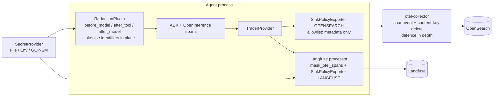

# WS5 — Secrets management & telemetry redaction

**Checklist items closed:** 2.2 (regression-locked), 2.3, 2.4, 2.5, 6.4 **Release blockers closed:** B8 **ADR:** ADR-0047 (proposed)

## 1. Current state (verified)

- **Denylist, not allowlist.** `DEFAULT_REDACT_KEYS` (`packages/telemetry/src/referraleasy_telemetry/masking.py:75-106`) lists `gen_ai.prompt/completion` and `llm.prompt/response`. It does not list OpenInference's `input.value`, `output.value`, `llm.input_messages.*` or `llm.output_messages.*`, or ADK's `gcp.vertex.agent.{llm_request,llm_response,tool_call_args,tool_response}`. The only other protection is the regex scrub at `:123-137`.
- **One provider, two sinks.** `configure_llm_tracing` attaches Langfuse *and* `GoogleADKInstrumentor` to the provider built at `telemetry/setup.py:217-241` (`llm_tracing.py:440-463`). OpenInference content spans therefore also reach `OTLPHTTPJSONSpanExporter`, and from there OpenSearch. ADK's own capture is **on by default** (`google/adk/telemetry/context.py:133-135`, `ADK_CAPTURE_MESSAGE_CONTENT_IN_SPANS` defaults to `'true'`), so OpenSearch receives prompt text even when Langfuse is off. The audit understated this.
- **Span events go out unmasked.** `export.py:244-250` encodes `event.attributes` raw. Links (`:254-258`) have the same gap.
- **Exceptions are recorded twice, both times raw.** `middleware.py:130` calls `span.record_exception`. Also, `use_span(span, end_on_exit=True)` at `:115` keeps OTel's default `record_exception=True` (`opentelemetry/trace/__init__.py:588`). Fixing only line 130 would leave the second copy. The collector rules (`infra/otel/otel-collector-config.yaml:61-98`) have no `spanevent` context.
- **Langfuse is regex-only.** Content is captured deliberately (`llm_tracing.py:25-30`). `_mask_otel_spans_with` (`:251-279`) patches **attributes only**: `OtelSpanPatch` has only `delete_attributes`/`set_attributes` (`langfuse/types.py:167`). Span events cannot be masked through that hook. The turn observation ships the whole payload as `input` (`:369`).
- **The pseudonym is unkeyed.** `pseudonymise` uses plain SHA-256 (`masking.py:54-69`), and so does the collector's OTTL `SHA256` (`:79-81`). A low-entropy MRN can be reversed with a dictionary. That is pseudonymisation in name only.
- **No hide defaults.** Nothing sets `OPENINFERENCE_HIDE_*` and no `TraceConfig` is passed. `instrument()` accepts `config=` (`openinference/instrumentation/google_adk/__init__.py:48`) and every default is `False` (`config.py:122-131`).
- **Secrets come from plain env.** `env_file: *app-env-file` (`compose.yaml:83,112,356…`) supplies them. The DB password is a literal inside `DATABASE_URL` (`compose.yaml:63`) and `POSTGRES_PASSWORD` (`:150`).
- **Some settings leak secrets in `repr`.** `GatewaySettings` is a plain `@dataclass(frozen=True, slots=True)` (`config.py:105-168`), so its auto-`repr` prints `patient_secret`, `admin_secret`, `a2a_service_token` and `database_url`. `referraleasy_rag.Settings.openrouter_api_key` is a plain `str` (`rag/config.py:93`). Two classes are already safe: `AgentSettings` uses `SecretStr` (`settings.py:59,105`), and guardrails uses `repr=False` (`guardrails/config.py:141`).
- **The placeholder guard is partial.** The gateway refuses `CHANGEME` JWT secrets outside demo (`config.py:190-209`), but not `A2A_SERVICE_TOKEN`. `.env.example:132-133` gives patient and admin the *same* placeholder key. `APP_ENV` falls back to `"demo"` when unset (`config.py:236`), so the default is *fail-open*.
- **CI covers the repo, not the runtime.** gitleaks scans history (`ci.yml:52-75`). `check_public_release.py` checks paths only, not token shapes. `test_masking.py` uses synthetic attribute maps. The planted-value test (`test_pipeline_live.py:292-320`) is `integration`-marked and needs collector + OpenSearch. The integration job (`ci.yml:192-266`) has only Postgres, so that test never runs in CI.
- **2.2 needs a correction.** `_open_session` seeds only `workflow_id/command_id/workflow_state` (`handler.py:373-381`). But `candidate_researcher`/`constraint_analyst` write **model output** into the same state via `output_key` (`subagents.py:191,207`). So state is not limited to three keys, and the regression test must cover those keys too.

## 2. Target architecture

Policy is **per sink and allowlist-based**. Content is reduced at the **ADK boundary**, before any instrumentor records it. Secrets come from **one interface** with file-mount semantics that are identical in compose and Cloud Run.



- **OpenSearch sink:** metadata only. Allowed keys come from an explicit list (`http.*`, `url.path`, `workflow.id`, `a2a.*`, `event.*`, `gen_ai.usage.*`, `gen_ai.request.model`, `llm.token_count.*`, `openinference.span.kind`, `tool.name`, `error.type`, `exception.type`, `exception.fingerprint`, `referraleasy.*`). Every other key is dropped. Each drop is counted in `referraleasy.redaction.dropped`. Events and links go through the same policy.
- **Langfuse sink:** content is allowed. Every content value has already been through a `Deidentifier` that replaces identifiers with deterministic tokens: HMAC-SHA256 under `TELEMETRY_PSEUDONYM_KEY`, rendered `⟦email:3f9a1c⟧`. Equal values give equal tokens, so a reviewer can follow one patient through a trace without seeing them. Secret-shaped keys are denied on this sink too.
- **Production profile:** `ADK_CAPTURE_MESSAGE_CONTENT_IN_SPANS=false`, `TraceConfig(hide_inputs=True, hide_outputs=True)` unless a DLP-backed `Deidentifier` is configured, stack traces never exported, and `SecretProvider=file`. **Demo profile:** content captured and tokenised by the regex `Deidentifier`, a startup banner, `/healthz` showing `telemetry.content_capture: "tokenised-demo"`, and a refusal to start if `APP_ENV` is production-like.
- **GCP design (ADR-0040 extension):** secrets are mounted as Cloud Run **volume** files from Secret Manager. Reading a volume fetches the current version, so rotation works without redeploy. The production `Deidentifier` is Sensitive Data Protection `CryptoDeterministicConfig` with a KMS-wrapped key. Infra sketches go in `infra/gcp/secrets.tf.example` and `infra/gcp/dlp.tf.example` with `var.project_id` placeholders only.

## 3. Key decisions & rejected alternatives

| Decision | Why | Alternative rejected |
|---|---|---|
| Per-sink **allowlist** (`SinkPolicy`) | Each new instrumentor version adds new content keys (`input.value` arrived unannounced). A denylist fails open on every upgrade. | Add the missing keys to `DEFAULT_REDACT_KEYS`. That fixes today and fails again on the next upgrade. |
| Reduce content at the ADK boundary with `RedactionPlugin` | Instrumentors record whatever the request holds. Tokenising before `call_llm` means no sink, and not the model provider either, sees raw identifiers. | Mask only at export. Then the content still reaches OpenRouter and every exporter needs perfect rules. |
| Plugin **mutates in place and always returns `None`** | ADK's `PluginManager._run_callbacks` exits early on the first non-`None` value (`plugin_manager.py:301-315`). A returned dict would skip `ProvenancePlugin` (WS9). | Return a replacement result. That silently disables later plugins. |
| One-way tokens, no detokenisation in the agent path | The schemas already forbid name, DOB and phone (`schemas.py:226,256`), and tools resolve identity from WS1 `ActorContext.patient_ref`. The model never needs a real identifier, so no reverse vault is needed. | A token vault in session state. That would put PHI in persisted state and contradict 2.2. |
| Keyed HMAC pseudonyms; the collector **deletes** identifiers instead of hashing them | Unkeyed SHA-256 of an MRN can be reversed by dictionary. If a raw identifier reaches the collector, it is a bug to drop and count, not something to hash. | Keep the SHA-256 that matches the collector. Rejected because it is reversible. |
| `SecretProvider` with **file** semantics as the production path | Compose `secrets:` and Cloud Run volume mounts are both files, so the code is the same locally and in GCP, and volume reads pick up rotation. | Call the Secret Manager API from the app. That adds a network dependency on boot plus IAM, and a local stub is less faithful. |
| `TraceConfig` passed in code from the profile; env can only **hide more** in production | A forgotten env var must not turn capture on. | Rely on `OPENINFERENCE_HIDE_*` in `.env`. That fails open. |
| Canaries **minted at test runtime** | gitleaks would flag a committed fake key, and an allowlist entry for it would create a blind spot. | Fixed canary strings in fixtures. |

## 4. Implementation steps

- **S1 — `SinkPolicy` + event/link masking.**
  - `packages/telemetry/src/referraleasy_telemetry/sinks.py`: add `SinkPolicy(allowed_keys, allowed_prefixes, content_keys, deidentifier)` plus `OPENSEARCH_POLICY` and `LANGFUSE_POLICY`.
  - `export.py:225-260`: apply the policy to attributes, `events[*].attributes` and `links[*].attributes`.
  - `setup.py:222`: pass `policy=OPENSEARCH_POLICY`.
  - Keep `MaskingPolicy` as the value-scrub layer underneath.
- **S2 — Exception sanitisation.**
  - `masking.py`: add `record_sanitised_exception(span, error, profile)`. It records `exception.type` and `exception.fingerprint` (sha256 of the type plus the top frame `module:lineno`). In demo it also records a scrubbed message truncated to 256 characters; it never records a stack trace.
  - `middleware.py:115`: change to `use_span(..., record_exception=False)`.
  - `middleware.py:130`: call the helper instead of `span.record_exception`.
  - Add a `RedactingLogFilter` on the root logger that scrubs `msg`, `args` and `exc_text`. It is installed in `configure_telemetry`.
- **S3 — Collector defence in depth.** In `otel-collector-config.yaml`, add `delete_matching_keys` for the content-key regex, a `spanevent` context that drops `exception.stacktrace` and scrubs `exception.message`, and identifier `delete_key` in place of `SHA256`. Document why in the file.
- **S4 — Keyed pseudonymisation + `Deidentifier`.**
  - `masking.py`: `pseudonymise(value, key)` uses HMAC.
  - New `packages/telemetry/.../deidentify.py`: a `Deidentifier` protocol with `RegexDeidentifier` (local) and a `SdpDeidentifier` stub (design-only, behind an extra).
  - Update `test_the_pseudonym_matches_the_collectors_sha256` to assert the opposite: no raw identifier reaches the collector.
- **S5 — `RedactionPlugin`.** `packages/agent-runtime/src/referraleasy_agent_runtime/plugins/redaction.py`:
  - `before_model_callback` tokenises `llm_request.contents` text parts in place.
  - `after_tool_callback` tokenises `result` in place.
  - `after_model_callback` tokenises `llm_response.content` in place.
  - Every hook returns `None`.
  - The plugin is registered in WS3's `App(plugins=[…])` stack in its reserved slot.
- **S6 — Capture defaults by profile.**
  - `llm_tracing.py:457`: `instrument(tracer_provider=…, config=trace_config_for(profile))`.
  - Construct Langfuse with `span_exporter=SinkPolicyExporter(OTLPSpanExporter(...), LANGFUSE_POLICY)`. Langfuse wraps it inside `LangfuseTransformingSpanExporter` (`span_processor.py:132-136`), so events can finally be masked.
  - The turn observation `input` (`:369`) goes through the `Deidentifier`.
  - Production sets `ADK_CAPTURE_MESSAGE_CONTENT_IN_SPANS=false` before ADK import.
  - The offline gate (`:126`) is relaxed only for an **injected in-memory exporter**, which makes no network call, so tests can drive it.
- **S7 — `SecretProvider`.** New package `packages/secrets/src/referraleasy_secrets/`:
  - `SecretName` enum: `JWT_PATIENT_SECRET`, `JWT_ADMIN_SECRET`, `A2A_SERVICE_TOKEN`, `ACTOR_CONTEXT_SIGNING_KEY` (WS1), `OPENROUTER_API_KEY`, `LANGFUSE_SECRET_KEY`, `DATABASE_PASSWORD`, `TELEMETRY_PSEUDONYM_KEY`, `EVAL_SAMPLE_SEED`.
  - `SecretProvider.get(name) -> SecretStr` and `.get_versions(name) -> (current, previous|None)`.
  - Providers: `FileSecretProvider` (`/run/secrets/<name>[.previous]`, 60 s TTL cache), `EnvSecretProvider` (demo only, refuses outside demo) and `GcpSecretManagerProvider` (sketch, optional extra).
  - `from_profile()` picks the provider and fails closed when `APP_ENV` is unset.
- **S8 — Wire consumers & `SecretStr` everywhere.**
  - `GatewaySettings`: secret fields become `SecretStr`, and `database_url` is split into a URL with no password plus `DATABASE_PASSWORD`.
  - `rag/config.py:93` gets `SecretStr`.
  - LiteLLM receives `api_key=` explicitly instead of reading env (`model.py:228-236`).
  - The placeholder guard extends to every `SecretName`, including `A2A_SERVICE_TOKEN`, and refuses identical patient and admin keys.
- **S9 — Compose & infra.**
  - `compose.yaml`: add top-level `secrets:` from `.secrets/*` (gitignored), `POSTGRES_PASSWORD_FILE` and an `x-app-secrets` anchor. `make secrets` (`scripts/generate_local_secrets.py`) writes random values. The `demo` profile may still use the env fixtures.
  - `infra/gcp/secrets.tf.example`: one `google_secret_manager_secret` per name, a `secretAccessor` per service account per secret (least privilege), Cloud Run `volumes { secret {...} }`, and Cloud SQL IAM auth so production has no DB password.
- **S10 — Canary CI + leak scanners.**
  - New `tests/security/` (see §5).
  - New `ci.yml` job `telemetry-canary`.
  - Extend `check_public_release.py` with token-shape scanning (JWT, `sk-…`, PEM headers, 40+ hex) over tracked files. Its output names only the file and line, never the value.

## 5. Tests that prove it

| Test | Asserts (negative case in bold) |
|---|---|
| `tests/telemetry/test_sink_policy.py::test_unknown_key_is_dropped_on_opensearch` | **A new key `input.value` holding a prompt is absent** from the encoded span, and `dropped` is incremented. |
| `…::test_every_admin_query_field_is_allowlisted` | Every field `query.py` reads is in `OPENSEARCH_POLICY`. This guards against an allowlist that breaks the admin pages (ADR-0039). |
| `…::test_span_event_attributes_are_masked` / `test_link_attributes_are_masked` | **A planted JWT in an event or link attribute** is not in the payload. |
| `tests/telemetry/test_exception_sanitising.py::test_raised_secret_never_exported` | A route raises `ValueError(f"token={canary}")`. The OTLP payload has `exception.type` and **no canary and no `exception.stacktrace`**. It fails today because `use_span` records the exception too. |
| `tests/telemetry/test_masking.py::test_pseudonym_requires_key` | Two keys give different tokens. **Unkeyed `sha256(mrn)` does not equal the exported token.** |
| `tests/agents/test_redaction_plugin.py::test_tokenised_before_call_llm` | A real `Runner` with the offline model and an in-memory exporter. The request content has `⟦email:…⟧`, and **the raw email appears in no span (including the `call_llm` span)**. |
| `…::test_redaction_never_short_circuits` | Every hook returns `None`. A stub `ProvenancePlugin` placed after it still sees `after_tool`. |
| `tests/agents/test_llm_tracing_capture_profile.py::test_production_hides_content` | Under the production profile, **OpenInference spans carry no `llm.input_messages.*`**, and ADK `tool_call_args == "{}"`. |
| `tests/secrets/test_provider.py::test_env_provider_refused_outside_demo`, `test_unset_app_env_is_not_demo`, `test_file_provider_rotation_reads_new_version`, `test_previous_version_verifies_old_jwt` | Fail closed, and rotation works. |
| `tests/secrets/test_no_secret_in_repr.py::test_settings_repr_has_no_secret` | Builds every settings class with canary values. **The canaries are absent** from `repr`, `str`, `dataclasses.asdict` JSON and `describe()`. |
| `…::test_secret_shaped_fields_are_secretstr` | Introspection: every field named `*secret*`, `*token*`, `*key*`, `*password*` or `database_url` in every settings dataclass is typed `SecretStr`. This fails today on `GatewaySettings`. |
| `tests/gateway/test_settings_describe.py::test_placeholder_a2a_token_refused_in_production` | **A `CHANGEME` A2A token** makes startup fail. |
| `tests/agents/test_session_state_hygiene.py::test_session_state_holds_no_token_shaped_values` | Runs a provider_matching turn whose payload carries canary JWT, API key and PHI. All `session.state` values, including `candidate_pool`/`constraint_analysis`, **match no token regex and contain no canary**. Seeded keys equal the three expected. **An ActorContext JWS is never stored.** |
| `tests/security/test_canary_tokens.py::test_no_canary_in_any_sink` | The full in-process e2e under the production profile with fake JWT, `sk-or-v1-<random>`, PHI email, phone, MRN and a bare-name marker. Capture covers the OpenSearch OTLP payload (a local HTTP capture server), the Langfuse exporter (in-memory), OTel logs, `caplog` at DEBUG and `capfd`. **No canary appears anywhere**, and the canaries *were* seen by the model stub, which proves the check is not vacuous. |
| `tests/security/test_collector_rules.py::test_collector_strips_content_keys` | Runs `otelcol-contrib` with a `file` exporter and sends a span with `input.value` and an event carrying a stack trace. **Both are absent** from the output. |

**CI:**
- The unit tests run in `unit-tests`.
- The new `telemetry-canary` job runs `pytest tests/security -m canary` with `APP_ENV=production`, a `FileSecretProvider` over a temporary directory, and an otelcol-contrib service container. It applies the same `passed == 0` anti-vacuity guard as `ci.yml:240-252`.
- The heavy `test_pipeline_live.py` moves to a nightly `observability-live` job with OpenSearch.

## 6. Demo-mode story

`make demo` is unchanged for the user. It runs `APP_ENV=demo` with `EnvSecretProvider` and the fixture secrets, and it now prints a banner: `DEMO PROFILE — fixture secrets, content captured with tokenised identifiers`. `/healthz` gains:

```
"secrets": {"provider": "env", "fixture": true},
"telemetry": {"content_capture": "tokenised-demo", "opensearch_policy": "metadata-only"}
```

Langfuse traces show conversations with `⟦email:3f9a1c⟧` tokens that stay the same across turns, which demonstrates the tokeniser live. The admin telemetry page shows `referraleasy.redaction.dropped` and `tokens_issued` counters, so the control is visible. Two refusals: `APP_ENV=demo` with `SECRET_PROVIDER=gcp` or with a `/run/secrets` mount fails to start, and `APP_ENV=production` with `EnvSecretProvider` fails to start. `make demo-prodlike` runs `make secrets` and the file provider for anyone who wants to see the production path locally.

## 7. Dependencies & sequencing

- **Independent, can land now:** S1–S4, S7–S8 and S10 (scanner part).
- **S5 needs WS3's plugin framework** and the `App(plugins=…)` wiring in `assembly.py`. The reserved slot is after Untrusted/Screening and before Provenance.
- **WS1:** `ACTOR_CONTEXT_SIGNING_KEY` comes from `SecretProvider` with kid/previous-version rotation. The ActorContext JWS is added to the canary set and must never appear in session state or spans; `Authorization` and `x-actor-context` are denied on all sinks.
- **WS6:** the screening output feeds `Deidentifier` hints; Model Armor and SDP are both GCP-design.
- **WS7:** persisted ADK *events* store message content. WS5's hygiene test covers `state`, and WS7 owns event retention and encryption-at-rest.
- **WS8:** emits `telemetry.redaction.dropped` and `canary.leak` signals for its alerts.
- **WS9:** Provenance hashes the tokenised values; the determinism keeps those hashes stable.

## 8. Effort & risk

| Slice | Effort | Main risk → mitigation / rollback |
|---|---|---|
| S1 | M | Allowlist drops a dashboard field → contract test; add key |
| S2, S3, S4 | S each | Lost debug detail / OTTL drift / pseudonyms change → local stderr keeps traces; collector test; data is synthetic |
| S5 | M | Plugin-vs-instrumentor ordering → canary asserts it; `REDACTION_PLUGIN=off` (demo only) |
| S6 | M | Langfuse `span_exporter` path diverges → pin version; test that `mask_otel_spans` still runs |
| S7–S9 | M | Compose churn breaks `make demo` → demo keeps env provider |
| S10 | M | Flaky collector container → retry once; in-process canary is the hard gate |

## 9. Portfolio talking points

- "Telemetry policy is an allowlist **per sink**. OpenSearch is an ops store and gets metadata. Langfuse is a debugging store and gets tokenised content. The same span is shaped twice, by two policies, and a new instrumentor key fails closed."
- "I redact at the ADK boundary, before instrumentation. The model provider never sees raw identifiers either, which is data minimisation and not just log hygiene."
- "The pseudonym is a keyed HMAC, not SHA-256. A hash of an MRN is a lookup table away from the MRN."
- "Secrets are files in both compose and Cloud Run. The production code path is the one I run locally, and Secret Manager volume reads give rotation without a redeploy."
- "The proof is a canary test: random secrets and PHI are planted at runtime, every sink is captured, and the build fails on any hit. It also asserts the canary reached the model, so a green run can't be vacuous."
