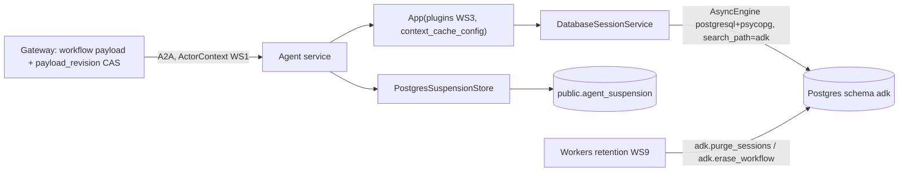

# WS7 — Durable agent state & context management

**Checklist items closed:** 5.3 parallel state isolation (proved statically), 5.4 durable sessions and suspensions, 5.5 context growth and tool-response bounds, plus the workflow payload concurrency finding. **Release blockers closed:** in-memory ADK sessions and suspensions in a multi-replica design, and unbounded tool responses fed to the model. **ADR:** ADR-0049 (proposed)

## 1. Current state (verified)

- `AgentService.sessions` defaults to `InMemorySessionService` (handler.py:44, :221). `suspensions` defaults to `InMemorySuspensionStore` (handler.py:222, suspend.py:158-177). `build_service` overrides neither (service.py:258-266). ADR-0033:80-83 and :148 accept this as a limitation.
- The session is per command: `session_id = f"{workflow_id}:{command_id}"` (assembly.py:160-172). `_open_session` reuses an existing session on redelivery (handler.py:366-382). The Runner gets the agent directly, with no `App` (assembly.py:280-284).
- **Correction (candidate_pool).** A *new* command never sees an earlier command's `candidate_pool`, even today, because the key contains `command_id`. A restart only changes what a **redelivery of the same command** sees. On the same replica it replays the failed attempt's transcript. On another replica it starts a fresh session. The bug is that the two paths behave differently, not that state is lost. The replay is also unsafe: the evidence ledger is rebuilt each turn (`toolbox().start`, handler.py:277), so evidence ids from the earlier attempt are not citable.
- **Correction (suspensions).** The agent-side store is write-only. `resume()` (suspend.py:284-295) has no production caller. The suspension leaves the agent only as `suspension_id` in the envelope and trace (agent-runtime app.py:269-289). The authoritative wait is the gateway's workflow payload, and choices are re-validated there (commands.py:1528-1543). The `Suspension` docstring claims that a `task` row persists it. No Python code writes `task`. What is actually lost: cross-replica idempotency on `idempotency_key`, and the audit record. There is also a latent bug: a redelivered command that suspends again gets a new uuid, so `save` raises `SuspensionError` (suspend.py:165-171).
- `DatabaseSessionService` needs `sqlalchemy[asyncio]`, which is **not installed**, so it would raise `missing_extra` (database_session_service.py:359-365). `prepare_tables()` runs `create_all` plus index DDL (:270-273, :531-606). The tables have generic, unqualified names (`sessions`, `events`, `app_states`, `user_states`; schemas/v1.py:64-263), and keys are `VARCHAR(128)` (shared.py:33). Appends take `FOR UPDATE` and raise `StaleSessionError` (:901-990).
- **Concurrency.** `update_payload` compares `state_version` but never moves it (control.py:1098-1129), so the compare-and-set misses a concurrent payload write. **Correction:** "bump state_version" is impossible. `workflow_guard` raises RE002 when `state_version` changes without a state change (003_workflow.sql:185-188), and approvals bind to `state_version` (014:491-493). `specialist_results` is a read-modify-write followed by a shallow `||` (coordination.py:274-277, :328-330). The write is not fenced on the continuation lease: the lease is only checked by the preceding `refresh` (continuations.py:151-158).
- **Context.** Tool responses are uncapped (tools/client.py:116-187; toolbox.py:200-237). The contracts have no `maxItems` (0 of 6 schema files), and schemas.py has no `max_length`. The existing bounds the audit lists are confirmed (budget.py:145-146, guardrails config.py:172, dispatch.py:85/:323, handler.py:821-826, loader.py:154).
- **ADK verified.** Compaction and `ContextFilterPlugin` trigger per invocation (runners.py:936; context_filter_plugin.py:104-160), so with one invocation per session they are no-ops. `context_cache_config` does reach LiteLLM as Anthropic `cache_control` (lite_llm.py:3888-3894). `on_event_callback` runs before persistence (base_plugin.py:155-160).
- **5.3 holds.** `asyncio.gather` covers only coverage_network and provider_matching (workflow.py:187-199). The keys are distinct (subagents.py:93-94, :191, :207) but have no prefix.

## 2. Target architecture

- Every agent service uses `DatabaseSessionService(db_engine=…)` on the existing Postgres, in a **dedicated `adk` schema** whose DDL the repo owns. The runtime role has DML but no CREATE.
- Sessions are **attempt-scoped**: `{workflow}:{command}` for the first attempt, `{workflow}:{command}#2…` for redeliveries. Earlier attempts are kept read-only for audit and are never replayed.
- Suspensions are durable and idempotent across replicas. The gateway stays the system of record for answers.
- Workflow payload writes use a trigger-maintained `payload_revision` CAS, per-role `jsonb_set`, and lease-fenced continuation writes.
- Context is bounded by construction: a per-tool response budget with a `truncated` marker and a cursor, `maxItems` everywhere, and prompt caching. Compaction is pinned behind a tripwire test rather than switched on unused.

## 3. Key decisions & rejected alternatives

| Decision | Why | Rejected alternative |
|---|---|---|
| ADK `DatabaseSessionService` on the existing Postgres, schema `adk` | ADK-native, and its row locks plus `StaleSessionError` handle multiple replicas | `VertexAiSessionService`: GCP-only (ADR-0040). SQLite: single-node. A custom store. |
| Repo **owns the DDL** in a migration that mirrors ADK v1. The runtime role has no CREATE, so `prepare_tables` only verifies. | migrations/README: "no ORM… constraints are the specification", with forward-only sha256 checks. DDL at runtime under concurrent cold starts is an outage pattern. | Letting ADK `create_all`: untracked schema, and the service would need DDL rights. |
| A drift test diffs the migration against `BaseV1.metadata` | Turns an ADK upgrade that changes the schema into a red build | Pinning ADK and hoping |
| Attempt-scoped sessions, no transcript replay | Replay feeds stale evidence to the model, and stored history is a tamper surface (hence ADK's `ToolCallIntegrityPlugin`) | `ResumabilityConfig`: experimental, at-least-once tool replay near booking writes |
| `PostgresSuspensionStore` with `save_or_get` semantics | Gives one canonical suspension per `idempotency_key` across replicas and fixes the redelivery raise | Deleting the agent-side store: loses the audit and the A2A `suspension_id` contract |
| `payload_revision` column plus per-role `jsonb_set` plus a lease fence | Keeps `state_version` as the transition counter that approvals bind to | Bumping `state_version`: blocked by the trigger and would invalidate live approvals. Whole-row `FOR UPDATE`: serialises patient commands behind 30 s turns. |
| Tool budget enforced in the `_adk_tool` wrapper, and the ledger records the **model-visible** view | The budget is per spec (pagination needs the spec's cursor), and a citation can only point at what the model saw | A generic `after_tool_callback` plugin: has no spec knowledge, and the ledger has already recorded the full result |
| `context_cache_config` on, compaction off with a tripwire | Caching pays inside a single 12-call turn. Compaction can't fire with one invocation per session. | Enabling compaction now: an untested config that never triggers |
| Role-prefixed identifier keys (`pm_candidate_pool`); `app:` and `user:` banned | `app:` state is shared by every workflow of the app, which is a cross-patient leak. Keys must stay valid template identifiers (`_is_valid_state_name`). | A `temp:` prefix: not persisted, so the audit loses what the analyst saw |

## 4. Implementation steps

- **S1 Store schema.** Add `sqlalchemy[asyncio]>=2.0` and `greenlet` to services/agents/pyproject.toml. Add migration `0NN_adk_session_store.sql`; every WS proposed 020, so the number is set at merge. It creates the v1 tables in schema `adk` (FK cascade, events index) and seeds `schema_version='1'`. It also adds the view `adk.session_summary` (counts and bytes, no content), plus `adk.purge_sessions(older_than, batch)` and `adk.erase_workflow(workflow_id)`, which delete by `user_id`.
- **S2 Wire the backend.** Add `build_sessions(env)` in service.py. `AGENT_SESSION_BACKEND` defaults to `postgres`; `memory` is allowed only under WS1 `APP_ENV=demo|test`. It builds `create_async_engine("postgresql+psycopg://…", pool_size=2, max_overflow=2, connect_args={"options":"-c search_path=adk"})` and passes it as `DatabaseSessionService(db_engine=…)`. `prepare_tables()` runs at startup, and a failure refuses start, as the gateway `ping` does (gateway app.py:528-535). `/healthz` reports `session_backend`, and the memory backend prints a startup banner. Amend ADR-0033.
- **S3 Session identity.** Rename `session_key` to `attempt_session_key`. On an existing session, `create_session` gets the next `#n`. A concurrent `AlreadyExistsError` maps to `retryable()`. Rename the output keys to `pm_candidate_pool` and `pm_constraint_analysis` (subagents.py:93-94, the :130 template, `INSTRUCTION_STATE_KEYS`). Add a 128-char key assertion.
- **S4 Suspensions.** Add migration `0NN_agent_suspension.sql`: `id`, a unique `idempotency_key`, `workflow_id uuid REFERENCES workflow`, `role`, `reason`, `record jsonb CHECK (NOT record ?| array[NEVER_PERSISTED_KEYS])`, `expires_at`, `resolved_at`. Add `suspend_store_postgres.py` (sync psycopg, keeping the module's "no async def" invariant). The protocol gains `save_or_get`: it inserts `ON CONFLICT DO NOTHING`, returns the canonical row when `(workflow_id, role, workflow_state, reason)` match, and raises otherwise. The handler calls it through `asyncio.to_thread`. Fix the `Suspension` docstring.
- **S5 Payload concurrency.** Add migration `0NN_workflow_payload_revision.sql`: a `payload_revision bigint` column, and a trigger that sets `NEW.payload_revision = OLD.payload_revision + 1` when the payload changes. `update_payload` takes `expected_payload_revision` in both profiles (control.py:295, :656, :1098). Add `merge_specialist_results(claim, role→output)` using nested `jsonb_set` with `WHERE coordination_job.owner = token AND lease_until > now()`, and switch coordination.py:328 to it.
- **S6 Tool budgets.** Add `ToolSpec.response_budget_bytes` (8 KiB default, 16 KiB for `find_candidates` and `search_directory`) and `limit`/`cursor` on list tools. `_adk_tool` keeps whole items within the budget and adds `{"truncated": true, "omitted": n, "next_cursor": …}`. The ledger records that view. Add `maxItems` to the contract schemas and `max_length` to the list fields in schemas.py, then regenerate.
- **S7 App config** (lands inside WS3's `build_app`). Add `context_cache_config=ContextCacheConfig(min_tokens=2048, ttl_seconds=300, cache_intervals=10)`. Add the compaction tripwire test. The Runner is built from the `App`.
- **S8 Retention and hygiene.** WS9's enforcer calls `adk.purge_sessions` (WS9 policy row: ADK sessions 30d) and `adk.erase_workflow`, and also purges expired `agent_suspension` rows. Add the persisted-session scan test.

## 5. Tests that prove it

Unit tests run in the default `uv run pytest` job. `integration` tests run in ci.yml's Postgres job (`pytest -m integration`, ci.yml:200-249).

| Test | Asserts |
|---|---|
| tests/agents/test_session_backend.py::`test_build_service_uses_database_sessions_by_default` | With no backend env, `service.sessions` is a `DatabaseSessionService` |
| …::`test_memory_backend_refused_outside_demo` (negative) | `memory` with `APP_ENV=production` or `K_SERVICE` set raises `ConfigurationError` |
| tests/integration/test_adk_session_schema.py::`test_migration_matches_adk_metadata` | Creates `BaseV1.metadata` in a scratch schema. Columns, types, PKs, FKs and indexes equal schema `adk`. |
| …::`test_prepare_tables_needs_no_ddl` (negative) | Under `SET ROLE adk_rw` (no CREATE), `prepare_tables` succeeds. After `DROP TABLE adk.events` it fails with a permission error and does not silently recreate the table. |
| …::`test_session_survives_replica_switch` | Two service instances on one DB: state written by A is read by B |
| …::`test_stale_writer_rejected` (attack) | Appending from an outdated `Session` object raises `StaleSessionError` |
| tests/agents/test_session_key.py::`test_redelivery_opens_new_attempt_without_replay` (negative) | The second attempt's `LlmRequest.contents` contains no event from attempt 1, and session `#2` exists |
| tests/agents/test_state_keys.py::`test_output_keys_unique_and_role_prefixed` | Walks `build_agent` for every role and every sub-agent: keys are unique and match `^(pm\|cn\|…)_[a-z_]+$` |
| …::`test_scoped_state_prefix_rejected` (negative) | A synthetic agent with `output_key="app:x"` fails the checker |
| …::`test_instruction_placeholders_are_declared_keys` | Every `{var}` in an instruction is a declared key |
| tests/agent_runtime/test_postgres_suspension_store.py::`test_redelivered_suspension_returns_original` | The same key from two store instances yields one id |
| …::`test_conflicting_suspension_raises` (negative) | Same key, different reason: `SuspensionError` |
| …::`test_db_rejects_budget_fields` (attack) | A raw INSERT with `"deadline"` in `record` violates the CHECK |
| tests/gateway/test_payload_concurrency.py::`test_per_role_results_both_survive` | Concurrent `coverage_network` and `provider_matching` writes both persist |
| …::`test_stale_payload_revision_refused` (negative) | An outdated revision raises, and the payload is unchanged |
| …::`test_zombie_continuation_cannot_write` (attack) | After lease expiry and reclaim, the old token's write returns no row |
| …::`test_payload_write_keeps_state_version_and_approval_live` | A live approval is still accepted after a payload write |
| tests/agents/test_tool_response_budget.py::`test_oversized_response_truncated_with_marker` | A 500-item fixture is at or under budget, with `truncated`, `omitted` and `next_cursor` |
| …::`test_omitted_evidence_not_citable` (negative) | Citing an omitted item's evidence id is refused by `guard_result` |
| …::`test_every_spec_declares_budget` | All `ToolSpec`s have a budget greater than 0 |
| tests/contracts/test_array_bounds.py::`test_every_array_has_max_items` | All JSON schema arrays and pydantic list fields are bounded. A 10k-item payload fails validation. |
| tests/agents/test_context_config.py::`test_litellm_request_marks_cache_points` | The captured completion args contain `cache_control_injection_points` |
| …::`test_compaction_tripwire` | If `attempt_session_key` stops including `command_id`, `events_compaction_config` must be set |
| tests/agents/test_session_hygiene.py::`test_persisted_session_has_no_credentials` | After an offline turn, `adk.events` and `adk.sessions` contain no `eyJ…\.…\.` JWS, `authorization` or `x-actor-context` (WS5 canary set). A seeded JWS fixture is detected, which proves the scanner itself works. |
| tests/workers/test_session_retention.py::`test_purge_cascades_and_spares_live` | Expired sessions and their events are gone; live ones remain |

## 6. Demo-mode story

`make demo` is unchanged: compose already runs Postgres, and the migrations add schema `adk`. Postgres sessions are the default even in the demo. A new `make demo-agent-restart` restarts `agent-provider-matching` mid-workflow. The workflow still finishes, and the admin panel "Agent sessions" (`GET /v1/admin/workflows/{id}/agent-sessions`, WS1 `admin:read`, metadata only) shows attempts `#1` and `#2`. Spans carry `session.backend`, `session.attempt`, `tool.response.truncated` and `llm.cached_prompt_tokens`, which shows the caching saving against the $10/day budget. `AGENT_SESSION_BACKEND=memory` prints `DEMO: agent sessions are in-memory and lost on restart` and reports `session_backend:"memory"` on `/healthz`.

## 7. Dependencies & sequencing

- **WS1:** `APP_ENV` profile guard (S2), admin scope for the sessions panel, and the ActorContext never entering prompts or state.
- **WS3:** `build_app` and `App(plugins=…)` (S7). Its plugins hold no session state, so there is no conflict.
- **WS5:** `RedactionPlugin.on_event_callback` redacts before persistence and must not alter the final JSON answer. WS5 owns the canary set. WS7 owns event retention and encryption at rest (Cloud SQL CMEK in the sketch).
- **WS9:** retention policy rows and the erasure job call S1's functions.
- **WS8:** an alert on the ratio of `StaleSessionError` to retryable results.

S1→S2→S3 form a chain. S4, S5 and S6 are independent of each other and of the other WS. Migration numbers are coordinated at merge.

## 8. Effort & risk

| Slice | Size | Main risk | Rollback |
|---|---|---|---|
| S1 | M | ADK schema drift on upgrade (caught by the drift test) | Forward migration that drops schema `adk` |
| S2 | M | Connection count: 7 services × 4 = 28 plus gateway and workers, against `max_connections` 100 | `AGENT_SESSION_BACKEND=memory` (demo only) |
| S3 | S | Renamed keys break the analyst template (caught by the placeholder test) | Revert the commit |
| S4 | M | Blocking DB call in the event loop (mitigated by `to_thread`) | Inject `InMemorySuspensionStore` |
| S5 | M | 26 `update_payload` call sites, including the memory-profile parity | Default `expected_payload_revision=None` during the transition |
| S6 | L | Truncation hides a candidate the model needed (mitigated by the cursor and eval cases in WS8) | Raise the budgets via env |
| S7 | S | `ContextCacheConfig` is experimental | Drop the field |
| S8 | S | Purge locks on a large `events` table (mitigated by batched deletes) | Disable the worker job |

Demo sizing: about 200 agent turns a day × about 100 KB of events gives about 20 MB a day. At WS9's 30-day retention that is about 600 MB raw, and roughly 150–200 MB after JSONB TOAST compression.

## 9. Portfolio talking points

- "Workflow state (gateway, CAS) is kept apart from conversation state (attempt-scoped ADK sessions), so a crash never needs transcript replay."
- "ADK's `DatabaseSessionService`, but we own the DDL. A drift test turns a framework upgrade into a red build, not a production `create_all`."
- "The audit said to bump `state_version`. The trigger and the approval binding said no, so payload writes got their own revision."
- "Context limits are structural: byte budgets, `maxItems`, cursors, and a ledger of only what the model saw."
- "Compaction stays off on purpose. It fires per invocation and we run one per session, and a tripwire test flips it on when that changes."
