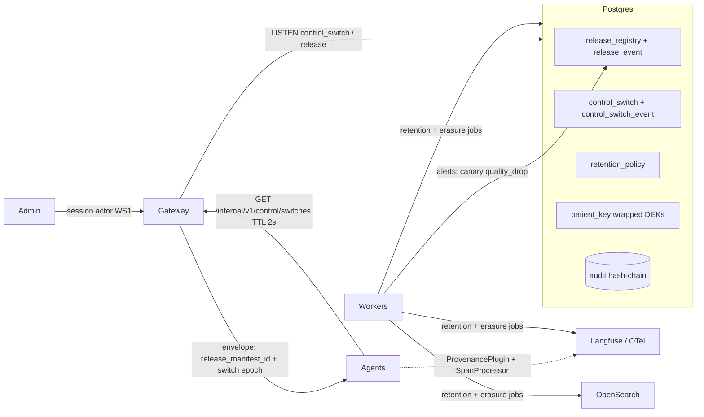

# WS9 — Release operations: provenance, kill switches, rollout/rollback, data lifecycle

**Checklist items closed:** 7.1 provenance on every span, 7.2 scoped and durable kill switch, 7.3 runtime rollout/rollback and runbooks, 7.4 retention and erasure. **Release blockers closed:** the process-local kill switch (ADR-0040 §2), canary/rollback that needs an image rebuild, no erasure path. **ADR:** ADR-0051 (proposed)

## 1. Current state (verified)

- **Pinning is real.** `google-adk==2.12.0` is pinned (pyproject.toml:92). The manifest records model, prompts, tool schema/impl digests and git/image/lockfile (manifest.py:9-22; `rel-20261016-8e00275.json` has `prompts` at :124 and `agent_model_id` at :134). `EffectiveVersions` resolves `prompt_version` for each agent (effective.py:61-84), and the gateway records `release_pin` for each workflow (release.py:204-230).
- **Traces do not carry that provenance.** The Langfuse client gets `release=service_version()` (llm_tracing.py:459, app.py:417), and that value is the `referraleasy-agent-runtime` package version (app.py:363-374). `_META_KEYS` (llm_tracing.py:85) drops `task_envelope`, which holds `release_manifest_id`, from the observation input. That is fine for input, but nothing reads the id anywhere else. `ATTR_AGENT_RELEASE` (conventions.py:223) is **never written**, yet the admin release filter queries it (query.py:365; admin.py:57,106). **Additional finding: filtering by release always returns an empty set today.** `events._base` sets only role and version (events.py:412-430). There is no prompt-version attribute.
- **Kill switch.** It is one in-process boolean (killswitch.py:1-95, built at app.py:241). It stops booking writes only, at `require_booking_writes` (commands.py:597-614). It is toggled at `POST /v1/admin/control/booking-writes` (api.py:640-658), with `by` taken from the request body (api.py:654-656). Toggles are not audited. ADR-0040:89-94 acknowledges that other replicas keep writing. The registry has its own `KillSwitch` (pinning.py:303), but release.py:251 calls `route()` without `kill_switch=`, so it is never consulted. Per-tool permissions exist only as code (`allowed_tools`, roles.py:123) and seeded `policy_rule` rows (005_policy.sql, policy.py:135). Good tests exist in tests/gateway/test_kill_switch.py (`test_a_patient_session_cannot_touch_the_switch` :197, `test_dispatch_is_refused_while_engaged_and_minted_once_released` :358).
- **Canary routing is correct but static.** Bucketing uses a sha256 hash (canary.py:1-45, kill-switch precedence at :254). It is covered by tests/release/test_canary_routing.py:208,278,325,386,408 and tests/gateway/test_release_pinning.py:79-119. The gateway reads `registry/releases/` baked into the image (release.py:17-20, gateway Dockerfile:154-161): *"nothing registers releases in the `release_registry` table yet"*. Changing canary % or rolling back therefore needs a rebuild and redeploy. `release_event.event` allows only `staged|activated|rolled_back|revoked` (012:86-87). The CI jobs `release-version-gate` and `release-evaluation` (ci.yml:440-546) gate releases but do not roll anything out. docs/runbooks/ holds only evaluation.md and local-demo.md.
- **Agents image** copies no `registry/` tree (services/agents/Dockerfile:62-166), so an agent cannot resolve its own manifest today.
- **Audit is strong.** It is append-only with a hash chain, and triggers refuse UPDATE/DELETE/TRUNCATE (013_audit.sql:62-70). `audit_verify_chain` is at :148. The actor comes from transaction GUCs and fails closed to `automation` (002_actor_context.sql). **Correction to the audit finding:** audit `detail` stores `patient_ref`, an opaque id, in the approval and booking triggers (013:256-285). It never stores clinical text. This is what makes crypto-shredding viable.
- **No lifecycle.** `command_dedup.expires_at` is documented as "prunable" (009:46-47), but no job prunes it. Nothing deletes `stream_event` rows (018:13-14). OpenSearch ISM covers telemetry for 7d and eval for 30d only. Langfuse has no retention setting and no deletion hook. There is no erasure endpoint. `audit.workflow_id … ON DELETE RESTRICT` (013:28) blocks deleting a workflow row.

## 2. Target architecture

- **Provenance.** Every agent, LLM and tool span carries `agent.release`, `release.manifest_hash`, `prompt.version`, `tool.schema_digest` (on tool spans), `model.name` and `adk.version`. Every Langfuse trace gets the same values as `langfuse.trace.metadata.*`, the tags `release:<id>` and `cohort:<stable|canary>`, and `langfuse.version=<release_manifest_id>`.
- **Control plane in the database.** Kill switches and rollout state are rows. Every write goes through one SQL function that writes the audit row in the same transaction. The gateway and the agents both enforce the switches.
- **Two rollout layers.** The *config release* is routed at runtime from the registry tables. The *image release* uses tagged Cloud Run revisions, and a conversation pinned to release X is served by the revision tagged `rel-x`.
- **Data lifecycle.** Each data class has a declared retention that a worker enforces. Erasure uses crypto-shredding, and the audit chain survives it.

## 3. Key decisions & rejected alternatives

| Decision | Why | Rejected alternative |
|---|---|---|
| ProvenancePlugin resolves `EffectiveVersions` in `before_run_callback` and puts them in a contextvar. A `ProvenanceSpanProcessor.on_start` stamps every span started under it. | ADK and OpenInference create spans at points that do not match callback order (telemetry/_instrumentation.py:291,721). A processor sees every span. The Langfuse keys are the ones `propagate_attributes` writes (langfuse/_client/attributes.py:32-58). | Using `get_current_span()` in callbacks, which misses sibling spans. A process-level `release=`, which is wrong under a canary. |
| A provenance **drift check**. At startup the agent hashes its live instruction and tool schemas and compares them with the pinned manifest's `instruction_hash`/`schema_hash`. | It proves that the running code is the code the manifest claims. Policy is `refuse` in production and `flag` (attribute `provenance.drift=true`) in demo. | Trusting the envelope id alone, which only records *intent*. |
| Kill switches live in `control_switch` with scope ∈ {global, agent_role, tool, workflow_kind} and mode ∈ {disable, read_only, human_only}. The gateway uses LISTEN/NOTIFY with a 2s TTL fallback. Agents poll the gateway. | Replicas converge in about 2s, and agents stay DB-free. A cache older than 10s or an unreachable store **fails closed to read_only**. | Redis or a flag SaaS (a new dependency for one table). A claim in the ActorContext, which cannot stop a turn already in flight. |
| One switch model. The registry `KillSwitch` and the booking switch both read from `control_switch`. `route(kill_switch=…)` is wired. | Today there are two switches and only one of them is connected. | Keeping both: an operator would have to know which one stops what. |
| The canary % is a **`release_event` row** (new `canary` event plus a `rollout_percentage` column), not a manifest edit. | `rollout` is part of `manifest_hash` (manifest.py docstring), and `release_registry` is immutable (012:61-70). A runtime change of % must not mint a new artifact. | Re-registering the manifest with a new rollout, which breaks `UNIQUE(component, version)` and conflates deployment decisions with artifacts. |
| Auto-rollback happens **only for canaries**, triggered by WS8 `quality_drop`/`terminal_failure_rate` filtered on `agent.release=<canary>`. | A rollback needs somewhere to send the traffic. Auto-rolling-back stable has no target and would cause an outage. | Auto-rolling back any release, or a human-only rollback (too slow at 3 a.m.). |
| Erasure by **crypto-shredding plus tombstoning**. Each patient has a DEK wrapped by a KEK from the SecretProvider interface. The workflow row is kept with its payload redacted. | The audit chain and the RESTRICT FK stay intact. Backups and replicas become unreadable without rewriting them. | `DELETE` cascades, which break the audit chain and FK by design. Exempting audit from erasure while it still holds linkable PII. |
| Retention is **data, not code**. `retention_policy` rows say which enforcer handles each class (postgres-worker, opensearch-ism, langfuse). | One table answers an auditor's question "how long do you keep X?". | Per-table cron SQL scattered across services. |

## 4. Implementation steps

- **S1 Provenance conventions.** In `packages/telemetry/.../conventions.py`, add `ATTR_MANIFEST_HASH="release.manifest_hash"`, `ATTR_PROMPT_VERSION="prompt.version"`, `ATTR_TOOL_SCHEMA_DIGEST="tool.schema_digest"`, `ATTR_ADK_VERSION="adk.version"` and `ATTR_RELEASE_COHORT`. Extend `events._base` (events.py:412) with `agent_release`/`prompt_version`. Add both new attributes to the OpenSearch index template `otel-telemetry-events.json` as keywords.
- **S2 ProvenancePlugin.** Create `packages/agent-runtime/src/referraleasy_agent_runtime/plugins/provenance.py`. It holds `ProvenancePlugin(BasePlugin)` and `ProvenanceSpanProcessor`. `before_run_callback` reads the validated `TaskEnvelope` (handler.py:521), resolves `effective_versions(manifest, agent_name=role)` and sets the contextvar. `after_run_callback` resets it. Register the processor in `configure_llm_tracing` (llm_tracing.py:434). Change `release=` to `None`; the release is now set for each trace. Copy `registry/` into the agents image (services/agents/Dockerfile, next to :152). Add the drift check at app start (app.py:~410). Register the plugin last in WS3's `App(plugins=[…])`.
- **S3 Control-switch store.** Add migration `020_control_switch.sql`. `control_switch` is the current-state table with PK (scope, target), mode, reason, engaged_by, engaged_at and an optional expires_at. `control_switch_event` is append-only. `control_switch_set(scope, target, mode, reason)` reads the actor from `current_actor_kind/id()`, upserts the switch, inserts the event, calls `audit_record('control.switch', …)` and runs `pg_notify('control_switch', epoch)`. In `services/gateway/.../killswitch.py`, add a `SwitchBoard` protocol with `InMemorySwitchBoard` (memory profile) and `PostgresSwitchBoard` (LISTEN plus TTL cache) implementations.
- **S4 Gateway enforcement and API.** Generalise `require_booking_writes` to `require(scope_ctx, effect)`. Add `POST /v1/admin/control/switches` and `GET` it. Keep `/booking-writes` as an alias for `(tool, booking_writes, disable)`. **Remove `by` from the body**; the actor comes from the WS1 session subject and is set into the GUCs. Wire `route(kill_switch=board.registry_view())` at release.py:251. Add `GET /internal/v1/control/switches`, authenticated with service identity and returning an ETag/epoch. In the admin UI, add scoped toggles to `apps/web/src/admin/pages/alerts.ts`.
- **S5 Agent enforcement.** Feed the WS2 ToolPolicyPlugin a `SwitchSnapshot` client (2s TTL, fail-closed after 10s). `read_only` refuses `BOOKING_WRITE_TOOLS` (roles.py:115) and other side-effect tools. `human_only` returns a typed `needs_human` refusal that the coordinator maps to handoff.
- **S6 Registry in the database.** Add migration `021_release_rollout.sql`, which extends the `release_event_event_known` CHECK with `canary` and `promoted` and adds `rollout_percentage smallint`. Add a `release-registry register` CLI command (cli.py) that inserts the manifest and a `staged` event; `make demo` runs it. Add `DbReleaseCatalog` in release.py that reads the `release_status` view. The file catalog stays as the memory-profile fallback. Add admin routes `POST /v1/admin/releases/{id}/{canary|promote|rollback}`, each requiring a `reason` and audited.
- **S7 Auto-rollback.** In `services/workers/.../alerts.py`, add a `CanaryGuard`. When a firing PAGE alert's series is scoped to an active canary, it writes a `rolled_back` event with actor `system:auto-rollback`, at most once per release, and emits `release.auto_rollback` for WS8.
- **S8 Cloud Run sketch (design-only).** Create `infra/gcp/cloudrun_rollout.tf.sketch`, covering revision tags for each release, `traffic { tag, percent }` and a placeholder `var.project_id`, plus an ADR-0051 section on mapping a pin to a revision. It must pass gitleaks and `scripts/check_public_release.py`.
- **S9 Runbooks** in `docs/runbooks/`:
  - `incident-response.md`: severity matrix, which switch to flip for each symptom, comms, and a post-incident `audit_verify_chain()`.
  - `rollback.md`: config vs image rollback, the API calls, verifying that new traffic lands on stable, and when to `revoke`.
  - `kill-switch.md`: the scope/mode matrix, propagation, verifying each replica (`/healthz.switch_epoch`), and release.
  - `key-rotation.md`: KEK rewrap, OpenRouter/Langfuse keys through the SecretProvider, and the WS1 JWS key overlap.
  - `data-erasure.md`: intake, identity check, the in-flight rule, the job, and the verification report.
  - `release-promotion.md`: staged → canary 5/25/50 → promote, using the WS8 gate criteria.
- **S10 Retention.** Add migration `022_retention.sql` with `retention_policy(data_class, store, locator, ttl, basis, action, enforcer)`. Seed rows:

  | Data class | Retention | Action |
  |---|---|---|
  | command_dedup | 7d after `expires_at` | delete |
  | stream_event | 30d after workflow terminal | delete |
  | outbox (delivered) | 14d | delete |
  | alert_event | 90d | delete |
  | ADK sessions (WS7) | 30d | delete |
  | telemetry | 7d | opensearch-ism |
  | eval | 30d | opensearch-ism |
  | Langfuse traces | 30d | langfuse |
  | audit, release_* | 6y | retain |

  The worker job `services/workers/.../retention.py` deletes in batches of up to 5k rows, and records `retention.pruned` counts in the audit table. It connects as DB role `referraleasy_retention`, which has DELETE only on prunable tables.
- **S11 Erasure.** Add migration `023_patient_erasure.sql`:
  - `patient_key(patient_ref PK, wrapped_dek, kek_version, destroyed_at)`.
  - `erasure_request(id, patient_ref_hmac, state ∈ requested|executing|verified|refused, …)`.
  - A `workflow.erased_at` column.

  A `PiiVault` in packages/domain encrypts the patient sub-document of `workflow.payload`, `evidence.payload`, handoff notes and patient documents (AES-GCM). `POST /v1/admin/erasure-requests` starts the request. The worker then:
  1. Refuses while a booking is in flight.
  2. Destroys the DEK.
  3. Redacts payloads and deletes the `stream_event` rows, session/task rows and ADK sessions.
  4. Calls `LangfuseEraser` (trace delete by `session_id`=workflow id) and `OpenSearchEraser` (`delete_by_query` on `workflow.id`).
  5. Writes `erasure.completed` with `patient_ref_hmac` and the count for each store.
  6. Runs verification.

## 5. Tests that prove it

All of these run in CI. Pure-Python tests run in `unit-tests`. Postgres tests run in the `integration-tests` job against the compose Postgres, as the migrations tests do today. Each control has a negative test.

| File | Test | Asserts |
|---|---|---|
| tests/agent_runtime/test_provenance_plugin.py | `test_every_llm_tool_and_agent_span_carries_the_pinned_release` | With an in-memory exporter and a stub model, every span has `agent.release`, `release.manifest_hash`, `prompt.version` equal to the manifest's, and `adk.version=="2.12.0"`. |
| same | `test_a_canary_turn_and_a_stable_turn_in_one_process_are_stamped_differently` | Two concurrent turns do not leak each other's provenance (contextvar isolation). |
| same | `test_a_turn_without_an_envelope_is_stamped_unpinned_not_guessed` (negative) | `agent.release=="unpinned"` and never the package version. |
| same | `test_drift_refuses_in_production_and_flags_in_demo` (negative) | A tampered instruction is refused under the prod profile, and in demo the span gets `provenance.drift=true`. |
| tests/gateway/test_admin_release_filter.py | `test_the_release_filter_finds_the_releases_traffic` | It fails today (the filter returns empty) and passes after S1+S2. |
| migrations/tests/test_control_switch.py | `test_a_switch_change_writes_one_audit_row_with_the_session_actor` | The audit `actor_id` equals the GUC actor, and `audit_verify_chain()` stays true. |
| same | `test_control_switch_event_cannot_be_rewritten` (negative) | UPDATE/DELETE raises. |
| tests/gateway/test_kill_switch_scoped.py | `test_engaging_on_replica_a_stops_writes_on_replica_b_within_3s` | Two gateway apps share one database through NOTIFY. |
| same | `test_body_supplied_by_is_ignored` (attack) | Sending `by:"ceo"` records the session subject instead. |
| same | `test_unreachable_store_fails_closed_to_read_only` (negative) | Writes are refused and reads still answer. |
| same | `test_registry_kill_switch_stops_new_routing` | The global `disable` makes `route()` return `stopped`. |
| tests/agents/test_tool_policy_switch.py | `test_read_only_switch_refuses_create_booking_inside_the_agent` | The agent refuses even if the gateway check is bypassed (defense in depth). |
| same | `test_stale_snapshot_refuses_writes` (negative) | |
| tests/release/test_db_catalog.py | `test_setting_canary_percent_changes_routing_without_restart` | The share moves from 5% to 25% over 2,000 synthetic conversation ids. |
| same | `test_rollback_via_admin_api_returns_new_traffic_to_stable_and_reports_pins` | |
| same | `test_patient_session_cannot_promote` (negative, attack) | |
| tests/workers/test_canary_guard.py | `test_quality_drop_on_canary_rolls_it_back_once` | |
| same | `test_alert_on_stable_never_auto_rolls_back` (negative) | |
| migrations/tests/test_retention.py | `test_expired_dedup_and_old_stream_events_are_pruned` | |
| same | `test_retention_role_cannot_delete_audit` (negative) | `InsufficientPrivilege`. |
| tests/integration/test_erasure.py | `test_erasure_leaves_no_canary_string_anywhere` | Seeds `ZZ-ERASE-<uuid>` into every PII field, runs the erasure, then scans every text/jsonb column, the OpenSearch indices and a Langfuse stub. Expects zero hits, the payload undecryptable, and `audit_verify_chain()` still true. |
| same | `test_erasure_refused_while_booking_in_flight` (negative) | Returns 409, and the DEK is intact. |
| tests/docs/test_runbooks_exist.py | `test_every_runbook_named_in_adr_0051_exists_and_has_a_verify_section` | |

## 6. Demo-mode story

`make demo` registers the committed manifest into `release_registry` and stages a second "canary" release at 10%. The admin **Alerts & Controls** page shows:
- the switch table, with the propagation epoch reported by each replica;
- a Releases panel with stable/canary %, plus Promote and Rollback buttons;
- an Erasure panel.

A demo script, `scripts/demo_release_ops.py`:
1. Engages `tool:create_booking read_only`. The patient UI shows the existing `booking_halted` refusal, now naming the scope and the operator from the session.
2. Opens a Langfuse trace where every span shows `release:rel-…` and `prompt.version`.
3. Injects a synthetic `quality_drop` on the canary and watches the auto-rollback appear in the audit log.
4. Erases a synthetic patient and prints the verification report.

The demo profile's laxer policies (drift is flagged rather than refused, and the in-memory switchboard when `GATEWAY_CONTROL_BACKEND=memory`) are announced in `/healthz.control_backend` and in the startup banner. Combining the memory board with `APP_ENV=production` refuses to start.

## 7. Dependencies & sequencing

- **WS1:** S4 depends on the session actor and GUC propagation. S5 needs service identity for the internal endpoint.
- **WS2:** S5 plugs into ToolPolicyPlugin.
- **WS3:** S2 needs the `App(plugins=[…])` seam. Until it exists, the span processor alone already delivers most of 7.1.
- **WS7:** owns the ADK session store that S10 and S11 prune and erase.
- **WS8:** owns alert rules. S7 consumes `quality_drop`/`terminal_failure_rate` per release, and WS8 consumes `release.auto_rollback` and `provenance_drift`.
- **WS5:** the RedactionPlugin runs before Provenance, so provenance attributes are never redacted. They contain no PII.
- **Independent:** S1, S3, S6, S9 and S10 can land in parallel. S7 needs S1+S2+S6. S11 needs S10 and the WS7 session store.

## 8. Effort & risk

| Slice | Size | Risk / rollback |
|---|---|---|
| S1, S5, S7, S8, S9 | S each | S7 flapping is bounded by the once-per-release rule. |
| S2 | M | Contextvar leakage across async generators (concurrency test). Rollback: remove the processor. |
| S3–S4 | M | NOTIFY lost on reconnect, bounded by the TTL re-read. Rollback: the memory board. |
| S6 | M | File and database catalogs diverge. Under Postgres the database wins. |
| S10 | M | Over-deletion is prevented by role grants and a dry-run mode. |
| S11 | L | The payload encryption retrofit needs a dual-read window. Losing the KEK makes all data unreadable, so it is backed up in a separate trust domain. |

## 9. Portfolio talking points

- "Pinning without stamping is a version you cannot prove. A span processor puts the release, prompt and manifest hash on every span. The drift check proves the running code *is* that release. That also fixed a release filter that had been silently empty."
- "A kill switch is only a control if every replica obeys it, it fails closed, and it records who pulled it. So it is a database row written through one audited function, enforced twice: at the gateway and in the agent's tool gate."
- "Canary % is a deployment event, not an artifact change. Keeping it out of the immutable manifest is what allows runtime rollout without breaking provenance. Pinned conversations route to the revision that matches their pin."
- "Append-only audit and the right to erasure are compatible if the audit holds only opaque references and the PII is encrypted with a per-patient key. Destroying the key is the erasure, and the hash chain still verifies."
- "Retention is declarative. One table tells an auditor how long each data class lives and which system enforces it."
