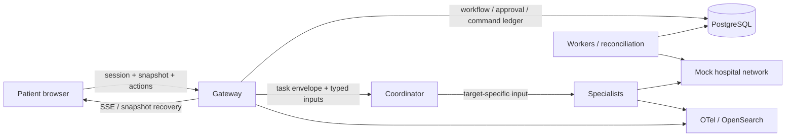

# Architecture review and local verification — 2026-10-18

## Product goal

ReferralEasy demonstrates synthetic patient referral coordination. A patient supplies a referral,
checks coverage and readiness, chooses a hospital, doctor and slot, reviews the exact booking
payload, and explicitly approves it. A scheduling result must distinguish confirmed, pending,
unknown, empty and failed outcomes. Timeouts must reconcile the same request rather than create a
second appointment. Missing information and outages must leave a readable recovery or human handoff.

The source specification is [Architecture v3](../../ReferralEasy_Architecture_v3_EN.md). This review
covers the running implementation and existing work in the checkout, rather than assuming every
planned feature is complete. Pre-existing uncommitted changes were preserved.

## Architecture assessment

The strongest part is the deterministic control plane: PostgreSQL constraints, transitions, approval
bindings, command deduplication, worker leases and outbox invariants. Keeping OpenSearch out of the
transaction authority is appropriate. The domain stores, explicit service assembly and injectable
transports provide useful seams for testing without a provider.

The largest quality problem was at the connections between these parts. Gateway tests constructed
one shape, component tests constructed another, and HTTP delegation tests bypassed the receiving
service. Each side passed while the complete patient journey failed. The repair strategy was to test
observable behavior across those connections and keep state and authority in their existing owners.

This diagram identifies the modules and their intended connections; it does not imply the
coordinator automatically drives every transition. The remaining execution gap is named below.

## Defects repaired

| Defect | Resulting behavior | Regression evidence |
| --- | --- | --- |
| False, string-valued or unrelated consent objects authorized a booking | Consent requires an explicit boolean agreement; a refusal leaves the question answerable | `tests/gateway/test_approval_binding.py` |
| The browser supplied no patient credential on stream/actions and never loaded the protected snapshot | Demo session entry, one patient HTTP client, authenticated reads/writes and stream cursor initialization | `apps/web/test/patient-client.test.ts`, `boot.test.ts` |
| Native browser fetch received the client instance as its receiver | Patient and admin clients bind fetch to the global browser object | Patient client test and nine real admin page reads |
| Snapshot serialization emitted `disabled: null`, which the TypeScript contract rejects | Issued cards carry a boolean disabled value | Real browser snapshot loading |
| Gateway `options`, booking payload and appointment fields did not match component reads | Gateway picker options, exact booking identifiers, nested confirmation state/reference and default consent text render | `apps/web/test/render.test.ts` |
| Snapshot omitted actionless receipts and handoff cards | Current display cards and a terminal event are included in snapshots | `tests/gateway/test_stream.py`, `test_booking_once.py` |
| Gateway restart lost the card registry although the workflow survived | Current cards and submitted markers are saved with workflow payload and restored on demand | `tests/gateway/test_surface_recovery.py`, memory and PostgreSQL |
| Removal frames also contained the removed cards, re-adding them in A2UI | Removal frames remove old instances; the next update issues the current card | Gateway surface tests and browser doctor-step radio count |
| A client could submit an option the server never offered | Selection IDs must identify one available server-issued option | `tests/gateway/test_commands.py` |
| Action acknowledgments left the old card interactive | The submitted card is emitted with its submitted flag; the pending latch is released | Stream/store tests and browser interactions |
| Failed booking delivery left the submit button disabled | A failed action reissues the current card; unknown delivery retries retain their command ID | `apps/web/test/action-retry.test.ts` |
| A second rapid click sent another request | The store coalesces a pending action; definite 4xx refusals release the intent for correction | Store and command tests |
| SSE gaps advanced the replay cursor beyond missing events; duplicates rewound it | The cursor advances only through contiguous accepted events | `apps/web/test/sse-client.test.ts` |
| Native EventSource and the wrapper both reconnected; stale callbacks could apply | One reconnect owner, explicit source close, timer cancellation and connection generations | SSE client tests |
| The server live-stream loop resent events preceding the reconnect cursor or stopped before a later terminal | Live delivery follows the last sent sequence and closes after delivering the terminal | `tests/gateway/test_stream.py` |
| Terminal events omitted the field the browser used for the final booking state | The store also reads the preceding authoritative workflow state | Surface store test and confirmed/pending browser journeys |
| A2A HTTP delegation read a different envelope shape from the actual agent route | The HTTP adapter validates and unwraps the actual protocol result | `tests/agents/test_http_delegation.py` crosses the real ADK service |
| Delegated tasks contained no specialist input | Workflow-supplied `specialist_inputs` are validated per role and only the target's document crosses the hop; source documents stay out of the coordinator model prompt | Six formerly expected-failing contract cases now pass |
| Validated specialist output was discarded by the runtime | A successful/suspended turn returns its schema-validated output alongside protocol status | Real HTTP delegation regression |
| A dispatch arriving as the idle thread exited could be stranded | Idle exit and worker selection coordinate under the same lock | Deterministic idle-exit race regression |
| `make e2e` killed shared processes and deleted the demo SQLite directory | Every iteration owns a separate server, port and temporary database; skipped/empty runs fail | `scripts/e2e.py`, two complete iterations |
| Vite's documented same-origin API path had no proxy | `/v1` proxies to the configured local gateway target | Browser runs through Vite; [Vite 6 proxy documentation](https://v6.vite.dev/config/server-options#server-proxy) |

## Scenarios exercised

| Scenario | Assertions |
| --- | --- |
| Browser instant confirmation | Hospital → doctor → slot → review → explicit consent → real mock appointment → gateway receipt; confirmed status and reference survive reload |
| Browser hospital review required | Hospital says `PENDING_REVIEW`; gateway says `BOOKING_UNVERIFIED`; no confirmed label |
| Repeated booking command and hospital request | Same command/request replay; one gateway booking row |
| False consent, unknown choice, stale version, wrong patient | Refusal before the forbidden change; another patient receives 404 |
| Reconnect, duplicate/out-of-order frames, old connection callbacks | Missing events replay before later ones; no cursor rewind or duplicate connection |
| Gateway restart | Current question is restored and accepted once; a submitted question cannot be answered again |
| Dropped action response | Retry button works and reuses the same command ID |
| Emergency / missing document / unavailable directory / empty availability | Existing guardrail, readiness, recovery and fault scenario suites |
| Timeout before commit vs timeout after commit | Unknown external results reconcile the original key; no second booking |
| Competing slot requests / idempotency-key reuse / 409 / 429 / 5xx / malformed responses | Existing mock API and scripted E2E invariants, repeated on fresh databases |
| Admin UI | All nine page endpoints answered 200, with zero browser page errors |

## Verification

- Python unit/contract suite: **2,912 passed**, two fixture applicability skips. Those skips are
  scenarios with no availability-results dependency, not unexecuted database tests.
- Full PostgreSQL integration suite on an isolated database: **509 passed**, no skips. The final
  changed gateway paths were also rerun against PostgreSQL after the last edits.
- TypeScript: **167 web + 94 mock API + 33 contract tests passed**.
- OpenSearch retrieval/index integration: **13 passed**, using dedicated test indices and offline embeddings.
- Scripted booking fault suite: **16 passed in each of two fresh iterations**.
- Browser: both complete booking outcomes above, reload, replay, explicit consent, patient isolation,
  three recorded selections and one gateway booking each; nine admin page reads without page errors.
- Python strict typing: 173 source files checked. TypeScript checks and production web build passed.
  The build retains the dependency's existing non-fatal Zod pure-annotation warnings.

Reproduce the isolated mock network tests with `make e2e REPEAT=2`. The full browser scenario driver
is [scripts/browser_scenarios.js](../../scripts/browser_scenarios.js), executed as a function by the
Playwright MCP `browser_run_code_unsafe` tool. Its header records the local port prerequisites.
The browser driver explicitly scripts coordinator and scheduling decisions and uses the gateway's
configured guardrail backend; it is not evidence of autonomous agent orchestration.

The review application runs at `http://127.0.0.1:3001`, with the updated gateway on `18080`, an isolated
mock hospital API on `4011`, and a separate PostgreSQL review demo database. Port 8081 was avoided after automatic development-tool probing on that port exhausted local TCP
ports; the final checks use 18080. The existing Compose services and their demo database were left intact. No production deployment was performed.

The confirmed browser example is workflow `7016ae27-1f91-4f69-bc18-ea337679978c`; the pending-review
example is `0a26e194-fd05-4980-82c3-03d747472571`. Both use synthetic patient reference
`b0000000-0000-4000-8000-000000000001`. Add `workflow_id` and `patient_ref` to the web URL to prefill
the demo session form. These rows live in the review demo database, separate from the test database.

## Remaining architecture work

1. **Resolved on 2026-10-19 for standard coordination.** Source records now build specialist inputs.
   Results produce transitions and cards. Accepted patient answers have leased, durable continuations.
   See [completion evidence](autonomous-coordination.md) and [ADR-0041](../adr/ADR-0041-autonomous-coordination.md).
2. **Historic SSE replay remains process-local.** Current cards and standard coordination jobs
   survive restart. Historic events, turn metadata and general model-task dispatch still need shared
   persistence before multiple gateway replicas serve the same stream. Standard card projections
   now have a stored repair intent; this does not make historic event replay durable.
3. **Workflow budget accounting is resolved.** Remote workflow tasks inherit the deadline and
   remaining counters. Parent budgets charge child usage. Queued commands expire. General model-task
   dispatch still needs the same durable queue design.
4. **General model-output grounding remains incomplete.** Standard workflow outputs now come from
   governed tool results and role schemas. Invented citations are refused even with no retrieved
   evidence. The general ADK path still needs all of `OutputGuardrail`'s source checks.
5. **The offline lexical guardrail is conservative.** In the running configuration, ordinary wording
   such as “I need a cardiology appointment” can require clarification. The passing browser booking
   case uses the authored request “Schedule a cardiology consultation.” No threshold or allowlist was
   relaxed during this review. More calibration data and a complete clarification/handoff journey
   are needed; passing one phrase does not establish a false-positive rate.
6. **Several planned platform features remain unfinished:** per-conversation release/canary pinning,
   evaluation replay and meaningful scoring, the durable alert scheduler, and operator queue actions
   in the admin UI. The existing package tests do not establish that those features run end to end.

The repaired journeys and checks are reproducible. This review does not label the entire future
architecture complete or the synthetic demo production-ready.
