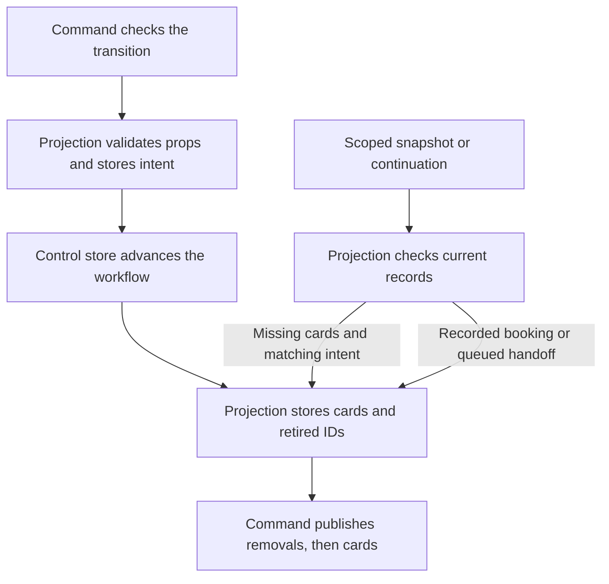

# Workflow surface projection

Date: 2026-10-19. Related decision: [ADR-0041](../adr/ADR-0041-autonomous-coordination.md).

The [projection module](../../services/gateway/src/referraleasy_gateway/projection.py) owns the card lifecycle.
It stores current cards, retires old cards, records submission and repairs missing cards.
Reads use stored records. Each gateway therefore sees answers that another gateway records.
If a worker advances during a read, the read keeps its observed row and cards together.
Repair stops if another command advances the workflow. Card writes still refuse a stale version.

## Responsibilities

| Module | Responsibility |
| --- | --- |
| `WorkflowSurfaceProjection` | Validate props; store card intent; issue, retire and restore cards; refuse invalid card actions |
| `CommandService` | Check patient scope, policy and consent; authorize transitions and bookings; publish events |
| `CoordinationService` | Choose the next workflow step and request projection repair through command authority |
| `surfaces.py` | Define the fixed catalog, stable IDs and complete agent decisions |
| `ControlState` | Enforce version checks and persist records through the memory or PostgreSQL adapter |

The projection receives the existing control-state interface. It cannot grant approval or advance a workflow.
This keeps one responsibility per module and preserves the existing adapter seam.

## Transition and repair



State transitions and projection writes use separate transactions. Stored intent supports repair after a crash between these writes.
New intent records name the target state and version. Repair refuses intent from an earlier visit to the same state.
Existing intent records without a version remain readable.

The projection stores the review card and its booking payload hash in one payload update.
Consent still uses the approval module. A card cannot grant consent.

Repair uses a confirmed booking record to restore an appointment receipt.
An unverified booking receives a status-check action for the original request.
Repair cannot create another booking.

A queued handoff record takes precedence over an unfinished consent card.
Repair replaces that card with the queued receipt. It cannot queue another handoff.
Each handoff intent records the earlier queued ID. An old receipt cannot replace a new consent question.

## Stored records

These records use the existing workflow payload. No database migration is required.

| Key | Purpose |
| --- | --- |
| `surface_components` | Current cards, including submitted cards |
| `coordination_projection` | Intended state, version and card props |
| `surface_retired_ids` | IDs of cards that the current projection replaced |
| `surface_state_version` | Version of the stored projection, including an empty surface |

Stable slot IDs keep the retired set bounded by the fixed catalog.
The retired set lets a replacement gateway refuse an old card as already answered.
Current submitted records prevent repair from opening an answered question again.

SSE history remains process local. A repaired snapshot returns stored cards and the local stream cursor.

## Verification

The [projection tests](../../tests/gateway/test_projection.py) use the public interface with both control adapters.
They cover card replacement, stored answers, empty surfaces, stale versions, repeated issuance and earlier intent formats.
The [restart tests](../../tests/gateway/test_surface_recovery.py) interrupt storage after a transition, booking or handoff approval.
They also check reads from two gateway instances.

Set `TEST_DATABASE_URL` to a migrated database reserved for tests. Then run the gateway suite:

```bash
.venv/bin/pytest tests/gateway -q
```

Run the autonomous journey with a fresh mock hospital for each iteration:

```bash
.venv/bin/python scripts/e2e.py --repeat 2 --test-path tests/e2e/test_autonomous_coordination.py
```

Results on 2026-10-19:

- Unit and contract suite: 2,948 passed. Two existing fixture checks skipped because their scenarios have no availability-result dependency.
- Gateway suite with memory and PostgreSQL: 500 passed, with no skips. Two tests exclude the PostgreSQL adapter as documented in that suite.
- Autonomous journey: eight scenarios passed in each of two fresh iterations with PostgreSQL.
- Repository lint and formatting passed. Type checking passed for all 177 Python source files.
